# PetHost — Dicionário de dados

_Modelo lógico do MVP · 19 tabelas · outubro de 2026 · complementa o [`escopo-mvp.md`](escopo-mvp.md)_

Este documento explica cada tabela e cada coluna do banco: o que guarda, por que existe e quais regras valem. O banco é o **PostgreSQL 17** (EF Core + Npgsql, um schema por módulo). Os tipos aparecem na forma genérica; a seção 1 mostra o tipo real no PostgreSQL (a coluna do SQL Server ficou só como referência, da época em que o banco não estava decidido).

## Sumário

1. [Legenda](#1-legenda)
2. [Convenções de nome](#2-convenções-de-nome)
3. [Glossário](#3-glossário)
4. [Diagrama](#4-diagrama)
5. [Tabelas e colunas](#5-tabelas-e-colunas)
6. [Relacionamentos](#6-relacionamentos)
7. [Valores dos enums](#7-valores-dos-enums)
8. [Referências](#8-referências)

## 1. Legenda

### Chaves e marcações

| Marca | Significado |
|---|---|
| `PK` | Chave primária. Identifica a linha. Duas PK na mesma tabela = chave composta (tabelas associativas). |
| `FK` | Chave estrangeira. Aponta para o `id` de outra tabela. |
| `UK` | Valor único. UK¹, UK², UK³: colunas com o mesmo número formam juntas uma combinação única. |
| Nulo = sim | A coluna pode ficar vazia. No diagrama Mermaid aparece como `"nullable"`. |

### Linhas do diagrama (pé-de-galinha)

| Símbolo (Mermaid) | Lê-se |
|---|---|
| `\|\|` | exatamente um |
| `o\|` | zero ou um |
| `\|{` | um ou muitos |
| `o{` | zero ou muitos |

Exemplo: `owners ||--o{ pets` lê-se "um tutor tem zero ou muitos pets; cada pet desse lado tem exatamente um tutor".

### Tipos

| Tipo no dicionário | O que é | PostgreSQL | SQL Server |
|---|---|---|---|
| `uuid` | Identificador único de 128 bits (todas as PKs e FKs) | `uuid` | `uniqueidentifier` |
| `int` / `smallint` | Número inteiro | `integer` / `smallint` | `int` / `smallint` |
| `varchar(n)` | Texto curto com limite | `varchar(n)` | `nvarchar(n)` |
| `char(n)` | Texto de tamanho fixo (UF, moeda) | `char(n)` | `nchar(n)` |
| `text` | Texto longo | `text` | `nvarchar(max)` |
| `boolean` | Sim ou não | `boolean` | `bit` |
| `date` | Só a data | `date` | `date` |
| `timestamp` | Data e hora, sempre em UTC | `timestamptz` | `datetime2` |
| `decimal(p,s)` | Número com casas fixas (coordenadas) | `numeric(p,s)` | `decimal(p,s)` |
| `enum` | Lista fechada de valores (seção 7) | `varchar` + `check` | `nvarchar` + `check` |

## 2. Convenções de nome

Os nomes seguem o padrão mais comum em projetos atuais. A regra de ouro: **um jeito só, aplicado em tudo**.

| Regra | Exemplo | Por quê |
|---|---|---|
| Inglês, minúsculo, snake_case | `check_in_date` | Funciona igual em qualquer banco e não precisa de aspas no PostgreSQL. |
| Tabela no plural | `bookings`, `pets` | Uma tabela é um conjunto de registros. |
| Tabela associativa = as duas entidades, plural no fim | `booking_pets` | Mostra quem liga com quem. |
| PK sempre `id` | `id` | Simples e previsível. |
| PK é `uuid` v7, gerado pela aplicação (nunca auto-incremento) | `0199c5a2-7f3e-7a41-9b1c-2d4e6f8a0b1c` | Não expõe quantos registros existem nem deixa adivinhar o id vizinho; a entidade nasce com id antes do insert; v7 é ordenado por tempo, então o índice não fragmenta como com v4. FKs seguem o mesmo tipo. |
| FK = entidade no singular + `_id` | `listing_id` | Dá para saber para onde aponta só pelo nome. |
| FK para `users` leva o papel | `owner_id`, `host_id` | Deixa claro quem é quem quando há dois usuários na mesma linha. |
| Booleanos como pergunta | `is_active`, `has_yard`, `accepts_large` | Lê-se como sim/não. |
| Data e hora termina em `_at` | `paid_at`, `created_at` | Instantes no tempo, em UTC. |
| Só data termina em `_date` | `check_in_date` | Dias do calendário, sem hora. |
| Dinheiro em centavos inteiros, termina em `_cents` | `total_cents = 30000` | Evita erro de arredondamento e é o formato do Stripe. |
| IDs externos com prefixo do serviço | `stripe_payment_intent_id` | Separa o id do Stripe do nosso. |
| Tabelas principais têm `created_at` e `updated_at` |  | Auditoria e depuração. |
| Valores de enum em inglês minúsculo | `in_progress` | O texto em português fica na tela, não no banco. |

**No código C#:** as entidades seguem o padrão do .NET (PascalCase, singular): `Booking`, `CheckInDate`, `ListingId`. O pacote `EFCore.NamingConventions` com `UseSnakeCaseNamingConvention()` converte para `bookings` e `check_in_date` no banco, sem configurar coluna por coluna.

## 3. Glossário

| No app (português) | No banco | Observação |
|---|---|---|
| Tutor | `users.role = owner` | "Owner" é o termo usado por plataformas de pet sitting. |
| Anfitrião | `users.role = host` |  |
| Cantinho | `listings` | Mesmo termo usado pelo Airbnb para o anúncio. Pessoa física tem um; empresa, um por filial (módulo Listings, [`modulo-listings.md`](modulo-listings.md)). |
| Reserva / estadia | `bookings` |  |
| Ficha do pet | `pets` |  |
| Anfitrião (perfil: PF/PJ, CPF/CNPJ, Stripe Connect) | `hosts` | 1:1 com a conta de role host. Só anfitrião **verificado** (nasce na aprovação). |
| Solicitação de cadastro de anfitrião (verificação) | `host_applications` | Documento + selfie conferidos pelo admin. Aprovada → cria `hosts`. |
| Foto da verificação (frente, verso, selfie) | `host_application_documents` | Chave no bucket **privado**; apagada depois da decisão. |
| Tipo de pet | `pets.species` | Enum fixo; o que não está na lista é `exotic`, com a descrição em texto. |
| Agenda bloqueada | `availability_blocks` | Períodos que o anfitrião fechou; nenhum pedido passa por eles. |
| Pagamento e repasse | `payments`, `payment_installments` | Repasse = payout; taxa da plataforma = platform fee; parcela = installment. |
| Conversa · Mensagem | `conversations` · `messages` |  |
| Denúncia de mensagem | `message_reports` | Quem recebeu a mensagem denuncia; o admin analisa. |
| Preferência de aviso do chat | `notification_preferences` | Liga/desliga o e-mail de mensagens não lidas, por conta. |
| Avaliação | `reviews` | Cada lado avalia o outro (`author_side`): o tutor avalia o anfitrião e o cantinho; o anfitrião avalia o tutor. |
| Nota do pet (na avaliação do anfitrião) | `review_pet_ratings` | Uma por pet da reserva. |
| Denúncia de avaliação | `review_reports` | Quem vê denuncia; procedente oculta a avaliação. |
| Lembrete de avaliar | `review_reminders` | Um por lado por reserva. |

## 4. Diagrama

```mermaid
erDiagram
    users ||--o| owners : "is owner"
    users ||--o| hosts : "is host"
    users ||--o{ host_applications : "applies"
    host_applications ||--o{ host_application_documents : "has"
    host_applications ||--o| hosts : "approved as"
    owners ||--o{ pets : "owns"
    hosts ||--o{ pets : "lives with"
    hosts ||--o{ listings : "offers"
    listings ||--o{ listing_photos : "has"
    pets ||--o{ pet_photos : "has"
    listings ||--o{ availability_blocks : "blocks"
    users ||--o{ bookings : "requests"
    listings ||--o{ bookings : "receives"
    bookings ||--|{ booking_pets : "includes"
    pets ||--o{ booking_pets : ""
    bookings ||--o| payments : "paid by"
    payments ||--|{ payment_installments : "split into"
    bookings ||--o{ reviews : "reviewed in"
    owners ||--o{ reviews : "writes / receives"
    hosts ||--o{ reviews : "writes / receives"
    listings ||--o{ reviews : "receives"
    reviews ||--o{ review_pet_ratings : "rates pets"
    reviews ||--o{ review_reports : "reported in"
    owners ||--o{ conversations : "talks"
    hosts ||--o{ conversations : "talks"
    conversations ||--o{ messages : "contains"
    messages ||--o| message_reports : "reported in"
    bookings ||--o{ messages : "during"
    users {
        uuid id PK
        varchar full_name
        varchar email UK
        varchar password_hash
        enum role UK
        varchar phone "nullable"
        varchar avatar_url "nullable"
        date birth_date "nullable"
        char zip_code "nullable"
        varchar street "nullable"
        varchar street_number "nullable"
        varchar complement "nullable"
        varchar neighborhood "nullable"
        varchar city "nullable"
        char state "nullable"
        boolean is_active
        timestamp deactivated_at "nullable"
        timestamp suspended_at "nullable"
        varchar suspension_reason "nullable"
        uuid suspended_by "nullable"
        timestamp created_at
        timestamp updated_at
    }
    owners {
        uuid id PK
        uuid user_id FK, UK
        char cpf UK "nullable"
        varchar stripe_customer_id UK "nullable"
        boolean is_active
        timestamp deactivated_at "nullable"
        timestamp created_at
        timestamp updated_at
    }
    hosts {
        uuid id PK
        uuid user_id FK, UK
        enum person_type
        char cpf UK
        char cnpj UK "nullable"
        varchar legal_name "nullable"
        varchar trade_name "nullable"
        char company_zip_code "nullable"
        varchar company_street "nullable"
        varchar company_street_number "nullable"
        varchar company_complement "nullable"
        varchar company_neighborhood "nullable"
        varchar company_city "nullable"
        char company_state "nullable"
        varchar stripe_account_id UK "nullable"
        uuid application_id UK
        timestamp verified_at
        uuid verified_by
        boolean stripe_details_submitted
        boolean stripe_charges_enabled
        boolean stripe_payouts_enabled
        varchar stripe_disabled_reason "nullable"
        timestamp stripe_onboarded_at "nullable"
        timestamp stripe_synced_at "nullable"
        timestamp stripe_account_created_at "nullable"
        int stripe_reminders_sent
        timestamp stripe_reminded_at "nullable"
        varchar stripe_rejected_account_id "nullable"
        int stripe_account_resets
        boolean is_active
        timestamp deactivated_at "nullable"
        timestamp suspended_at "nullable"
        timestamp created_at
        timestamp updated_at
    }
    host_applications {
        uuid id PK
        uuid user_id FK
        enum status
        enum person_type
        char cpf
        char cnpj "nullable"
        varchar legal_name "nullable"
        varchar trade_name "nullable"
        varchar company_zip_code "nullable"
        varchar company_city "nullable"
        enum document_type
        varchar notice_version
        timestamp notice_accepted_at
        varchar notice_ip_address "nullable"
        int attempt_number
        timestamp submitted_at "nullable"
        timestamp reviewed_at "nullable"
        uuid reviewed_by "nullable"
        enum rejection_reason "nullable"
        varchar review_notes "nullable"
        timestamp closed_at "nullable"
        timestamp documents_purged_at "nullable"
        timestamp created_at
        timestamp updated_at
    }
    host_application_documents {
        uuid id PK
        uuid application_id FK, UK
        enum kind UK
        varchar storage_key
        char content_hash
        bigint size_bytes
        timestamp uploaded_at
    }
    pets {
        uuid id PK
        uuid owner_id FK "nullable"
        uuid host_id FK "nullable"
        enum species
        varchar species_description "nullable"
        varchar name
        varchar breed "nullable"
        enum size "nullable"
        date birth_date "nullable"
        enum sex
        boolean is_neutered
        boolean is_vaccinated
        text medication_notes "nullable"
        text feeding_notes "nullable"
        boolean good_with_dogs
        boolean good_with_cats
        boolean good_with_kids
        varchar vet_contact "nullable"
        text notes "nullable"
        decimal weight_kg "nullable"
        char microchip "nullable"
        text allergies "nullable"
        boolean is_active
        timestamp deactivated_at "nullable"
        timestamp created_at
        timestamp updated_at
    }
    listings {
        uuid id PK
        uuid host_id FK
        varchar title
        text description
        char zip_code
        varchar street
        varchar street_number
        varchar complement "nullable"
        varchar neighborhood
        varchar city
        char state
        decimal latitude
        decimal longitude
        decimal approx_latitude
        decimal approx_longitude
        enum home_type "nullable"
        boolean has_yard
        boolean has_dogs
        boolean has_cats
        boolean has_kids
        boolean accepts_small
        boolean accepts_medium
        boolean accepts_large
        int accepted_species
        int capacity
        decimal nightly_rate
        text house_rules "nullable"
        smallint available_weekdays
        boolean is_active
        timestamp deactivated_at "nullable"
        timestamp created_at
        timestamp updated_at
    }
    pet_photos {
        uuid id PK
        uuid pet_id FK
        varchar url
        char content_hash "nullable"
        smallint position
        timestamp created_at
    }
    listing_photos {
        uuid id PK
        uuid listing_id FK
        varchar url
        char content_hash
        smallint position
        timestamp created_at
    }
    availability_blocks {
        uuid id PK
        uuid listing_id FK
        date start_date
        date end_date
        varchar reason "nullable"
        timestamp created_at
    }
    bookings {
        uuid id PK
        uuid owner_id FK
        uuid listing_id FK
        uuid host_id FK
        date check_in_date
        date check_out_date
        int pet_count
        numeric nightly_rate
        numeric total_price
        enum status
        timestamptz requested_at
        timestamptz responded_at "nullable"
        timestamptz confirmed_at "nullable"
        timestamptz checked_in_at "nullable"
        timestamptz checked_out_at "nullable"
        timestamptz expired_at "nullable"
        timestamptz cancelled_at "nullable"
        enum cancelled_by "nullable"
        varchar cancellation_reason "nullable"
        varchar decline_reason "nullable"
        int refund_percentage "nullable"
        timestamptz created_at
        timestamptz updated_at
    }
    booking_pets {
        uuid booking_id PK, FK
        uuid pet_id PK, FK
    }
    payments {
        uuid id PK
        uuid booking_id FK, UK
        uuid owner_id FK
        uuid host_id FK
        bigint amount_cents
        char currency
        int installment_count
        int plan_revision
        enum status
        int refund_percentage "nullable"
        timestamptz created_at
        timestamptz updated_at
        timestamptz cancelled_at "nullable"
        timestamptz settled_at "nullable"
    }
    payment_installments {
        uuid id PK
        uuid payment_id FK
        int number
        bigint amount_cents
        bigint late_fee_cents
        timestamptz due_at
        enum status
        enum method "nullable"
        varchar stripe_payment_intent_id UK "nullable"
        varchar stripe_charge_id "nullable"
        enum refund_status
        bigint refunded_cents
        enum payout_status
        bigint host_payout_cents
        bigint platform_fee_cents
        varchar stripe_transfer_id "nullable"
        bigint reversed_cents
        enum dispute_status
        varchar stripe_dispute_id "nullable"
    }
    stripe_events {
        uuid id PK
        varchar stripe_event_id UK
        varchar type
        timestamptz processed_at
        timestamptz created_at
    }
    conversations {
        uuid id PK
        uuid owner_id FK, UK
        uuid host_id FK, UK
        timestamptz last_message_at "nullable"
        varchar blocked_by "nullable"
        timestamptz blocked_at "nullable"
        timestamptz moderation_blocked_at "nullable"
        timestamptz owner_unread_notified_at "nullable"
        timestamptz host_unread_notified_at "nullable"
        timestamptz created_at
        timestamptz updated_at
    }
    message_reports {
        uuid id PK
        uuid message_id FK, UK
        uuid conversation_id FK
        varchar reported_by
        varchar reason
        varchar description "nullable"
        varchar status
        timestamptz created_at
        timestamptz resolved_at "nullable"
        uuid resolved_by FK "nullable"
        varchar resolution_note "nullable"
    }
    messages {
        uuid id PK
        uuid conversation_id FK
        varchar sent_by
        varchar body "nullable"
        varchar image_url "nullable"
        uuid booking_id FK "nullable"
        timestamptz read_at "nullable"
        timestamptz created_at
    }
    reviews {
        uuid id PK
        uuid booking_id FK, UK
        varchar author_side UK
        uuid owner_id FK
        uuid host_id FK
        uuid listing_id FK
        timestamptz stay_ended_at
        smallint rating
        varchar comment "nullable"
        varchar reply_text "nullable"
        timestamptz hidden_at "nullable"
        timestamptz published_at
        timestamptz created_at
        timestamptz updated_at
        timestamptz deleted_at "nullable"
    }
    review_pet_ratings {
        uuid review_id PK, FK
        uuid pet_id PK, FK
        smallint rating
        varchar comment "nullable"
    }
    review_reports {
        uuid id PK
        uuid review_id FK
        uuid reported_by FK
        varchar reason
        varchar status
        timestamptz created_at
    }
```

_Versão em imagem, com tamanhos dos campos: [`er.png`](er.png)._

## 5. Tabelas e colunas

Na ordem do fluxo: contas e pets, depois o anfitrião, depois a reserva e o pagamento, por fim o chat e as avaliações.

### `users` · Usuários

Toda conta do sistema: tutores, anfitriões e administradores — os dados **comuns** aos papéis. O tipo da conta (role) é escolhido no cadastro e não muda. A mesma pessoa pode ter uma conta de tutor e outra de anfitrião com o mesmo e-mail; cada uma tem os próprios dados e o próprio status. Fica no schema `auth` (módulo Auth).

| Coluna | Tipo | Chave | Nulo | Descrição |
|---|---|---|---|---|
| `id` | `uuid` | `PK` | não | Identificador da conta. |
| `full_name` | `varchar(120)` |  | não | Nome completo. |
| `email` | `varchar(160)` | `UK¹` | não | E-mail de login. Único junto com role. |
| `password_hash` | `varchar(255)` |  | não | Hash da senha (nunca a senha em texto). |
| `role` | `enum` | `UK¹` | não | Tipo da conta: owner (tutor), host (anfitrião) ou admin. |
| `phone` | `varchar(20)` |  | sim² | Telefone com DDD, só dígitos (ex.: 44999990000). Só é mostrado ao outro lado depois do pagamento. |
| `avatar_url` | `varchar(500)` |  | sim | Foto de perfil. URL pública do bucket de imagens (pasta `avatars/`), gravada só pela rota de upload. |
| `birth_date` | `date` |  | sim² | Data de nascimento. 18 anos ou mais. Usada na verificação de documentos: o tutor só troca até o primeiro pagamento, com a senha. |
| `zip_code` | `char(8)` |  | sim² | CEP, só dígitos (ex.: 87020000). |
| `street` | `varchar(120)` |  | sim² | Rua / logradouro. |
| `street_number` | `varchar(10)` |  | sim² | Número. Texto: aceita "S/N", "120-A". |
| `complement` | `varchar(60)` |  | sim | Complemento (apto, bloco). |
| `neighborhood` | `varchar(80)` |  | sim² | Bairro. Usado no selo "Vizinho" e na busca. |
| `city` | `varchar(80)` |  | sim² | Cidade. |
| `state` | `char(2)` |  | sim² | UF, ex.: PR. Só as 27 UFs válidas, em maiúsculas. |
| `is_active` | `boolean` |  | não | Conta ativa. Inativa não entra nem renova sessão; vale só para esta conta, não para a outra da mesma pessoa. |
| `deactivated_at` | `timestamp` |  | sim | Quando foi inativada. Nulo enquanto ativa. |
| `suspended_at` | `timestamptz` |  | sim | Quando o **admin** suspendeu a conta. Diferente de inativar: a pessoa não reativa sozinha. Nulo se não suspensa. |
| `suspension_reason` | `varchar(500)` |  | sim | Motivo informado pelo admin. Obrigatório ao suspender. |
| `suspended_by` | `uuid` |  | sim | O admin que suspendeu (users.id). Sem FK: o histórico não depende da conta do admin. |
| `created_at` | `timestamp` |  | não | Quando o registro foi criado (UTC). |
| `updated_at` | `timestamp` |  | não | Última alteração do registro (UTC). |

> Índice único (`email, role`).
>
> ² Obrigatório para tutor e anfitrião (o cadastro exige); nulo só no admin, que é criado direto no banco (`seed`).
>
> **Endereço:** rua, número, complemento, CEP, cidade e UF são exatamente os campos do endereço de cobrança do Stripe (`line1` = rua + número, `line2` = complemento, `postal_code`, `city`, `state`, `country = BR`). Rua, número e complemento só aparecem para o outro lado depois do pagamento (escopo, regra 7).

### `owners` · Tutores

O que só o tutor tem. 1:1 com `users` de role `owner`: tem id próprio e aponta para a conta por `user_id`. Criado junto com a conta no cadastro de tutor. Fica no schema `owner` (módulo Owners) — por isso `user_id` é **FK lógica, sem constraint física**: módulos não têm restrição nem JOIN entre schemas; a ligação é garantida pela aplicação.

| Coluna | Tipo | Chave | Nulo | Descrição |
|---|---|---|---|---|
| `id` | `uuid` | `PK` | não | Identificador do tutor. |
| `user_id` | `uuid` | `FK UK` | não | A conta do tutor → users.id (FK lógica, sem constraint física). Única: um tutor por conta. |
| `cpf` | `char(11)` | `UK` | sim | Nulo só em tutor suspenso cujo CPF o admin liberou (disputa de CPF; check `cpf IS NOT NULL OR suspended_at IS NOT NULL`). CPF, só dígitos, com dígitos verificadores conferidos. Um CPF por conta de tutor. Pode ser corrigido **só até o primeiro pagamento** (enquanto `stripe_customer_id` é nulo). Regra entre papéis: o mesmo CPF só pode estar também numa conta de anfitrião do **mesmo e-mail** (escopo, restrição 9). |
| `stripe_customer_id` | `varchar(255)` | `UK` | sim | Customer no Stripe (cus_...). Criado no primeiro pagamento. |
| `is_active` | `boolean` | | não | Falso depois de inativado. Default `true`. Anda junto com `users.is_active` da conta. |
| `deactivated_at` | `timestamptz` | | sim | Quando foi inativado pela última vez. Nulo enquanto ativo. |
| `suspended_at` | `timestamptz` | | sim | Quando o admin suspendeu. Anda junto com `users.suspended_at`. |
| `created_at` | `timestamp` |  | não | Quando o registro foi criado (UTC). |
| `updated_at` | `timestamp` |  | não | Última alteração do registro (UTC). |

> **Para o Stripe:** o tutor é o pagador. No primeiro pagamento, o módulo de pagamentos cria o Customer com nome, e-mail, telefone (`+55...`) e endereço de `users`, e o CPF como tax ID `br_cpf`. O id volta para `stripe_customer_id` e é reaproveitado nos pagamentos seguintes (cartão salvo, recibos, histórico).
>
> O CPF do **anfitrião** também precisa ficar no banco, guardado pelo módulo do anfitrião e enviado ao Stripe Connect no onboarding (que confere CPF, nome e nascimento e coleta documento e conta bancária). Sem ele aqui não dá para aplicar a restrição 9: o Stripe não devolve o número completo do documento. Na hora de gravar o CPF de qualquer papel, a aplicação confere os dois lados: CPF de outro e-mail → `409`. Implementado pelo contrato `ICpfOwnership` ([`modulo-hosts.md`](modulo-hosts.md) seção 4.1).

### `hosts` · Anfitriões

O que só o anfitrião tem. 1:1 com `users` de role `host`: tem id próprio e aponta para a conta por `user_id`. Fica no schema `host` (módulo Hosts) — `user_id` é **FK lógica, sem constraint física**, como em `owners`. O anfitrião pode ser **pessoa física** ou **pessoa jurídica** (empresa de hospedagem): é o `business_type` da conta conectada no Stripe (`individual` ou `company`). **Só existe anfitrião verificado:** a linha nasce quando o admin aprova a solicitação de cadastro (`host_applications`), com os dados conferidos nela ([`modulo-hosts.md`](modulo-hosts.md)). Pessoa física ou jurídica: na jurídica, o CPF é do representante legal (o dono da conta).

| Coluna | Tipo | Chave | Nulo | Descrição |
|---|---|---|---|---|
| `id` | `uuid` | `PK` | não | Identificador do anfitrião. É ele que os outros módulos guardam (ex.: `pets.host_id`), nunca o id da conta. |
| `user_id` | `uuid` | `FK UK` | não | A conta do anfitrião → users.id (FK lógica). Única: um anfitrião por conta. |
| `person_type` | `enum` |  | não | `pf` (pessoa física) ou `pj` (pessoa jurídica). |
| `cpf` | `char(11)` | `UK³` | não | Pessoa física: CPF do anfitrião. Pessoa jurídica: CPF do **representante legal**, que o Stripe exige de toda empresa. Só dígitos, dígitos verificadores conferidos. |
| `cnpj` | `char(14)` | `UK` | sim | Só pessoa jurídica (obrigatório nela). Aceita o **CNPJ alfanumérico** (julho de 2026): 12 posições letra/dígito + 2 dígitos verificadores. Guardado sem máscara, em maiúsculas. |
| `legal_name` | `varchar(160)` |  | sim | Razão social. Só pessoa jurídica (obrigatório nela). Stripe: `company.name`. |
| `trade_name` | `varchar(120)` |  | sim | Nome fantasia: o nome que o tutor vê. Só pessoa jurídica (obrigatório nela). |
| `company_zip_code` … `company_state` |  |  | sim | Endereço da empresa (CEP, rua, número, complemento, bairro, cidade, UF), mesmos tamanhos do endereço de `users`. Só pessoa jurídica (obrigatório nela, exceto o complemento). Stripe: `company.address`. |
| `stripe_account_id` | `varchar(255)` | `UK` | sim | Conta conectada no Stripe (acct_...). Criada na primeira abertura do cadastro de recebimento, que só existe depois da verificação (sem perfil, sem cadastro). Uma por anfitrião; trocar é pelo suporte. Fica no anfitrião, não no cantinho. |
| `application_id` | `uuid` | `UK` | não | A solicitação aprovada que criou o perfil → host_applications.id (mesmo schema, sem constraint física: é só a referência histórica). |
| `verified_at` | `timestamptz` |  | não | Quando o admin aprovou a identidade. |
| `verified_by` | `uuid` |  | não | O admin que aprovou (users.id). Sem FK, como `suspended_by`. |
| `stripe_details_submitted` | `boolean` |  | não | Espelho do Stripe (`details_submitted`): terminou o onboarding. Default `false`. |
| `stripe_charges_enabled` | `boolean` |  | não | Espelho do Stripe (`charges_enabled`). Default `false`. |
| `stripe_payouts_enabled` | `boolean` |  | não | Espelho do Stripe (`payouts_enabled`): pode receber repasses. **Cantinho só aparece na busca com isto ligado.** Default `false`. (Antes ficava em `listings.payouts_enabled`; mudou para cá porque a conta conectada é do anfitrião.) |
| `stripe_disabled_reason` | `varchar(100)` |  | sim | Por que o Stripe bloqueou (`requirements.disabled_reason`), para o painel mostrar o que falta. |
| `stripe_onboarded_at` | `timestamptz` |  | sim | Quando a conta passou a poder receber repasses pela primeira vez. |
| `stripe_synced_at` | `timestamptz` |  | sim | Última sincronização: webhook `account.updated` ou `POST /hosts/me/stripe-account/synchronization`. Sempre relendo a conta na API do Stripe. |
| `stripe_account_created_at` | `timestamptz` |  | sim | Quando o anfitrião abriu o cadastro de recebimento (conta conectada criada). Base dos lembretes. |
| `stripe_reminders_sent` | `integer` |  | não | Quantos lembretes de "termine o cadastro de recebimento" já foram enviados. Default `0`. |
| `stripe_reminded_at` | `timestamptz` |  | sim | Último lembrete. |
| `stripe_rejected_account_id` | `varchar(255)` |  | sim | A última conta conectada recusada pelo Stripe que o admin desligou para o anfitrião tentar de novo (histórico). |
| `stripe_account_resets` | `integer` |  | não | Quantas vezes o admin deu nova chance (entra na chave de idempotência da criação da conta). Default `0`. |
| `is_active` | `boolean` |  | não | Default `true`. Anda junto com `users.is_active`. |
| `deactivated_at` | `timestamptz` |  | sim | Quando foi inativado pela última vez. |
| `suspended_at` | `timestamptz` |  | sim | Quando o admin suspendeu. Anda junto com `users.suspended_at`. |
| `identity_released_at` | `timestamptz` |  | sim | Quando o admin liberou o CPF/CNPJ deste anfitrião (disputa de documento; só de suspenso). Os valores ficam como evidência, mas deixam de contar nos índices únicos e na restrição 9; a suspensão não sai mais. |
| `created_at` | `timestamptz` |  | não | Quando o registro foi criado (UTC). |
| `updated_at` | `timestamptz` |  | não | Última alteração do registro (UTC). |

> ³ Único só entre pessoas físicas não liberadas (índice parcial `WHERE person_type = 'pf' AND identity_released_at IS NULL`); na empresa, quem é único é o CNPJ (`uq_hosts_cnpj`, também ignorando o liberado). Entre pessoas, a restrição 9 vale pela aplicação (`ICpfOwnership`): como cada e-mail tem uma conta de anfitrião, uma pessoa representa no máximo uma empresa.
>
> CHECK `ck_hosts_company_data`: pessoa jurídica tem CNPJ, razão social, nome fantasia e endereço da empresa; pessoa física não tem nenhum deles.
>
> **Para o Stripe Connect** (conta criada pela Accounts v2, `POST /v2/core/accounts`): pessoa física → `identity.individual` com nome, nascimento, CPF (`br_cpf`), telefone e endereço (os da conta). Pessoa jurídica → `identity.business_details` com razão social (`registered_name`), CNPJ (`br_cnpj`), endereço da empresa e telefone; mais o **representante** (`relationship.representative`) com nome, nascimento, CPF, e-mail, telefone e endereço — os da conta. O que o Stripe pedir além disso (sócios com 25%+, cargo do representante, site/descrição do negócio, MCC, conta bancária e documentos) é coletado no onboarding do Stripe (embutido ou hospedado), não por nós. Implementado em `StripeConnectGateway` ([`modulo-hosts.md`](modulo-hosts.md) seção 9).

### `host_applications` · Solicitações de cadastro de anfitrião

O caso de verificação de identidade: a pessoa com conta de anfitrião envia CPF, tipo de documento e três fotos; o admin confere e aprova (cria a linha em `hosts`) ou recusa. Schema `host` (módulo Hosts, [`modulo-hosts.md`](modulo-hosts.md)). A linha fica para o histórico e a trilha; as fotos são apagadas depois que ela fecha.

| Coluna | Tipo | Chave | Nulo | Descrição |
|---|---|---|---|---|
| `id` | `uuid` | `PK` | não | Identificador da solicitação. |
| `user_id` | `uuid` | `FK` | não | A conta de anfitrião → users.id (FK lógica). **Uma solicitação aberta por conta** (único parcial com `status IN (draft, submitted)`). |
| `status` | `enum` |  | não | draft, submitted, approved, rejected, rejected_final, cancelled, expired (seção 7). |
| `person_type` | `enum` |  | não | `pf` ou `pj`. Escolhido ao abrir; não muda. |
| `cpf` | `char(11)` | `UK` | não | Pessoa física: o CPF do anfitrião. Empresa: o do **representante legal** (o dono da conta). Só dígitos, conferido. Único entre as solicitações **abertas** (parcial) e sujeito à restrição 9: CPF de uma conta de outro e-mail (tutor, anfitrião ou solicitação aberta) é recusado. Vai para `hosts.cpf` na aprovação. |
| `cnpj` | `char(14)` | `UK` | sim | Só empresa (obrigatório nela). Único entre as solicitações abertas (parcial) e não pode ser de um anfitrião. Vai para `hosts.cnpj`. |
| `legal_name`, `trade_name` | `varchar(160)`, `varchar(120)` |  | sim | Razão social e nome fantasia. Só empresa (obrigatórios nela). |
| `company_zip_code` … `company_state` |  |  | sim | Endereço da empresa, mesmas colunas de `hosts`. Só empresa (obrigatório nela, exceto o complemento). CHECK `ck_host_applications_company_data`: empresa tem todos os dados da empresa; pessoa física, nenhum. |
| `document_type` | `enum` |  | não | rg, cnh ou cin. |
| `notice_version` | `varchar(20)` |  | não | Versão do aviso de uso das fotos que a pessoa aceitou (transparência, LGPD). |
| `notice_accepted_at` | `timestamptz` |  | não | Quando aceitou o aviso (= quando abriu a solicitação). |
| `notice_ip_address` | `varchar(45)` |  | sim | IP de quem aceitou. Dado pessoal. |
| `attempt_number` | `int` |  | não | 1 na primeira; +1 a cada recusa comum anterior. Máximo 3 recusas. |
| `submitted_at` | `timestamptz` |  | sim | Quando foi enviada para a fila. Ordena a fila do admin. |
| `reviewed_at` | `timestamptz` |  | sim | Quando o admin decidiu. |
| `reviewed_by` | `uuid` |  | sim | O admin que decidiu (users.id), sem FK. |
| `rejection_reason` | `enum` |  | sim | Motivo da recusa que a pessoa vê (seção 7). Preenchido **só** em rejected/rejected_final (CHECK). |
| `review_notes` | `varchar(500)` |  | sim | Motivo escrito pelo admin (aprovação ou recusa). **Interno**: a pessoa não vê. |
| `closed_at` | `timestamptz` |  | sim | Quando fechou (decidida, cancelada ou expirada). Base do prazo de guarda das fotos. |
| `documents_purged_at` | `timestamptz` |  | sim | Quando as fotos foram apagadas do bucket. |
| `created_at` | `timestamptz` |  | não | Quando foi aberta (UTC). Base do prazo do rascunho (7 dias). |
| `updated_at` | `timestamptz` |  | não | Última alteração (UTC). |

> Índices: único parcial (`user_id`), (`cpf`) e (`cnpj`) `WHERE status IN ('draft','submitted')`; (`status`, `submitted_at`) para a fila; (`user_id`, `created_at`); (`closed_at`) `WHERE closed_at IS NOT NULL AND documents_purged_at IS NULL` para a limpeza. Concorrência otimista pelo `xmin` (dois admins decidindo juntos → `409`).

### `host_application_documents` · Fotos da verificação

Frente e verso do documento e a selfie segurando o documento. Ficam no **bucket privado** (sem leitura pública); o admin vê pela rota da API, e cada abertura vai para a trilha.

| Coluna | Tipo | Chave | Nulo | Descrição |
|---|---|---|---|---|
| `id` | `uuid` | `PK` | não | Identificador da foto. |
| `application_id` | `uuid` | `FK UK⁴` | não | Solicitação → host_applications.id. FK física (mesmo schema), `ON DELETE CASCADE`. |
| `kind` | `enum` | `UK⁴` | não | front, back ou selfie. Uma foto por vaga. |
| `storage_key` | `varchar(200)` |  | não | **Chave** do arquivo no bucket privado (`host-applications/<guid>.<ext>`). Nunca uma URL. |
| `content_hash` | `char(64)` |  | não | SHA-256 da imagem: a mesma imagem não entra em duas vagas. |
| `size_bytes` | `bigint` |  | não | Tamanho do arquivo. |
| `uploaded_at` | `timestamptz` |  | não | Quando a foto foi enviada (ou trocada). |

> ⁴ Índice único (`application_id`, `kind`). As linhas são apagadas junto com os arquivos quando o prazo de guarda vence (padrão: na decisão).

### `pets` · Pets

A ficha do animal. Pertence a **um tutor** (pet que vai se hospedar; vai junto com cada reserva para o anfitrião ler antes de aceitar) **ou a um anfitrião** (pet que mora na casa dele; o tutor vê com quem o pet dele vai conviver). Fica no schema `pet` (módulo Pets); `owner_id` e `host_id` são **FKs lógicas, sem constraint física**.

| Coluna | Tipo | Chave | Nulo | Descrição |
|---|---|---|---|---|
| `id` | `uuid` | `PK` | não | Identificador do pet. |
| `owner_id` | `uuid` | `FK` | sim | Tutor dono do pet → owners.id (id do tutor, não da conta). Nulo quando o pet é de um anfitrião. |
| `host_id` | `uuid` | `FK` | sim | Anfitrião dono do pet → hosts.id (id do anfitrião, não da conta). Nulo quando o pet é de um tutor. |
| `species` | `enum` |  | não | Tipo do animal (seção 7). O que não está na lista é `exotic`. |
| `species_description` | `varchar(60)` |  | sim | O que é o animal ("Iguana verde"). Obrigatório **só** quando `species = exotic`; nulo nos outros. |
| `name` | `varchar(60)` |  | não | Nome do pet. O produto usa sempre o nome ("A Pipoca chegou!"). |
| `breed` | `varchar(60)` |  | sim | Raça em texto livre. Vazio = sem raça definida. |
| `size` | `enum` |  | sim | Porte: small, medium, large. Obrigatório para `species = dog`, opcional para `cat`, nulo nos outros. |
| `birth_date` | `date` |  | sim | Nascimento aproximado. A idade é calculada. Não pode ser no futuro. |
| `sex` | `enum` |  | não | male, female ou unknown (aves, peixes e vários exóticos só se sexam com exame). |
| `is_neutered` | `boolean` |  | não | Castrado. |
| `is_vaccinated` | `boolean` |  | não | Vacinas em dia. |
| `medication_notes` | `text` |  | sim | Remédio, dose e horário (até 1000 caracteres). Se preenchido, o tutor confirma que vai entregar o remédio. |
| `feeding_notes` | `text` |  | sim | Rotina de alimentação (até 1000 caracteres). A ração é sempre levada pelo tutor. |
| `good_with_dogs` | `boolean` |  | não | Convive bem com cães. Usado no "Combina com seu pet". |
| `good_with_cats` | `boolean` |  | não | Convive bem com gatos. |
| `good_with_kids` | `boolean` |  | não | Convive bem com crianças. |
| `vet_contact` | `varchar(160)` |  | sim | Veterinário de confiança (nome e telefone). |
| `notes` | `text` |  | sim | "Coisas que só quem convive sabe": medos, manias, comandos (até 2000 caracteres). |
| `weight_kg` | `decimal(6,3)` |  | sim | Peso aproximado em kg, com precisão de grama. Maior que 0 e até 150. Ajuda onde não há porte. |
| `microchip` | `char(15)` |  | sim | Número do microchip (ISO 11784/11785), só dígitos. Único entre os pets ativos. |
| `allergies` | `text` |  | sim | Alergias e restrições: alimentos, remédios, produtos (até 1000 caracteres). |
| `is_active` | `boolean` |  | não | Pets com histórico são desativados, nunca apagados. Inativo só o dono vê. |
| `deactivated_at` | `timestamptz` |  | sim | Quando foi desativado pela última vez. Nulo enquanto ativo. |
| `created_at` | `timestamp` |  | não | Quando o registro foi criado (UTC). |
| `updated_at` | `timestamp` |  | não | Última alteração do registro (UTC). |

> CHECKs: `ck_pets_one_keeper` (`num_nonnulls(owner_id, host_id) = 1` — exatamente um dono), `ck_pets_size_required_for_dogs`, `ck_pets_size_only_for_dogs_and_cats`, `ck_pets_description_only_for_exotic`, e um por enum (`species`, `size`, `sex`). Índices `ix_pets_owner_id` e `ix_pets_host_id`; índice único parcial `uq_pets_microchip_active` (`microchip` `WHERE is_active AND microchip IS NOT NULL`): o microchip identifica um animal, então dois pets ativos não o repetem; o pet desativado libera o número (o animal mudou de tutor).

### `pet_photos` · Fotos do pet

Até 3 fotos por pet, gravadas só pelas rotas de upload (`/pets/{petId}/photos`).

| Coluna | Tipo | Chave | Nulo | Descrição |
|---|---|---|---|---|
| `id` | `uuid` | `PK` | não | Identificador da foto (usado para substituir ou tirar). |
| `pet_id` | `uuid` | `FK` | não | Pet → pets.id. FK física (mesmo módulo), `ON DELETE CASCADE`. |
| `url` | `varchar(500)` |  | não | URL pública da imagem no bucket (pasta `pets/`). |
| `content_hash` | `char(64)` |  | sim | SHA-256 da imagem, em hexadecimal. Impede a mesma imagem duas vezes no mesmo pet. Nulo só nas fotos de antes da regra. |
| `position` | `smallint` |  | não | Vaga de 1 a 3; a menor é a capa. Vaga liberada é a primeira a ser ocupada de novo. O dono reordena (`PUT /pets/{id}/photos/order`): a primeira da lista vira a vaga 1, sem buraco. |
| `created_at` | `timestamp` |  | não | Quando o registro foi criado (UTC). |

> `ck_pet_photos_position` (`position BETWEEN 1 AND 3`) e constraint única **deferrable** `uq_pet_photos_pet_id_position` (`pet_id`, `position`, conferida no commit, para reordenar trocando vagas numa transação): o limite de 3 fotos vale também no banco. Índice único parcial `uq_pet_photos_pet_id_content_hash` (`pet_id`, `content_hash` `WHERE content_hash IS NOT NULL`): sem imagem repetida no mesmo pet.

### `listings` · Cantinhos

O espaço que o anfitrião oferece (no app: "cantinho"). Schema `listing` (módulo Listings, [`modulo-listings.md`](modulo-listings.md)). **Pessoa física tem um cantinho; empresa (pessoa jurídica) tem vários, um por filial** — por isso `host_id` não é único, e o limite da pessoa física fica na aplicação (o tipo do anfitrião mora em `host.hosts`). A verificação (aprovação do admin) e a situação no Stripe ficam no anfitrião (`hosts.verified_at`, `hosts.stripe_payouts_enabled`), não aqui: só anfitrião verificado tem cantinho.

| Coluna | Tipo | Chave | Nulo | Descrição |
|---|---|---|---|---|
| `id` | `uuid` | `PK` | não | Identificador do cantinho. |
| `host_id` | `uuid` | `FK` | não | Anfitrião dono → hosts.id (FK lógica, sem constraint: outro schema). Não é único: empresa tem um cantinho por filial; pessoa física, no máximo um (regra da aplicação). |
| `title` | `varchar(80)` |  | não | Título, ex.: "Casa com quintal no Jardim Alvorada". |
| `description` | `text` |  | não | Descrição livre da casa e da rotina (até 4000 caracteres). |
| `zip_code` | `char(8)` |  | não | CEP, só dígitos. Mesmo formato do endereço de `users`. |
| `street` | `varchar(120)` |  | não | Rua. Só aparece para o dono (e, no futuro, para o tutor após o pagamento). |
| `street_number` | `varchar(10)` |  | não | Número ("S/N" aceito). Só para o dono. |
| `complement` | `varchar(60)` |  | sim | Complemento. Só para o dono. |
| `neighborhood` | `varchar(80)` |  | não | Bairro. É o que aparece na busca. Filtro da busca sem acento nem maiúsculas (`unaccent`). |
| `city` | `varchar(80)` |  | não | Cidade. Filtro da busca sem acento nem maiúsculas (`unaccent`). |
| `state` | `char(2)` |  | não | UF. |
| `latitude` | `decimal(9,6)` |  | não | Coordenada do endereço, calculada pela API (geocodificação no Nominatim/OpenStreetMap), nunca enviada pelo cliente. Base da busca por raio ("2 km de você"). Não sai para quem não é o dono. |
| `longitude` | `decimal(9,6)` |  | não | Idem. |
| `approx_latitude` | `decimal(6,3)` |  | não | Ponto aproximado para o mapa público: a coordenada andada ao acaso até 0,4 km e arredondada para 3 casas; a casa fica sempre a menos de 500 m. Sorteado no cadastro e de novo só quando a coordenada muda. Base da busca por raio. Sai para todos. |
| `approx_longitude` | `decimal(6,3)` |  | não | Idem. |
| `home_type` | `enum` |  | sim | house ou apartment. Obrigatório para pessoa física; opcional para empresa (filial é espaço comercial). |
| `has_yard` | `boolean` |  | não | Tem quintal. Gera o selo "Casa com quintal". |
| `has_dogs` | `boolean` |  | não | Tem cães no espaço. Usado no "Combina com seu pet". |
| `has_cats` | `boolean` |  | não | Tem gatos no espaço. |
| `has_kids` | `boolean` |  | não | Tem crianças no espaço. |
| `accepted_species` | `int` |  | não | Tipos de pet aceitos, como conjunto de bits (12 bits, mesmos valores de `pets.species`, seção 7). Ao menos um. Aceitar `exotic` quer dizer "aceito conversar". Substitui a antiga tabela `listing_species`. |
| `accepts_small` | `boolean` |  | não | Aceita porte pequeno (vale para cachorro e gato). Com cachorro ou gato aceito, ao menos um porte é obrigatório. |
| `accepts_medium` | `boolean` |  | não | Aceita porte médio. |
| `accepts_large` | `boolean` |  | não | Aceita porte grande. |
| `capacity` | `int` |  | não | Quantos pets ao mesmo tempo, somando todos os tutores. 1 a 10 (pessoa física) ou 1 a 200 (empresa, por filial). |
| `nightly_rate` | `decimal(10,2)` |  | não | Diária por pet, em reais (60.00 = R$ 60,00), de 10.00 a 10000.00. O anfitrião define. A conversão para centavos (Stripe) fica no módulo de pagamentos. |
| `house_rules` | `text` |  | sim | Regras da casa (até 2000 caracteres). |
| `available_weekdays` | `smallint` |  | não | Dias da semana em que recebe pets, como conjunto de bits (bit = `1 << dia`, domingo = 0). Ao menos um. A agenda (datas bloqueadas) vale por cima disso. |
| `is_active` | `boolean` |  | não | Default `true`. Cantinho não é apagado: é inativado e pode voltar. Inativo só o dono vê. |
| `deactivated_at` | `timestamptz` |  | sim | Quando foi inativado pela última vez. |
| `created_at` | `timestamptz` |  | não | Quando o registro foi criado (UTC). |
| `updated_at` | `timestamptz` |  | não | Última alteração do registro (UTC). |

> Índices: `ix_listings_host_id` ("meus cantinhos" e o limite da pessoa física) e o parcial `ix_listings_approx_latitude_approx_longitude_active` (`approx_latitude, approx_longitude` `WHERE is_active`), que filtra a caixa em volta do círculo na busca por raio. Extensão `unaccent` (schema `public`, migration `AddUnaccentExtension`) para os filtros de cidade e bairro. CHECKs: `ck_listings_home_type`, `ck_listings_capacity` (1–200), `ck_listings_nightly_rate` (10–10000), `ck_listings_accepted_species` (1–4095), `ck_listings_available_weekdays` (1–127), `ck_listings_latitude`, `ck_listings_longitude`, `ck_listings_approx_latitude`, `ck_listings_approx_longitude`. Só cantinho ativo de anfitrião ativo, sem suspensão e com `hosts.stripe_payouts_enabled` aparece na busca.

### `listing_photos` · Fotos do cantinho

Fotos do cantinho, em ordem. Até 5 por cantinho, gravadas só pelas rotas de upload (`/listings/{listingId}/photos`).

| Coluna | Tipo | Chave | Nulo | Descrição |
|---|---|---|---|---|
| `id` | `uuid` | `PK` | não | Identificador da foto. |
| `listing_id` | `uuid` | `FK` | não | Cantinho → listings.id. FK física (mesmo schema), `ON DELETE CASCADE`. |
| `url` | `varchar(500)` |  | não | URL pública da imagem no bucket (pasta `listings/`). |
| `content_hash` | `char(64)` |  | não | SHA-256 da imagem: a mesma imagem não entra duas vezes no cantinho. |
| `position` | `smallint` |  | não | Ordem de exibição, de 1 a 5, sempre sem buraco; a 1 é a capa. Foto nova entra no fim; tirar uma sobe as de trás; o anfitrião reordena (`PUT /listings/{id}/photos/order`). |
| `created_at` | `timestamptz` |  | não | Quando o registro foi criado (UTC). |

> `ck_listing_photos_position` (1–5); constraint única **deferrable** `uq_listing_photos_listing_id_position` (`listing_id, position`, conferida no commit, para reordenar trocando posições numa transação); índice único `uq_listing_photos_listing_id_content_hash`.

### `availability_blocks` · Bloqueios de agenda

Períodos em que o anfitrião fechou a agenda. Por padrão tudo está disponível. Fica no schema `listing` (módulo Listings, [`modulo-listings.md`](modulo-listings.md) seção 6.1). Nenhum pedido de reserva passa por um dia bloqueado (`BOOKING_DATES_BLOCKED`) e a busca por datas não mostra o cantinho; reservas que já existiam não mudam.

| Coluna | Tipo | Chave | Nulo | Descrição |
|---|---|---|---|---|
| `id` | `uuid` | `PK` | não | Identificador do bloqueio. |
| `listing_id` | `uuid` | `FK` | não | Cantinho → listing.listings.id (FK física, `ON DELETE CASCADE`). |
| `start_date` | `date` |  | não | Primeiro dia bloqueado (a partir de hoje, horário de Brasília, até 365 dias à frente). |
| `end_date` | `date` |  | não | Último dia bloqueado (inclusive); igual ao início fecha um dia só. |
| `reason` | `varchar(120)` |  | sim | Motivo opcional, só para o anfitrião (e o admin). Não vai para a trilha. |
| `created_at` | `timestamptz` |  | não | Quando o registro foi criado (UTC). |

> `ck_availability_blocks_period` (`end_date >= start_date`); índice `ix_availability_blocks_listing_id_start_date_end_date`. Na aplicação: sem sobreposição entre bloqueios do mesmo cantinho e até 50 que ainda não acabaram. Reabrir as datas apaga a linha (a trilha guarda o período).

### `bookings` · Reservas

Uma estadia: um tutor, um cantinho, um período e um ou mais pets. Guarda o ciclo de status e uma cópia da diária no momento do pedido. Fica no schema `booking` (módulo Bookings, [`modulo-bookings.md`](modulo-bookings.md)); `owner_id`, `listing_id`, `host_id` e `booking_pets.pet_id` são **FKs lógicas, sem constraint física**.

| Coluna | Tipo | Chave | Nulo | Descrição |
|---|---|---|---|---|
| `id` | `uuid` | `PK` | não | Identificador da reserva. |
| `owner_id` | `uuid` | `FK` | não | Tutor que pediu → owner.owners.id (o id do tutor, como nos pets; não o da conta). |
| `listing_id` | `uuid` | `FK` | não | Cantinho → listing.listings.id. |
| `host_id` | `uuid` | `FK` | não | Anfitrião dono do cantinho → host.hosts.id, copiado no pedido (listagem do anfitrião). |
| `check_in_date` | `date` |  | não | Dia de chegada (a partir de hoje, horário de Brasília; até 365 dias à frente). |
| `check_out_date` | `date` |  | não | Dia de saída. Maior que check_in_date; no máximo 30 noites. |
| `pet_count` | `int` |  | não | Quantidade de pets, 1 a 10 (igual às linhas em booking_pets). |
| `nightly_rate` | `numeric(10,2)` |  | não | Cópia da diária por pet (reais) no momento do pedido. |
| `total_price` | `numeric(12,2)` |  | não | Diária × noites × pets, em reais. |
| `status` | `varchar(20)` |  | não | requested, accepted, confirmed, in_progress, completed, declined, expired, cancelled. |
| `requested_at` | `timestamptz` |  | não | Quando o tutor pediu. Base do prazo de 24h e do selo "Responde rápido". |
| `responded_at` | `timestamptz` |  | sim | Quando o anfitrião aceitou ou recusou. |
| `confirmed_at` | `timestamptz` |  | sim | Quando foi confirmada: a 1ª parcela foi paga (aviso do Stripe, pelo módulo de pagamento). |
| `checked_in_at` | `timestamptz` |  | sim | Quando o anfitrião marcou "chegou". |
| `checked_out_at` | `timestamptz` |  | sim | Quando marcou "voltou pra casa" (o anfitrião, o admin ou a plataforma, 3 dias depois do dia de saída sem check-out). Libera repasse e avaliações. |
| `check_in_reminded_at` | `timestamptz` |  | sim | Quando tutor e anfitrião foram lembrados da estadia (na véspera do check-in, uma vez só). |
| `care_terms_accepted_at` | `timestamptz` |  | sim | Quando o tutor confirmou que leva a ração e entrega os remédios (escopo, regra 8). Nulo só nas reservas pedidas antes dessa confirmação existir. |
| `response_reminded_at` | `timestamptz` |  | sim | Quando o anfitrião foi lembrado de responder o pedido (4h antes do fim do prazo, uma vez só). |
| `payment_reminded_at` | `timestamptz` |  | sim | Quando o tutor foi lembrado de pagar a 1ª parcela (6h antes do fim do prazo, uma vez só). |
| `check_out_reminded_at` | `timestamptz` |  | sim | Quando o anfitrião foi lembrado de fazer o check-out (no dia de saída, uma vez só). |
| `expired_at` | `timestamptz` |  | sim | Quando expirou sem resposta. |
| `cancelled_at` | `timestamptz` |  | sim | Quando foi cancelada. |
| `cancelled_by` | `varchar(10)` |  | sim | Quem cancelou: owner, host ou platform (parcela vencida antes do check-in, admin, ou suspensão de um dos lados pelo admin). A conta vai na trilha de auditoria. |
| `cancellation_reason` | `varchar(500)` |  | sim | Motivo do cancelamento: opcional para tutor e anfitrião, obrigatório para o admin; na suspensão, um texto fixo ("O anfitrião/tutor não está mais disponível no PetHost."). Nulo no cancelamento por parcela vencida. |
| `decline_reason` | `varchar(500)` |  | sim | Motivo da recusa, opcional. |
| `refund_percentage` | `int` |  | sim | Quanto do que foi pago volta para o tutor no cancelamento de reserva paga (100, 50, ou 0 quando o tutor foi suspenso — o pago fica com o anfitrião). Nulo se nada foi pago. |
| `created_at` | `timestamptz` |  | não | Quando o registro foi criado (UTC). |
| `updated_at` | `timestamptz` |  | não | Última alteração do registro (UTC). |

> CHECKs: período, pet_count, status, cancelled_by, refund_percentage e valores. Concorrência otimista pelo `xmin`. Índices: (`listing_id, check_in_date, check_out_date`) para a capacidade; (`owner_id, check_in_date`) e (`host_id, check_in_date`) para as listagens; (`status, requested_at`) para a expiração (pedido sem resposta e aceite sem pagamento). Dinheiro em reais (`numeric`), como a diária do cantinho; centavos ficam com o módulo de pagamento.

### `booking_pets` · Pets da reserva

Tabela associativa: quais pets vão em cada reserva (N:N).

| Coluna | Tipo | Chave | Nulo | Descrição |
|---|---|---|---|---|
| `booking_id` | `uuid` | `PK FK` | não | Reserva → bookings.id. |
| `pet_id` | `uuid` | `PK FK` | não | Pet → pet.pets.id (FK lógica). Precisa ser do mesmo tutor da reserva, ativo, de espécie e porte aceitos. |

### `payments` · Pagamentos

O pagamento de uma reserva: o plano de parcelas que o tutor escolheu e o destino do dinheiro. Schema `payment` (módulo Payments, [`modulo-payments.md`](modulo-payments.md)). Valores em centavos, como o próprio Stripe trabalha.

| Coluna | Tipo | Chave | Nulo | Descrição |
|---|---|---|---|---|
| `id` | `uuid` | `PK` | não | Identificador do pagamento. |
| `booking_id` | `uuid` | `FK UK` | não | Reserva → booking.bookings.id (FK lógica). Um pagamento por reserva. |
| `owner_id` | `uuid` | `FK` | não | Tutor que paga → owner.owners.id (FK lógica). |
| `host_id` | `uuid` | `FK` | não | Anfitrião que recebe o repasse → host.hosts.id (FK lógica). |
| `amount_cents` | `bigint` |  | não | Valor total da reserva (a soma das parcelas). |
| `currency` | `char(3)` |  | não | Sempre `brl` no MVP. |
| `installment_count` | `int` |  | não | Em quantas parcelas (1 a 6). |
| `plan_revision` | `int` |  | não | Quantas vezes o plano foi escolhido (trocar antes de pagar cria parcelas novas). |
| `status` | `varchar(20)` |  | não | pending, active, paid ou cancelled. |
| `refund_percentage` | `int` |  | sim | Quanto do que foi pago volta ao tutor, copiado da reserva cancelada (expirada: 100). |
| `created_at` | `timestamptz` |  | não | Quando o plano foi escolhido (UTC). |
| `updated_at` | `timestamptz` |  | não | Última alteração (UTC). Ordena a fila da manutenção. |
| `cancelled_at` | `timestamptz` |  | sim | Quando a reserva foi cancelada ou expirou. |
| `settled_at` | `timestamptz` |  | sim | Quando nada mais havia a cobrar, devolver ou repassar. Nulo = a manutenção revisita. |

> CHECKs: status na lista, `amount_cents > 0`, `installment_count` 1–6, `refund_percentage` 0–100, `currency = 'brl'`. Concorrência otimista pelo `xmin`. Índices: `uq_payments_booking_id`, `ix_payments_owner_id`, `ix_payments_host_id_created_at` (ganhos do anfitrião) e o parcial `ix_payments_updated_at_unsettled` (`WHERE settled_at IS NULL`).

### `payment_installments` · Parcelas

Uma parcela do pagamento — uma cobrança no Stripe (`PaymentIntent`), com o reembolso, o repasse e a contestação dela (o Stripe liga os três à cobrança de origem).

| Coluna | Tipo | Chave | Nulo | Descrição |
|---|---|---|---|---|
| `id` | `uuid` | `PK` | não | Identificador da parcela (UUID v7). Base das chaves de idempotência no Stripe. |
| `payment_id` | `uuid` | `FK` | não | Pagamento → payments.id (FK física, `ON DELETE CASCADE`). |
| `number` | `int` |  | não | 1 a 6, na ordem de vencimento. Único por pagamento. |
| `amount_cents` | `bigint` |  | não | Valor da parcela (os centavos que sobram da divisão vão na 1ª), sem acréscimo. |
| `late_fee_cents` | `bigint` |  | não | Multa (2%) e juros (1% ao mês, por dia) por atraso que entraram na cobrança: o que a cobrança aberta pede a mais e, depois de paga, o que o tutor pagou a mais. 0 se em dia. |
| `due_at` | `timestamptz` |  | não | Vencimento: a 1ª no prazo da reserva (24h depois do aceite); as outras no fim do dia (Brasília), a cada 30 dias. |
| `status` | `varchar(20)` |  | não | pending, processing, paid, overdue ou cancelled. |
| `method` | `varchar(10)` |  | sim | card ou pix, quando o tutor pagou. |
| `stripe_payment_intent_id` | `varchar(255)` | `UK` | sim | Cobrança no Stripe (pi_...). Único quando preenchido. |
| `intent_open` | `boolean` |  | não | A cobrança ainda pode ser paga (precisa ser cancelada se a parcela não for mais cobrada). |
| `payment_attempts` | `int` |  | não | Quantas cobranças a parcela já teve. |
| `stripe_charge_id` | `varchar(255)` |  | sim | Cobrança efetiva (ch_...). Origem do repasse (`source_transaction`). |
| `failure_code` | `varchar(100)` |  | sim | Por que a última tentativa falhou (código do Stripe). |
| `paid_at` | `timestamptz` |  | sim | Quando o Stripe confirmou. |
| `reminder_sent_at` | `timestamptz` |  | sim | Quando o lembrete de vencimento foi enviado. |
| `overdue_since` | `timestamptz` |  | sim | Desde quando está em atraso (venceu depois do check-in). |
| `overdue_reminded_at` | `timestamptz` |  | sim | Quando o tutor recebeu o último lembrete da parcela em atraso (um a cada 7 dias, por até 4 semanas). |
| `overdue_escalated_at` | `timestamptz` |  | sim | Quando a parcela fez 4 semanas em atraso: o admin foi avisado (uma vez) e os lembretes ao tutor pararam. |
| `refund_status` | `varchar(20)` |  | não | none, pending, succeeded ou failed. |
| `refunded_cents` | `bigint` |  | não | Quanto foi (ou está sendo) devolvido ao tutor (0 se nada). |
| `stripe_refund_id` | `varchar(255)` |  | sim | Reembolso (re_...). |
| `refunded_at` | `timestamptz` |  | sim | Quando o reembolso foi pedido. |
| `payout_status` | `varchar(20)` |  | não | held (guardado), transferred (repassado), cancelled (não haverá repasse) ou reversed (estornado por contestação). |
| `host_payout_cents` | `bigint` |  | não | 90% do retido (acréscimo por atraso incluído). Vai para o anfitrião (gravado no repasse). |
| `platform_fee_cents` | `bigint` |  | não | 10% do retido. Fica com o PetHost (paga a taxa do Stripe). |
| `stripe_transfer_id` | `varchar(255)` |  | sim | Transferência ao anfitrião (tr_...). |
| `transferred_at` | `timestamptz` |  | sim | Quando o repasse foi feito. |
| `payout_failure_code` | `varchar(100)` |  | sim | Por que o último repasse ou estorno falhou (a manutenção tenta de novo). |
| `reversed_cents` | `bigint` |  | não | Quanto do repasse foi estornado do anfitrião. |
| `stripe_transfer_reversal_id` | `varchar(255)` |  | sim | Estorno do repasse (trr_...). |
| `reversed_at` | `timestamptz` |  | sim | Quando o estorno foi feito. |
| `dispute_status` | `varchar(20)` |  | não | none, open, won ou lost. |
| `stripe_dispute_id` | `varchar(255)` |  | sim | Contestação (dp_...). |
| `disputed_at` | `timestamptz` |  | sim | Quando a contestação chegou. |
| `dispute_closed_at` | `timestamptz` |  | sim | Quando foi decidida. |

> Regra (por parcela): platform_fee_cents + host_payout_cents = amount_cents + late_fee_cents − refunded_cents. CHECKs: `number` 1–6, `amount_cents > 0`, `late_fee_cents ≥ 0`, status e meios na lista, `refunded_cents` entre 0 e `amount_cents + late_fee_cents`, `host_payout_cents + platform_fee_cents ≤ amount_cents + late_fee_cents`, `reversed_cents ≤ host_payout_cents`. Índices: `uq_payment_installments_payment_id_number`, `uq_payment_installments_stripe_payment_intent_id` (parcial) e `ix_payment_installments_status`.

### `stripe_events` · Eventos do Stripe

Registro dos webhooks do Stripe já tratados pelo módulo de pagamento (schema `payment`). O Stripe pode mandar o mesmo evento mais de uma vez; esta tabela garante que cada um seja processado só uma vez.

| Coluna | Tipo | Chave | Nulo | Descrição |
|---|---|---|---|---|
| `id` | `uuid` | `PK` | não | Identificador interno. |
| `stripe_event_id` | `varchar(255)` | `UK` | não | ID do evento no Stripe (evt_...). |
| `type` | `varchar(80)` |  | não | Tipo, ex.: payment_intent.succeeded. |
| `processed_at` | `timestamptz` |  | não | Quando foi processado (gravado só depois de tratar: evento que falhou volta no reenvio). |
| `created_at` | `timestamptz` |  | não | Quando o registro foi criado (UTC). |

> O corpo do evento **não** é guardado (mudou do modelo original): ele traz dados do tutor e não é preciso — a cobrança é relida na API do Stripe.

### `conversations` · Conversas

O chat entre um tutor e um anfitrião. Uma conversa por dupla, que serve antes, durante e depois das reservas. Fica no schema `conversation` (módulo Conversations, [`modulo-conversations.md`](modulo-conversations.md)); `owner_id` e `host_id` são **FKs lógicas, sem constraint física** — o id do perfil, como em `bookings`, nunca o da conta.

| Coluna | Tipo | Chave | Nulo | Descrição |
|---|---|---|---|---|
| `id` | `uuid` | `PK` | não | Identificador da conversa (UUID v7). |
| `owner_id` | `uuid` | `FK UK²` | não | Tutor que puxou a conversa → owner.owners.id. |
| `host_id` | `uuid` | `FK UK²` | não | Anfitrião do cantinho → host.hosts.id. |
| `last_message_at` | `timestamptz` |  | sim | Quando chegou a última mensagem (só avança). Ordena a lista e é a base da retenção. Nulo enquanto ninguém escreveu. |
| `blocked_by` | `enum` |  | sim | Quem bloqueou: `owner` ou `host`. Nulo = liberada. Bloqueada, ninguém envia; só quem bloqueou desbloqueia. |
| `blocked_at` | `timestamptz` |  | sim | Quando foi bloqueada. Nulo junto com `blocked_by` (CHECK). |
| `moderation_blocked_at` | `timestamptz` |  | sim | Quando a moderação bloqueou (denúncia procedente). Independe de `blocked_by`: nenhum dos lados tira. Nulo = sem bloqueio da moderação. |
| `owner_unread_notified_at` | `timestamptz` |  | sim | Quando o tutor recebeu o último e-mail de mensagens não lidas desta conversa. Só mensagem nova depois disso (e 60 min depois) gera outro. |
| `host_unread_notified_at` | `timestamptz` |  | sim | O mesmo, para o anfitrião. |
| `created_at` | `timestamptz` |  | não | Quando a conversa foi aberta (UTC). Base da retenção se ninguém escreveu. |
| `updated_at` | `timestamptz` |  | não | Última alteração (UTC). |

> Índice único (`owner_id, host_id`): `uq_conversations_owner_id_host_id`. Índices (`owner_id, last_message_at`) e (`host_id, last_message_at`) para as listas. **Retenção (LGPD):** apagada, com as mensagens e as fotos, 90 dias depois da última atividade — a não ser que a dupla tenha reserva em aberto, que a conversa esteja bloqueada ou que tenha denúncia pendente.

### `messages` · Mensagens

Cada mensagem do chat. Pode ter texto, foto ou os dois. Durante a estadia, as fotos daqui fazem o papel de diário.

| Coluna | Tipo | Chave | Nulo | Descrição |
|---|---|---|---|---|
| `id` | `uuid` | `PK` | não | Identificador da mensagem (UUID v7). |
| `conversation_id` | `uuid` | `FK` | não | Conversa → conversations.id. FK física, `ON DELETE CASCADE`. |
| `sent_by` | `enum` |  | não | Quem enviou: `owner` (tutor) ou `host` (anfitrião) da conversa. Substitui o antigo `sender_id → users.id`: a conversa tem exatamente dois lados. |
| `body` | `varchar(2000)` |  | sim | Texto (ou legenda da foto), sem espaços nas pontas. Pelo menos body ou image_url precisa existir (CHECK). |
| `image_url` | `varchar(500)` |  | sim | Foto no bucket público (pasta `conversations`). URL gerada pela API, nunca vinda do cliente. |
| `booking_id` | `uuid` | `FK` | sim | Reserva em andamento da dupla no envio → booking.bookings.id (FK lógica). É o histórico da estadia. |
| `read_at` | `timestamptz` |  | sim | Quando quem recebeu leu. Nulo = não lida (contador). O remetente não vê. |
| `created_at` | `timestamptz` |  | não | Quando a mensagem foi enviada (UTC). |

> Índice em (`conversation_id, created_at`) para a página de mensagens (cursor por `created_at, id`). Índice parcial (`conversation_id, sent_by`) `WHERE read_at IS NULL` para o contador. Índice parcial em `booking_id` `WHERE booking_id IS NOT NULL`.

### `message_reports` · Denúncias de mensagem

Quem recebeu uma mensagem a denuncia; o admin analisa. Schema `conversation`. Uma denúncia por mensagem.

| Coluna | Tipo | Chave | Nulo | Descrição |
|---|---|---|---|---|
| `id` | `uuid` | `PK` | não | Identificador da denúncia (UUID v7). |
| `message_id` | `uuid` | `FK UK` | não | Mensagem denunciada → messages.id. FK física, `ON DELETE CASCADE`. |
| `conversation_id` | `uuid` | `FK` | não | Conversa da mensagem → conversations.id. FK física, `ON DELETE CASCADE`. A retenção consulta as pendentes por ela. |
| `reported_by` | `enum` |  | não | Quem denunciou: `owner` ou `host` — o lado que recebeu a mensagem. |
| `reason` | `enum` |  | não | `spam`, `harassment`, `scam`, `inappropriate` ou `other`. |
| `description` | `varchar(1000)` |  | sim | O que quem denunciou contou. Obrigatória em `other`. |
| `status` | `enum` |  | não | `pending` (esperando o admin), `upheld` (procedente: bloqueia a conversa pela moderação) ou `dismissed` (improcedente). |
| `created_at` | `timestamptz` |  | não | Quando foi denunciada (UTC). |
| `resolved_at` | `timestamptz` |  | sim | Quando o admin analisou. |
| `resolved_by` | `uuid` | `FK` | sim | Admin que analisou → auth.users.id (FK lógica). |
| `resolution_note` | `varchar(1000)` |  | sim | Observação do admin (obrigatória ao analisar). |

> Único em `message_id`: `uq_message_reports_message_id`. Índice (`status, created_at`) para a fila; parcial em `conversation_id` `WHERE status = 'pending'` para a retenção. CHECK: pendente sem `resolved_*`; analisada com data, admin e observação. Concorrência otimista pelo `xmin`. Enquanto pendente, segura a conversa na retenção.

### `notification_preferences` · Preferências de aviso do chat

O que a conta quer receber do chat fora do app. Schema `conversation`. Só existe linha para a conta que mudou a escolha; sem linha, recebe tudo.

| Coluna | Tipo | Chave | Nulo | Descrição |
|---|---|---|---|---|
| `user_id` | `uuid` | `PK` `FK` | não | Conta → auth.users.id (FK lógica). Tutor e anfitrião da mesma pessoa são contas diferentes. |
| `unread_messages_email` | `boolean` |  | não | Recebe o e-mail de "mensagens não lidas". |
| `updated_at` | `timestamptz` |  | não | Última mudança (UTC). |

### `audit_entries` · Trilha de auditoria

Quem fez o quê, sobre o quê, quando e de onde. Schema `audit` (módulo Audit, [`modulo-audit.md`](modulo-audit.md)). Só recebe `INSERT`: nunca é alterada nem apagada pela aplicação. Sem FK para as outras tabelas, de propósito: o registro sobrevive à conta ou ao tutor.

| Coluna | Tipo | Chave | Nulo | Descrição |
|---|---|---|---|---|
| `id` | `uuid` | `PK` | não | UUID v7 (ordenado pelo tempo). |
| `occurred_at` | `timestamptz` |  | não | Quando aconteceu (UTC). |
| `action` | `varchar(64)` |  | não | `alvo.ação`, ex.: `owner.suspended`, `session.login_failed`. |
| `target_type` | `varchar(32)` |  | não | `account`, `owner`, `audit`. |
| `target_id` | `uuid` |  | sim | Id do alvo (conta, tutor). Nulo quando não se sabe (login com e-mail inexistente). |
| `actor_id` | `uuid` |  | sim | Quem fez (users.id). Nulo em ação anônima sem conta. |
| `actor_role` | `varchar(16)` |  | sim | Papel de quem fez, quando veio do token. |
| `reason` | `varchar(500)` |  | sim | Motivo — obrigatório nas ações do admin. |
| `details` | `jsonb` |  | não | Contexto curto. **Nunca** senha, token ou CPF completo. |
| `ip_address` | `varchar(45)` |  | sim | IP do cliente (já resolvido pelo `X-Forwarded-For`). Dado pessoal: tem retenção. |
| `trace_id` | `varchar(64)` |  | sim | Liga o registro ao log do request. |

> Índices: (`target_type`, `target_id`, `occurred_at`), (`actor_id`, `occurred_at`), (`action`, `occurred_at`), (`occurred_at`).

### `outbox_emails` · Caixa de saída de e-mails

E-mails esperando envio. Schema `email` (infraestrutura compartilhada, `Shared.Infrastructure/Email`; [`modulo-auth.md`](modulo-auth.md) seção 6.4). A linha nasce quando um caso de uso pede o envio e é **apagada** quando o SMTP aceita — o corpo pode ter token de troca de senha. O que falha fica com a próxima tentativa agendada; esgotadas as 8 tentativas, recebe `failed_at` e é apagado 7 dias depois. Sem FK: o destinatário é só um endereço.

| Coluna | Tipo | Chave | Nulo | Descrição |
|---|---|---|---|---|
| `id` | `uuid` | `PK` | não | UUID v7. |
| `to_address` | `varchar(320)` |  | não | E-mail do destinatário. |
| `to_name` | `varchar(200)` |  | sim | Nome do destinatário. |
| `subject` | `varchar(300)` |  | não | Assunto. |
| `text_body` | `text` |  | não | Corpo em texto puro. |
| `html_body` | `text` |  | não | Corpo em HTML. |
| `created_at` | `timestamptz` |  | não | Quando foi enfileirado (UTC). |
| `attempts` | `integer` |  | não | Tentativas iniciadas (conta quando o despachante pega o e-mail). |
| `next_attempt_at` | `timestamptz` |  | não | Quando pode ser pego. Durante um envio fica 5 min no futuro (reserva): se a API cair, o e-mail volta para a fila quando ela vence. |
| `last_error` | `varchar(2000)` |  | sim | Erro da última tentativa que falhou. |
| `failed_at` | `timestamptz` |  | sim | Tentativas esgotadas: saiu da fila. Nulo = pendente. |

> Índice: (`next_attempt_at`) `WHERE failed_at IS NULL`, para a busca do despachante.

### `reviews` · Avaliações

Avaliação de uma estadia concluída, escrita por um dos lados (`author_side`): o tutor avalia o anfitrião e o cantinho; o anfitrião avalia o tutor (e os pets, em `review_pet_ratings`). Uma por lado por reserva. Fica no schema `review` (módulo Reviews, [`modulo-reviews.md`](modulo-reviews.md)). Grava sempre tutor, anfitrião **e** cantinho da reserva: pessoa física mostra pela nota do anfitrião; empresa, pela do cantinho (filial) ou do anfitrião (empresa inteira).

| Coluna | Tipo | Chave | Nulo | Descrição |
|---|---|---|---|---|
| `id` | `uuid` | `PK` | não | Identificador da avaliação. |
| `booking_id` | `uuid` | `FK UK²` | não | Reserva avaliada → bookings.id (status completed), sem FK física. |
| `author_side` | `varchar(10)` | `UK²` | não | Quem escreveu: `owner` (tutor) ou `host` (anfitrião). Uma por lado por reserva, mesmo apagada. |
| `owner_id` | `uuid` | `FK` | não | Tutor da reserva → owners.id, sem FK física: o autor ou o avaliado. |
| `host_id` | `uuid` | `FK` | não | Anfitrião da reserva → hosts.id, sem FK física: o avaliado ou o autor. |
| `listing_id` | `uuid` | `FK` | não | Cantinho da estadia → listings.id, sem FK física (copiado da reserva). |
| `stay_ended_at` | `timestamptz` |  | não | Check-out da reserva (checked_out_at). Base do prazo de 7 dias. |
| `rating` | `smallint` |  | não | Nota inteira de 1 a 5 (`CHECK`). |
| `comment` | `varchar(1000)` |  | sim | Comentário. |
| `reply_text` | `varchar(1000)` |  | sim | Resposta pública do avaliado. |
| `replied_at` | `timestamptz` |  | sim | Quando respondeu (junto com `reply_text`). |
| `hidden_at` | `timestamptz` |  | sim | Ocultada pela moderação (denúncia procedente): some das listas e da média. |
| `hidden_by` | `uuid` |  | sim | O admin que ocultou (users.id), sem FK. |
| `hidden_reason` | `varchar(1000)` |  | sim | Motivo da ocultação (o autor vê). |
| `published_at` | `timestamptz` |  | não | A partir de quando os outros leem (às cegas): o fim do prazo, ou antes, quando o outro lado também avalia. |
| `subject_notified_at` | `timestamptz` |  | sim | Quando o avaliado recebeu o e-mail da publicação. |
| `created_at` | `timestamptz` |  | não | Quando foi criada (UTC). |
| `updated_at` | `timestamptz` |  | não | Última mudança (UTC). |
| `deleted_at` | `timestamptz` |  | sim | Apagada pelo autor (soft delete): some das listas. |

> Índice único (`booking_id`, `author_side`). Índices parciais (`WHERE deleted_at IS NULL`) em (`host_id`, `author_side`, `created_at`), (`listing_id`, `author_side`, `created_at`) e (`owner_id`, `author_side`, `created_at`). Índice (`published_at`) `WHERE subject_notified_at IS NULL AND deleted_at IS NULL`, para o aviso da publicação. Prazo: criar até 7 dias após `stay_ended_at`; editar só antes da publicação. Concorrência otimista pelo `xmin`.

### `review_pet_ratings` · Notas dos pets

Nota que o anfitrião dá a cada pet da reserva, dentro da avaliação dele.

| Coluna | Tipo | Chave | Nulo | Descrição |
|---|---|---|---|---|
| `review_id` | `uuid` | `PK FK` | não | A avaliação do anfitrião → reviews.id (`ON DELETE CASCADE`). |
| `pet_id` | `uuid` | `PK FK` | não | Pet da reserva → pets.id, sem FK física. |
| `rating` | `smallint` |  | não | Nota inteira de 1 a 5 (`CHECK`). |
| `comment` | `varchar(1000)` |  | sim | Como foi com o pet. |

### `review_reports` · Denúncias de avaliação

Quem vê a avaliação (menos o autor) denuncia; o admin analisa. Procedente oculta a avaliação.

| Coluna | Tipo | Chave | Nulo | Descrição |
|---|---|---|---|---|
| `id` | `uuid` | `PK` | não | Identificador da denúncia. |
| `review_id` | `uuid` | `FK UK²` | não | A avaliação → reviews.id (`ON DELETE CASCADE`). |
| `reported_by` | `uuid` | `UK²` | não | Conta de quem denunciou (users.id), sem FK. Uma denúncia por conta por avaliação. |
| `reporter_side` | `varchar(10)` |  | não | `owner` ou `host`. |
| `reason` | `varchar(30)` |  | não | `offensive`, `false_information`, `personal_data`, `spam` ou `other`. |
| `description` | `varchar(1000)` |  | sim | Obrigatória em `other`. |
| `status` | `varchar(20)` |  | não | `pending`, `upheld`, `dismissed` ou `closed` (a avaliação foi apagada antes da análise). |
| `created_at` | `timestamptz` |  | não | Quando foi denunciada. |
| `resolved_at` | `timestamptz` |  | sim | Quando o admin analisou (ou quando a avaliação foi apagada, na `closed`). |
| `resolved_by` | `uuid` |  | sim | O admin (users.id), sem FK. Nulo na `closed`. |
| `resolution_note` | `varchar(1000)` |  | sim | Observação do admin; na procedente, é o motivo da ocultação. |

> Índice (`status`, `created_at`) para a fila do admin. Concorrência otimista pelo `xmin`.

### `review_reminders` · Lembretes de avaliar

| Coluna | Tipo | Chave | Nulo | Descrição |
|---|---|---|---|---|
| `booking_id` | `uuid` | `PK` | não | A reserva → bookings.id, sem FK física. |
| `side` | `varchar(10)` | `PK` | não | Quem recebeu o lembrete: `owner` ou `host`. |
| `sent_at` | `timestamptz` |  | não | Quando foi para a caixa de saída. |

## 6. Relacionamentos

| De | Para | Cardinalidade | Observação |
|---|---|---|---|
| `users` | `owners` | 1 : 0..1 | Só contas owner. owners.user_id → users.id; schemas diferentes, sem FK física. |
| `users` | `hosts` | 1 : 0..1 | Só contas host. hosts.user_id → users.id; schemas diferentes, sem FK física. |
| `owners` | `pets` | 1 : N | Pets do tutor. pets.owner_id → owners.id, sem FK física. |
| `users` | `host_applications` | 1 : N | Solicitações de cadastro da conta de anfitrião (no máximo uma aberta). host_applications.user_id → users.id, sem FK física. |
| `host_applications` | `host_application_documents` | 1 : 0..3 | Frente, verso e selfie. FK física, `ON DELETE CASCADE`. Apagadas depois da decisão. |
| `host_applications` | `hosts` | 1 : 0..1 | A solicitação aprovada cria o anfitrião (hosts.application_id, único). |
| `hosts` | `pets` | 1 : N | Pets que moram na casa do anfitrião. pets.host_id → hosts.id, sem FK física. Cada pet tem exatamente um dono (tutor **ou** anfitrião). |
| `hosts` | `listings` | 1 : N | Pessoa física: no máximo um cantinho. Empresa: um por filial. listings.host_id → hosts.id, sem FK física. |
| `listings` | `listing_photos` | 1 : 0..5 | Até 5 fotos, em ordem. FK física, `ON DELETE CASCADE`. |
| `listings` | `availability_blocks` | 1 : N | Períodos fechados pelo anfitrião. |
| `users` | `bookings` | 1 : N | O tutor faz várias reservas. |
| `listings` | `bookings` | 1 : N | Várias no mesmo período, limitadas por capacity. |
| `bookings` | `pets` (via `booking_pets`) | N : N | Com pets, via booking_pets. |
| `bookings` | `payments` | 1 : 0..1 | Criado quando o tutor escolhe as parcelas. |
| `payments` | `payment_installments` | 1 : 1..6 | Uma cobrança no Stripe por parcela. |
| `bookings` | `reviews` | 1 : 0..2 | Uma por lado (tutor e anfitrião). booking_id, sem FK física. |
| `reviews` | `review_pet_ratings` | 1 : N | Só na avaliação do anfitrião. FK física, `ON DELETE CASCADE`. |
| `reviews` | `review_reports` | 1 : N | Uma por conta. FK física, `ON DELETE CASCADE`. |
| `owners` | `reviews` | 1 : N | owner_id → owners.id, sem FK física (autor ou avaliado, conforme `author_side`). |
| `hosts` / `listings` | `reviews` | 1 : N | host_id → hosts.id e listing_id → listings.id, sem FK física. |
| `owners` / `hosts` | `conversations` | 1 : N | owner_id → owners.id e host_id → hosts.id, sem FK física; uma por dupla. |
| `conversations` | `messages` | 1 : N | FK física, `ON DELETE CASCADE` (a retenção apaga a conversa inteira). |
| `bookings` | `messages` | 1 : N | booking_id, sem FK física: as mensagens enviadas durante a estadia. |
| `messages` | `message_reports` | 1 : 0..1 | FK física, `ON DELETE CASCADE`; uma denúncia por mensagem. |

## 7. Valores dos enums

| Coluna | Valores no banco | Na tela |
|---|---|---|
| `users.role` | `owner` · `host` · `admin` | Tutor · Anfitrião · Admin |
| `hosts.person_type` · `host_applications.person_type` | `pf` · `pj` | Pessoa física · Pessoa jurídica |
| `host_applications.status` | `draft` · `submitted` · `approved` · `rejected` · `rejected_final` · `cancelled` · `expired` | Rascunho · Em análise · Aprovada · Recusada · Recusada (definitiva) · Desistiu · Expirada |
| `host_applications.document_type` | `rg` · `cnh` · `cin` | RG · CNH · Carteira de Identidade Nacional |
| `host_applications.rejection_reason` | `document_illegible` · `document_expired` · `selfie_mismatch` · `data_mismatch` · `missing_document` · `suspected_fraud` · `other` | Documento ilegível · Vencido · Selfie não confere · Dados não batem · Foto errada · Suspeita de fraude (definitiva) · Outro |
| `host_application_documents.kind` | `front` · `back` · `selfie` | Frente · Verso · Selfie com o documento |
| `pets.species` | `dog` · `cat` · `cockatiel` · `parrot` · `parakeet` · `canary` · `rabbit` · `hamster` · `guinea_pig` · `fish` · `turtle` · `exotic` | Cachorro · Gato · Calopsita · Papagaio · Periquito · Canário · Coelho · Hamster · Porquinho-da-índia · Peixe · Tartaruga/jabuti · Exótico (com descrição) |
| `pets.size` | `small` · `medium` · `large` | P · M · G (cachorro obrigatório, gato opcional) |
| `pets.sex` | `male` · `female` · `unknown` | Macho · Fêmea · Não sei |
| `listings.home_type` | `house` · `apartment` (nulo só em empresa) | Casa · Apartamento |
| `listings.accepted_species` | bits dos valores de `pets.species` (`dog` = 1, `cat` = 2, `cockatiel` = 4 … `exotic` = 2048); no JSON, lista de nomes | Tipos aceitos |
| `listings.available_weekdays` | bits `1 << dia` (domingo = 1, segunda = 2 … sábado = 64); no JSON, `monday` … `sunday` | Dias em que recebe |
| `bookings.status` | `requested` · `accepted` · `confirmed` · `in_progress` · `completed` · `declined` · `expired` · `cancelled` | Solicitada · Aceita · Confirmada · Em andamento · Concluída · Recusada · Expirada · Cancelada |
| `bookings.cancelled_by` | `owner` · `host` · `platform` | Tutor · Anfitrião · Plataforma (parcela não paga) |
| `messages.sent_by` | `owner` · `host` | Tutor · Anfitrião |
| `reviews.author_side` · `review_reports.reporter_side` · `review_reminders.side` | `owner` · `host` | Tutor · Anfitrião |
| `review_reports.reason` | `offensive` · `false_information` · `personal_data` · `spam` · `other` | Ofensa · Não aconteceu · Dado pessoal exposto · Spam · Outro (com descrição) |
| `review_reports.status` | `pending` · `upheld` · `dismissed` · `closed` | Esperando análise · Procedente (avaliação oculta) · Improcedente · Fechada (avaliação apagada pelo autor) |
| `payments.status` | `pending` · `active` · `paid` · `cancelled` | Aguardando a 1ª parcela · Pago em parte · Pago · Cancelado |
| `payment_installments.status` | `pending` · `processing` · `paid` · `overdue` · `cancelled` | A vencer · Confirmando · Paga · Em atraso · Cancelada |
| `payment_installments.method` | `card` · `pix` | Cartão · Pix |
| `payment_installments.refund_status` | `none` · `pending` · `succeeded` · `failed` | Sem reembolso · Voltando · Devolvido · Falhou |
| `payment_installments.payout_status` | `held` · `transferred` · `cancelled` · `reversed` | Retido · Repassado · Sem repasse · Estornado |
| `payment_installments.dispute_status` | `none` · `open` · `won` · `lost` | Sem contestação · Aberta · Ganha · Perdida |

**Ciclo de `bookings.status`:**

```mermaid
stateDiagram-v2
    [*] --> requested
    requested --> accepted
    requested --> declined
    requested --> expired: 24h sem resposta
    accepted --> confirmed: 1ª parcela paga
    accepted --> expired: 24h sem pagar
    requested --> cancelled
    accepted --> cancelled
    confirmed --> cancelled: com reembolso (tutor, anfitrião ou plataforma; pet que não chegou: 50%)
    confirmed --> in_progress: chegou
    in_progress --> completed: voltou pra casa (ou plataforma, 3 dias depois da saída)
    completed --> [*]
    declined --> [*]
    expired --> [*]
    cancelled --> [*]
```

## 8. Referências

- [Bytebase: PostgreSQL SQL Review and Style Guide](https://www.bytebase.com/blog/postgres-sql-review-guide/)
- [Bytebase: SQL Table Naming Dilemma: Singular vs. Plural](https://www.bytebase.com/blog/sql-table-naming-dilemma-singular-vs-plural/)
- [RootSoft: Database Naming Conventions & Best Practices](https://github.com/RootSoft/Database-Naming-Convention)
- [Stripe: The Charge object (valores na menor unidade da moeda)](https://docs.stripe.com/api/charges/object)
- [Stripe: Receive Stripe events in your webhook endpoint](https://docs.stripe.com/webhooks)
- [EFCore.NamingConventions (snake_case no EF Core)](https://github.com/efcore/EFCore.NamingConventions)
