# PetHost — Módulo Bookings (reservas)

_Documento do que foi implementado · outubro de 2026 · complementa o [`PROJECT_STANDARDS.md`](PROJECT_STANDARDS.md), o [`escopo-mvp.md`](escopo-mvp.md) (seções 5 a 7) e o [`dicionario-de-dados.md`](dicionario-de-dados.md)_

A **reserva** é a estadia de um ou mais pets de um tutor no cantinho de um anfitrião, num período. O tutor pede; o anfitrião aceita ou recusa; o tutor paga (Pix ou cartão, à vista ou em até 6x — [`modulo-payments.md`](modulo-payments.md)) e a reserva fica confirmada; no dia, o anfitrião marca a chegada ("A Pipoca chegou!") e, no fim, a saída ("A Pipoca voltou pra casa"). Os dois podem cancelar até a chegada.

## Sumário

- [PetHost — Módulo Bookings (reservas)](#pethost--módulo-bookings-reservas)
  - [Sumário](#sumário)
  - [1. Ciclo de status](#1-ciclo-de-status)
  - [2. Estrutura](#2-estrutura)
  - [3. Endpoints](#3-endpoints)
    - [3.1 Pedido](#31-pedido)
    - [3.2 Resposta](#32-resposta)
    - [3.3 E-mails](#33-e-mails)
  - [4. Regras do pedido](#4-regras-do-pedido)
  - [5. Aceite, recusa e expiração](#5-aceite-recusa-e-expiração)
  - [6. Cancelamento](#6-cancelamento)
  - [7. Check-in e check-out](#7-check-in-e-check-out)
  - [8. Banco](#8-banco)
  - [9. Comunicação com outros módulos](#9-comunicação-com-outros-módulos)
  - [10. Testes](#10-testes)
  - [11. Decisões e pendências](#11-decisões-e-pendências)

---

## 1. Ciclo de status

```mermaid
stateDiagram-v2
    [*] --> requested: tutor pede
    requested --> accepted: anfitrião aceita (segura a vaga; 24h para pagar)
    requested --> declined: anfitrião recusa
    requested --> expired: 24h sem resposta (ou a data de chegada passou)
    requested --> cancelled: tutor ou anfitrião
    accepted --> confirmed: 1ª parcela paga (webhook do Stripe)
    accepted --> expired: 24h sem pagar (ou o dia de chegada acabou)
    accepted --> cancelled: tutor ou anfitrião (nada pago)
    confirmed --> in_progress: check-in (chegou)
    confirmed --> cancelled: tutor, anfitrião ou plataforma (com reembolso)
    in_progress --> completed: check-out (voltou pra casa; libera o repasse)
```



| Status | Quando | Ocupa vaga? |
|---|---|---|
| `requested` | O tutor pediu. O anfitrião tem 24h para responder. | não |
| `accepted` | O anfitrião aceitou; o tutor tem 24h para pagar a 1ª parcela (`paymentDeadline`). | **sim** (segura a vaga até pagar ou expirar) |
| `confirmed` | A 1ª parcela foi paga (confirmação do Stripe). | **sim** |
| `in_progress` | O pet está com o anfitrião. | **sim** |
| `completed` | O pet voltou pra casa. Fim. | não |
| `declined` · `expired` · `cancelled` | Fins antecipados. | não |

> **Quem confirma é o pagamento.** O aceite leva para `accepted`; o módulo Payments, quando o Stripe confirma a 1ª parcela, chama o contrato `IBookingPaymentOutcomes.ConfirmPaidAsync` e a reserva vai para `confirmed` (`ConfirmPayment`). Aceite não pago em 24h (ou até o fim do dia de chegada) **expira**.

## 2. Estrutura

```
src/Modules/Bookings/
├── Domain/          Booking (agregado), BookingId, BookingPet, StayPeriod, BookingStatus (+ Values),
│                    BookingParty (+ Values), BookableListing, BookablePet, ListingOccupancy,
│                    BookingClock, BookingSearch, BookingsErrors, IBookingRepository, IBookingsUnitOfWork
├── Application/     CreateBooking, AcceptBooking, DeclineBooking, CancelBooking, CheckInBooking,
│                    CheckOutBooking, GetBookingById, ListMyBookings, ExpireOverdueBookings,
│                    ConfirmBookingPayment e CancelUnpaidBooking (chamados pelo Payments),
│                    BookingAccess, BookingResponseBuilder, portas IBookingParties, IBookingListings,
│                    IBookingPets, IBookingPayments
├── Infrastructure/  BookingsDbContext (schema booking), BookingConfiguration, BookingRepository,
│                    BookingsUnitOfWork (xmin + trava do cantinho), adaptadores, BookingExpirationService,
│                    Payments/BookingPaymentOutcomes (contrato para o Payments)
└── Presentation/    BookingsController
```

## 3. Endpoints

| Método | Rota | Quem | O quê |
|---|---|---|---|
| `POST` | `/api/v1/bookings` | owner | Pede a estadia. `201` + `Location`. Nasce `requested`. |
| `GET` | `/api/v1/bookings/me?[status=][&page=&pageSize=]` | owner, host | As reservas da conta: do tutor, as que ele pediu; do anfitrião, as dos cantinhos dele. Paginada, da chegada mais recente para a mais antiga. |
| `GET` | `/api/v1/bookings/{bookingId}` | owner, host, admin | Uma reserva. Só o tutor que pediu, o anfitrião do cantinho e o admin; os outros, `404`. |
| `POST` | `/api/v1/bookings/{bookingId}/acceptance` | host | Aceita (→ `accepted`; o tutor tem 24h para pagar). |
| `POST` | `/api/v1/bookings/{bookingId}/refusal` | host | Recusa (→ `declined`), corpo opcional `{ "reason": "..." }`. |
| `POST` | `/api/v1/bookings/{bookingId}/cancellation` | owner, host | Cancela (→ `cancelled`), corpo opcional `{ "reason": "..." }`. |
| `POST` | `/api/v1/bookings/{bookingId}/check-in` | host | "Chegou" (→ `in_progress`). |
| `POST` | `/api/v1/bookings/{bookingId}/check-out` | host | "Voltou pra casa" (→ `completed`). |

Rotas de ação seguem o padrão de sub-recurso substantivado (§13), como `/approval` e `/rejection` da verificação do anfitrião. O lado de quem age sai sempre do **papel do token** (`owner` cancela como tutor; `host`, como anfitrião) e o perfil, do `sub` — nunca do corpo.

### 3.1 Pedido

```json
{
  "listingId": "0199…",
  "petIds": ["0199…", "0199…"],
  "checkIn": "2026-12-20",
  "checkOut": "2026-12-25"
}
```

Datas como **texto** `yyyy-MM-dd` (como as outras datas da API): data mal formada volta como erro do campo, junto com os outros, em vez de um erro genérico do corpo.

### 3.2 Resposta

`BookingResponse`: `id`, `status`, `listingId`, `listing` (`{ id, title, neighborhood, city, state }` — nunca a rua), `ownerId`, `owner` (`{ id, name, avatarUrl }`), `hostId`, `host` (empresa pelo nome fantasia), `pets` (`[{ id, name, species, size }]`), `checkIn`, `checkOut`, `nights`, `petCount`, `nightlyRate`, `totalPrice`, `requestedAt`, `responseDeadline` (só enquanto `requested`), `paymentDeadline` (só enquanto `accepted`: até quando pagar a 1ª parcela), `respondedAt`, `confirmedAt`, `checkedInAt`, `checkedOutAt`, `expiredAt`, `cancelledAt`, `cancelledBy` (`owner`/`host`/`platform`), `cancellationReason`, `declineReason`, `refundPercentage`, **`contact`**, `createdAt`, `updatedAt`. Nulos são omitidos.

**Contato só depois da confirmação** (escopo, regra 7): `contact` aparece quando a reserva está `confirmed`, `in_progress` ou `completed`, e depende de quem vê:

| Quem vê | `contact` |
|---|---|
| Tutor | `{ "phone": "<do anfitrião>", "address": { "zipCode", "street", "number", "complement", "neighborhood", "city", "state" } }` — o endereço exato do cantinho. |
| Anfitrião | `{ "phone": "<do tutor>" }` |
| Admin, ou reserva `requested`/`accepted`/`declined`/`expired`/`cancelled` | omitido |

O telefone sai como está gravado na conta (só dígitos).

### 3.3 E-mails

Cada mudança abaixo manda e-mail pela caixa de saída (`IEmailOutbox`, em segundo plano, depois de gravar). Porta `IBookingNotifier` (Application), adaptador `Infrastructure/Notifications/BookingEmailNotifier.cs`; quem recebe o quê fica em `BookingNotifications`.

| Quando | Quem recebe | Assunto | Conteúdo |
|---|---|---|---|
| Anfitrião **aceita** | Tutor | "sua reserva foi aceita!" | Cantinho (bairro), período, pets, valor, **prazo para pagar** (horário de Brasília) e como pagar (Pix ou cartão, até 6x). Sem endereço nem telefone. |
| Reserva **confirmada** (1ª parcela paga) | Tutor | "pagamento confirmado, reserva garantida!" | Cantinho, endereço exato, período, pets, valor, telefone do anfitrião, parcelas seguintes e regra de reembolso. |
| Reserva **confirmada** (1ª parcela paga) | Anfitrião | "você tem uma reserva confirmada" | Cantinho (bairro), período, pets, valor, telefone do tutor, lembrete do check-in. |
| Anfitrião **recusa** | Tutor | "sua reserva não foi aceita" | Dados do pedido (só o bairro) e o motivo, se houver. Sem telefone. |
| Tutor, anfitrião ou **plataforma** cancela | Os dois | "reserva cancelada" | Quem cancelou ("Você cancelou", "Fulano cancelou" ou "cancelada automaticamente porque uma parcela não foi paga no prazo"), dados (só o bairro), motivo e, para o tutor, o reembolso (`refundPercentage`, do valor pago). Sem telefone. |

O e-mail segue a mesma regra de `contact`: telefone só em reserva que libera contato, e endereço exato só para o tutor. Os e-mails de parcela, reembolso e repasse são do Payments ([`modulo-payments.md`](modulo-payments.md) seção 13).

## 4. Regras do pedido

Na ordem em que são conferidas. Formato e período voltam **todos juntos** num só `400`; o resto, um erro por vez.

| # | Regra | Erro |
|---|---|---|
| 1 | `listingId` obrigatório; `petIds` de 1 a **10**, sem repetição nem id vazio; `checkIn`/`checkOut` obrigatórios no formato `yyyy-MM-dd`. | `400` nos campos |
| 2 | **Período válido** (`StayPeriod`): chegada a partir de **hoje** (horário de Brasília) e até **365 dias** à frente; saída **depois** da chegada; até **30 noites**. | `400` em `checkIn`/`checkOut` |
| 3 | A conta tem perfil de tutor, ativo. | `404 BOOKING_OWNER_NOT_FOUND` · `403 BOOKING_OWNER_DEACTIVATED` |
| 4 | O tutor **não tem parcela em atraso** (estadia feita e parcela vencida sem pagar — [`modulo-payments.md`](modulo-payments.md) seção 10). | `422 BOOKING_OWNER_PAYMENT_OVERDUE` |
| 5 | O cantinho existe e pode ser reservado agora — **mesmo critério da busca**: ativo, anfitrião ativo, sem suspensão e com repasses liberados pelo Stripe. | `404 BOOKING_LISTING_NOT_FOUND` |
| 6 | Cada pet é **do tutor** (pet de outro tutor ou de anfitrião responde igual a inexistente). | `404 BOOKING_PET_NOT_FOUND` |
| 7 | Cada pet está ativo. | `422 BOOKING_PET_INACTIVE` |
| 8 | **Espécie** aceita pelo cantinho. | `422 BOOKING_PET_SPECIES_NOT_ACCEPTED` |
| 9 | **Porte** aceito pelo cantinho (pet sem porte, como gato sem porte informado, não é barrado). | `422 BOOKING_PET_SIZE_NOT_ACCEPTED` |
| 10 | O pet não está em **outra reserva em aberto** (`requested`, `accepted`, `confirmed`, `in_progress`) que divide noite com o período — não pode estar em duas casas. | `409 BOOKING_PET_PERIOD_CONFLICT` |
| 11 | **Dia da semana**: o cantinho recebe em **todos os dias** da estadia, da chegada à saída (inclusive). | `422 BOOKING_WEEKDAY_NOT_AVAILABLE` (com a data) |
| 12 | **Capacidade** (escopo, regra 2): em nenhuma **noite** do período a soma dos pets das reservas que ocupam vaga (`accepted`, `confirmed`, `in_progress`), mais os do pedido, passa da capacidade. | `422 BOOKING_CAPACITY_EXCEEDED` (com a noite) |

**Valor** (escopo, regra 4): `totalPrice = nightlyRate × noites × pets`, com a diária **copiada** do cantinho no momento do pedido (mudar a diária depois não muda a reserva). Noites = saída − chegada.

**Ocupação por noite:** a noite de um dia vai dele até o dia seguinte. Quem sai no dia 25 e quem chega no dia 25 **não** dividem noite — a vaga passa de um para o outro.

**Hoje é em Brasília** (`BookingClock`, UTC−3 fixo: o piloto é só em Maringá e o Brasil não tem horário de verão desde 2019). Às 23h do dia 19 em Brasília (02h UTC do dia 20) ainda é dia 19.

> O pedido **não** ocupa vaga: a capacidade é conferida aqui só para o tutor não pedir o impossível. Quem decide é o aceite, que passa a segurar a vaga enquanto o tutor paga.

## 5. Aceite, recusa e expiração

- **Só o anfitrião do cantinho**, com perfil ativo e sem suspensão (`403 BOOKING_HOST_DEACTIVATED`; sem perfil, `404 BOOKING_HOST_NOT_FOUND`). Reserva de outro anfitrião: `404 BOOKING_NOT_FOUND`.
- **Só `requested`**; outro status: `422 BOOKING_NOT_AWAITING_RESPONSE`.
- **O tutor ainda precisa estar ativo e sem suspensão.** Suspenso (ou inativo) depois do pedido: `422 BOOKING_OWNER_INACTIVE`, sem gravar nem mandar e-mail — o aceite mandaria a ele o endereço exato do anfitrião. O anfitrião recusa ou deixa expirar.
- **Prazo**: 24h desde o pedido **ou** até a data de chegada passar, o que vier primeiro. Fora do prazo, a reserva **expira na hora** (é gravada como `expired`) e o pedido volta `422 BOOKING_RESPONSE_EXPIRED`.
- **Aceitar confere a capacidade de novo**, com as condições atuais do cantinho (a capacidade pode ter mudado e outras reservas podem ter sido aceitas ou confirmadas): `422 BOOKING_CAPACITY_EXCEEDED`.
- **O aceite segura a vaga** (`accepted` ocupa capacidade) e abre o **prazo de pagamento**: 24h depois do aceite, sem passar do fim do dia de chegada (Brasília) — `paymentDeadline` na resposta. A 1ª parcela paga confirma (`ConfirmPayment`, pelo contrato `IBookingPaymentOutcomes`; aviso repetido não muda nada). Cancelada ou expirada enquanto o tutor pagava: o Payments devolve o dinheiro.
- **Dois aceites ao mesmo tempo** no mesmo cantinho não passam juntos do limite: a conta e a gravação rodam numa transação com o cantinho travado (`pg_advisory_xact_lock`, chave tirada do id do cantinho). Quem chega depois espera e já vê o que o primeiro gravou.
- **Tarefa de expiração** (`BookingExpirationService`, a cada 5 min): pedidos `requested` vencidos **e aceites `accepted` sem pagamento no prazo** viram `expired` (até 200 por rodada). O aceite que expira avisa o Payments, que cancela a cobrança aberta no Stripe (o QR code do Pix). Configuração `BookingExpiration:Enabled` (padrão `true`) e `BookingExpiration:IntervalMinutes` (padrão `5`). Os testes desligam e chamam o comando direto.

## 6. Cancelamento

**Qual é o limite?** Tutor e anfitrião podem cancelar **até o check-in** — enquanto a reserva está `requested`, `accepted` ou `confirmed`. **Depois que o pet chegou** (`in_progress`) ou voltou (`completed`), não se cancela: `422 BOOKING_CANNOT_CANCEL_AFTER_CHECK_IN`. Recusada ou expirada: `422 BOOKING_ALREADY_CLOSED`; já cancelada: `422 BOOKING_ALREADY_CANCELLED`.

O cancelamento não é barrado pelo prazo, mas o **reembolso** depende de quem cancela e de quando (escopo, seção 6). A reserva guarda o percentual em `refundPercentage`; o módulo de pagamento usa:

| Quem cancela | Reserva | Quando | `refundPercentage` |
|---|---|---|---|
| Tutor ou anfitrião | `requested` / `accepted` (nada pago) | a qualquer momento | — (nulo) |
| **Tutor** | `confirmed` | **48h ou mais** antes da chegada (meia-noite do dia, Brasília) | **100** |
| **Tutor** | `confirmed` | menos de 48h antes (inclusive no dia) | **50** (os outros 50% seguem o 90/10) |
| **Anfitrião** | `confirmed` | a qualquer momento antes da chegada | **100** |
| **Plataforma** (`cancelledBy = platform`) | `confirmed` | uma parcela venceu antes do check-in e passou da tolerância de 24h (`CancelUnpaid`, chamado pelo Payments) | **100** |

O percentual vale **sobre o que já foi pago** (com parcelas, o tutor pode ter pago só uma parte); as parcelas ainda não pagas são canceladas. Cancelar avisa o Payments (`IBookingPayments.BookingChangedAsync`), que devolve o dinheiro e repassa ao anfitrião a parte retida — [`modulo-payments.md`](modulo-payments.md) seção 9.

Cancelar não exige perfil ativo, mas quem está inativo ou suspenso não tem sessão (a conta perde as sessões na hora). Por isso **tutor e anfitrião não inativam o perfil com reserva em aberto** (`422 OWNER_HAS_OPEN_BOOKING` / `422 HOST_HAS_OPEN_BOOKING`): cancelam, respondem ou fazem o check-out antes. Motivo opcional, até 500 caracteres.

## 7. Check-in e check-out

Os dois são do **anfitrião** do cantinho (é ele quem recebe e entrega o pet), com perfil ativo.

| Ação | Precisa | Erros |
|---|---|---|
| **Check-in** ("chegou") | `confirmed` (paga), **a partir do dia de chegada** e **antes do dia de saída**. | `422 BOOKING_NOT_CONFIRMED` · `422 BOOKING_CHECK_IN_TOO_EARLY` · `422 BOOKING_CHECK_IN_WINDOW_CLOSED` |
| **Check-out** ("voltou pra casa") | `in_progress`. Pode ser **antes** do dia de saída (o tutor buscou mais cedo). Avisa o Payments, que **repassa** ao anfitrião o que já foi pago. | `422 BOOKING_NOT_IN_PROGRESS` |

Reserva que chega ao dia de saída sem check-in fica `confirmed` (não aconteceu); o tutor ainda pode cancelá-la. Duas pessoas mexendo na mesma reserva ao mesmo tempo (o tutor cancela enquanto o anfitrião marca a chegada): concorrência otimista pelo `xmin`, quem grava depois recebe `409 BOOKING_CONFLICT`.

Toda mudança de status vai para a trilha: `booking.requested`, `booking.accepted`, `booking.confirmed` (1ª parcela paga), `booking.declined`, `booking.expired`, `booking.cancelled` (com `by` — `owner`, `host` ou `platform` — e `refundPercentage`), `booking.checked_in`, `booking.checked_out`. O motivo em texto livre não entra.

## 8. Banco

Schema `booking`, migrations `CreateBookingsTables` e `AllowPlatformCancellationOnBookings` (o CHECK de `cancelled_by` aceita `platform`).

- `booking.bookings`: colunas do [dicionário](dicionario-de-dados.md#bookings--reservas). CHECKs: `check_out_date > check_in_date`, `pet_count` 1–10, status e `cancelled_by` (`owner`, `host`, `platform`) na lista, `refund_percentage` 0–100, valores não negativos. Concorrência pelo `xmin`.
- `booking.booking_pets`: PK (`booking_id`, `pet_id`), FK física para `bookings` com `ON DELETE CASCADE`; `pet_id` é FK lógica para `pet.pets`.
- Índices: `ix_bookings_listing_id_check_in_date_check_out_date` (capacidade), `ix_bookings_owner_id_check_in_date` e `ix_bookings_host_id_check_in_date` (listagens), `ix_bookings_status_requested_at` (expiração), `ix_booking_pets_pet_id` (pet já reservado). Os três com datas são criados em SQL na migration (as datas são colunas do tipo complexo `StayPeriod`).

`owner_id` é o **id do tutor** (`owner.owners.id`), como nos pets — não o da conta. `host_id` é copiado do cantinho no pedido, para a listagem do anfitrião não depender do Listings. Dinheiro em **reais** (`numeric`), como a diária do cantinho; a conversão para centavos fica no módulo de pagamento.

## 9. Comunicação com outros módulos

Nenhuma referência a outro módulo (§5, verificado em `BookingsModuleBoundaryTests`):

| Porta (Application) | Adaptador (Infrastructure) | Contrato |
|---|---|---|
| `IBookingParties` | `BookingParties` | `IOwnerDirectory` (tutor da conta), `IHostDirectory` (anfitrião da conta), `IUserDirectory` (nome, foto, telefone e e-mail) |
| `IBookingListings` | `BookingListings` | **`IListingDirectory`** (novo, implementado pelo Listings) + `IHostDirectory` (`IsListable`) |
| `IBookingNotifier` | `BookingEmailNotifier` | `IEmailOutbox` (`Shared.Infrastructure`) |
| `IBookingPets` | `BookingPets` | **`IPetDirectory`** (novo, implementado pelo Pets) |
| `IBookingPayments` | `BookingPayments` | **`IPaymentDirectory`** (tutor com parcela em atraso) e **`IBookingPaymentsSync`** (avisa que a reserva foi cancelada, expirou ou foi concluída — best-effort: falha vai para o log e a manutenção do Payments completa), implementados pelo Payments |

No sentido contrário, o Bookings **implementa** o contrato `IBookingDirectory` (`Shared.Contracts/Bookings`, adaptador `Infrastructure/Directory/BookingDirectory.cs`): pet com reserva em aberto e pet reservado com o anfitrião (Pets), tutor e anfitrião com reserva em aberto (Owners e Hosts, para barrar a inativação), maior ocupação por noite num período e números do anfitrião para os selos (Listings), e a reserva vista pelo pagamento (`GetForPaymentAsync` → `BookingPaymentView`: status, valor, datas, prazo de pagamento e reembolso — Payments). Implementa também **`IBookingPaymentOutcomes`** (`Infrastructure/Payments/BookingPaymentOutcomes.cs`): o Payments confirma a reserva paga (`ConfirmPaidAsync`) e cancela a que ficou com parcela vencida antes do check-in (`CancelUnpaidAsync`). Esses dois caminhos não avisam o Payments de volta — quem chamou foi ele. O `OwnerReference` ganhou `IsSuspended` (com `IsAvailable`): tutor suspenso não pede estadia, e o aceite confere de novo (`IBookingParties.IsOwnerAvailableAsync`).

Contratos novos em `Shared.Contracts`: `Listings/IListingDirectory` (`ListingReference`: dono, título, bairro, ativo, capacidade, diária, espécies, portes e dias da semana — sem endereço exato) e `Pets/IPetDirectory` (`PetReference`: dono, nome, espécie, porte, ativo — sem a ficha de saúde).

## 10. Testes

- **Domínio** (`Bookings.Domain.UnitTests`, 101): `StayPeriod` (cada regra, limites, noites × dias, sobreposição, formato da data), `BookableListing` (porte, primeiro dia fechado incluindo a saída), `ListingOccupancy` (só confirmadas contam, troca de vaga no mesmo dia), `Booking.Request` (cada ramo de falha), cada transição e cada ramo de falha (aceite segurando a vaga, recusa, expiração por 24h e pela data, cancelamento com 100/50/sem reembolso, check-in cedo/tarde, check-out), pagamento (prazo de 24h limitado ao dia de chegada, confirmação idempotente, confirmação recusada em reserva cancelada, expiração do aceite não pago, cancelamento pela plataforma), `BookingClock` em Brasília.
- **Application** (`Bookings.Application.UnitTests`, 88): cada handler, caminho feliz e cada falha, com `Times.Never` no `SaveChanges` quando falha; confirmação pelo pagamento (grava, `booking.confirmed`, e-mails com contato) e cancelamento pela plataforma (100%, `by = platform`), tutor com parcela em atraso barrado, cancelamento e check-out avisando o pagamento; quem recebe cada e-mail (aceite: só o tutor, com o prazo e sem contato; confirmação: os dois, cada um com o telefone do outro; recusa: só o tutor, sem telefone nem endereço; cancelamento: os dois); trava do cantinho no aceite; aceite de tutor suspenso recusado sem gravar nem mandar e-mail; expiração gravada no aceite/recusa fora do prazo; validador (campos juntos, formato, período, pets).
- **Integração** (`Bookings.IntegrationTests`, 34, Postgres + Redis + RustFS em container): o caminho inteiro (pedido → aceite → pagamento → check-in → cancelar recusado → check-out), aceite não pago expirando e devolvendo a vaga, tutor com parcela em atraso barrado, `400` com todos os campos, período inválido, dia da semana fechado, capacidade, pet em duas reservas (`409`), pet de outro tutor, porte, papel errado (`403`), **dois aceites simultâneos disputando a última vaga** (um `200`, um `422`), recusa sem corpo, reembolso 50/100, cancelar duas vezes, check-in cedo e sem confirmação, check-out sem check-in, quem vê (`404` para estranho), listagem paginada e ordenada, filtro de status inválido, expiração pela tarefa; contato só depois do pagamento; e-mails de aceite (só o tutor), confirmação (os dois), recusa e cancelamento entregues; pet com reserva em aberto não desativa; tutor com reserva em aberto não inativa (e inativa depois de cancelar); anfitrião com estadia em andamento não inativa (e inativa depois do check-out); aceite de tutor suspenso depois do pedido (`422 BOOKING_OWNER_INACTIVE`, reserva continua `requested`, sem e-mail de aceite); ficha do pet liberada ao anfitrião depois do pedido; busca por datas escondendo o cantinho cheio só nas noites ocupadas, com selos.

## 11. Decisões e pendências

| Decisão | Por quê |
|---|---|
| Aceite → `accepted`; o pagamento confirma | Escopo, seção 5: só reserva paga vira confirmada (e libera o contato). |
| O aceite segura a vaga durante as 24h de pagamento | Com o pagamento assíncrono, dois aceites podiam pagar pela mesma vaga; o escopo dizia "só paga bloqueia". O aceite já confere a capacidade com o cantinho travado, então passa a segurá-la até pagar ou expirar. |
| Cancelamento pela plataforma (`platform`) | Parcela vencida antes do check-in (decisão do produto): a vaga volta e o tutor recebe 100% do que pagou. |
| Cancelamento até o check-in, com reembolso 100/50 | Escopo, seção 6 (decisão confirmada): o limite é a chegada do pet; o tempo só muda quanto volta. |
| Todos os dias da estadia precisam ser dias em que o cantinho recebe | "Dias em que recebe pets" = dias em que o anfitrião está disponível para cuidar; inclui a saída (ele entrega o pet). |
| Ocupação por noite | Padrão de hotel: a vaga de quem sai de manhã serve para quem chega à tarde. |
| Capacidade conferida no pedido e de novo no aceite (travado) | O pedido não segura vaga (escopo, regra 6); o aceite é quem ocupa. |
| Trava por `pg_advisory_xact_lock` | Sem tabela de agenda por dia, a trava serializa só os aceites do mesmo cantinho. Simples e suficiente para o MVP. |
| Expiração na hora + tarefa a cada 5 min | O atraso da tarefa nunca deixa um pedido vencido ser aceito. |
| Datas como texto no JSON | Padrão do projeto: erro de formato volta no campo, junto com os outros. |
| E-mail depois de gravar, pela caixa de saída | Não segura o request no SMTP e não se perde se a API cair. |
| Fuso fixo UTC−3 | Piloto em Maringá; sem horário de verão. Trocar por fuso por cantinho se houver outras cidades. |
| Inativar com reserva em aberto é barrado; o aceite confere o tutor | A conta inativa perde as sessões e não entra nem para cancelar ou fazer o check-out (a estadia ficaria presa). O aceite mandaria o endereço exato do anfitrião a um tutor suspenso. Mesmo critério do pet com reserva em aberto. |

**Pendências**

1. ~~Pagamento~~ — feito no módulo Payments ([`modulo-payments.md`](modulo-payments.md)).
2. **Agenda** (`availability_blocks`): datas bloqueadas pelo anfitrião ainda não barram o pedido.
3. **Tutor ou anfitrião suspenso pelo admin com reserva em aberto.** Inativar o próprio perfil já é barrado com reserva em aberto e o aceite confere o tutor, mas a **suspensão** não mexe nas reservas: `confirmed` fica até alguém cancelar (o tutor de anfitrião suspenso cancela, mas a menos de 48h leva 50%), e `in_progress` de anfitrião suspenso fica presa — não há rota de admin para cancelar nem fazer o check-out. Próximos passos: na suspensão, cancelar automaticamente `requested`/`confirmed` (100% para a outra parte, com e-mail) e uma rota de admin para encerrar a estadia em andamento.
