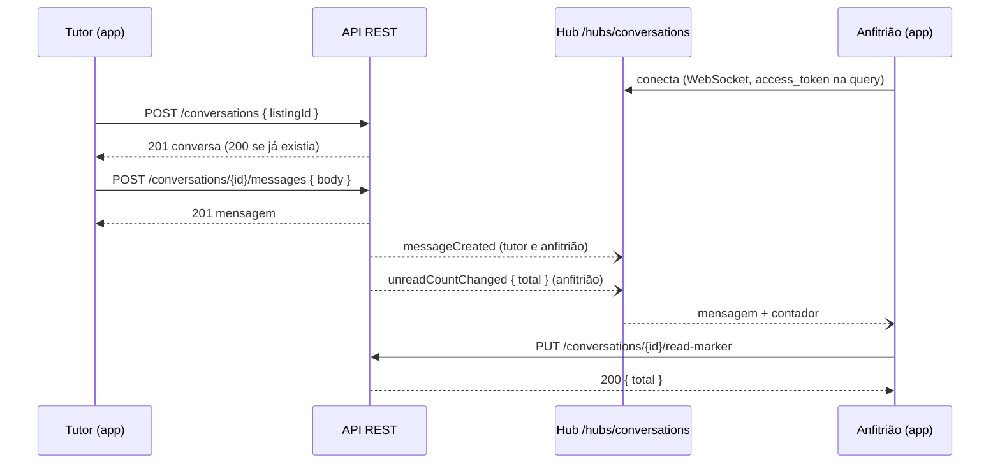

# PetHost — Módulo Conversations (chat)

_Documento do que foi implementado · outubro de 2026 · complementa o [`PROJECT_STANDARDS.md`](PROJECT_STANDARDS.md), o [`escopo-mvp.md`](escopo-mvp.md) (seção 3.1, Chat) e o [`dicionario-de-dados.md`](dicionario-de-dados.md)_

O **chat** é a conversa entre um tutor e um anfitrião: uma por dupla, que serve antes, durante e depois das reservas. O tutor toca em **"Puxar conversa"** no cantinho para tirar dúvidas; os dois trocam texto e foto; durante a estadia, as fotos que o anfitrião manda fazem o papel de diário e ficam ligadas à reserva. Mensagem nova e contador de não lidas chegam **em tempo real** pelo hub SignalR. **Moderação:** qualquer um dos dois bloqueia a conversa (ninguém envia até quem bloqueou desbloquear) e denuncia a mensagem que recebeu; o admin analisa a fila de denúncias, e a denúncia procedente bloqueia a conversa de vez. Só o backend está feito; o front (React) vem depois.

## Sumário

- [PetHost — Módulo Conversations (chat)](#pethost--módulo-conversations-chat)
  - [Sumário](#sumário)
  - [1. Como funciona](#1-como-funciona)
  - [2. Estrutura](#2-estrutura)
  - [3. Endpoints](#3-endpoints)
    - [3.1 Conversa](#31-conversa)
    - [3.2 Mensagem](#32-mensagem)
    - [3.3 Mensagens antigas (cursor)](#33-mensagens-antigas-cursor)
    - [3.4 Foto](#34-foto)
    - [3.5 Limite de envio](#35-limite-de-envio)
    - [3.6 Bloqueio](#36-bloqueio)
    - [3.7 Denúncia e fila do admin](#37-denúncia-e-fila-do-admin)
    - [3.8 E-mail de mensagens não lidas](#38-e-mail-de-mensagens-não-lidas)
  - [4. Tempo real (hub)](#4-tempo-real-hub)
  - [5. Regras](#5-regras)
  - [6. Retenção (LGPD)](#6-retenção-lgpd)
  - [7. Banco](#7-banco)
  - [8. Comunicação com outros módulos](#8-comunicação-com-outros-módulos)
  - [9. Configuração](#9-configuração)
  - [10. Testes](#10-testes)
  - [11. Decisões e pendências](#11-decisões-e-pendências)

---

## 1. Como funciona



**Escrever é REST; o hub só avisa.** Abrir conversa, enviar e marcar como lida passam pela API, com validação, envelope, `Result`, rate limit e trilha. Depois que a mensagem é gravada, o hub empurra o evento para as contas dos dois lados. O aviso é best-effort: se falhar, a mensagem já está no banco e o app recupera pelo REST ao reconectar.

## 2. Estrutura

```
src/Modules/Conversations/
├── Domain/          Conversation (agregado, com o bloqueio), ConversationId, ConversationParty (+ Values), Message (agregado),
│                    MessageId, Reports/ (MessageReport — agregado —, MessageReportId, ReportReason e ReportStatus + Values,
│                    IMessageReportRepository), ConversationsErrors, IConversationRepository, IMessageRepository,
│                    IConversationsUnitOfWork
├── Application/     StartConversation, ListMyConversations, GetConversationById, GetUnreadMessageCount,
│                    MarkConversationRead, PurgeInactiveConversations, SendMessage, SendPhotoMessage,
│                    ListConversationMessages, BlockConversation, UnblockConversation (+ ConversationBlocking), LiftModerationBlock, NotifyUnreadMessages,
│                    Reports/ (ReportMessage, ListMessageReports, GetMessageReportById, ResolveMessageReport,
│                    MessageReportResponseBuilder), ConversationAccess, ConversationNotifications, ConversationTrail,
│                    ConversationResponseBuilder; portas IConversationParties, IConversationListings,
│                    IConversationBookings, IConversationRealtime e IConversationQueries (leitura)
├── Infrastructure/  ConversationsDbContext (schema conversation), configurações, repositórios, ConversationQueries
│                    (leitura projetada), ConversationsUnitOfWork, adaptadores (Parties/, Listings/, Bookings/),
│                    Retention/ConversationRetentionService, Moderation/ (ModerationEmailAlerts, ConversationModerationOptions), UnreadEmail/ (UnreadEmailService, UnreadMessagesEmailNotifier, UnreadEmailOptions)
└── Presentation/    ConversationsController, ConversationsAdminController, Reports/ConversationReportsAdminController, Realtime/ (ConversationsHub, ConversationEvents, SignalRConversationRealtime)

src/Shared/PetHost.Shared.Infrastructure/Realtime/   AddRealtime (SignalR + JSON da API + backplane Redis) e SubjectUserIdProvider
src/Host/PetHost.Api/                               Program.cs (módulo, AddRealtime, MapConversationsHub) e
                                                    Authentication/JwtEnvelopeEvents.cs (token do hub pela query)
```

A mensagem é um **agregado separado** da conversa: a conversa não carrega o histórico, só o instante da última mensagem. O aviso em tempo real implementa uma porta da Application (`IConversationRealtime`) na **Presentation**, que é quem conhece o hub (a Infrastructure não referencia a Presentation, §4).

## 3. Endpoints

| Método | Rota | Quem | O quê |
|---|---|---|---|
| `POST` | `/api/v1/conversations` | owner | "Puxar conversa": corpo `{ "listingId": "..." }`. `201` + `Location` quando nasce; `200` com a mesma conversa se a dupla já tem uma. Cantinho da própria pessoa (conta de anfitrião com o mesmo e-mail do tutor): `422 CONVERSATION_OWN_LISTING`. |
| `GET` | `/api/v1/conversations/me?[page=&pageSize=]` | owner, host | As conversas da conta, pelo papel do token. Da atividade mais recente para a mais antiga, cada uma com a última mensagem e o `unreadCount`. Paginada. Anfitrião ainda não aprovado (sem perfil): lista vazia. |
| `GET` | `/api/v1/conversations/me/unread-count` | owner, host | O contador do app: total de não lidas da conta, em todas as conversas. `{ "total": n }`. Anfitrião ainda não aprovado: `0`. |
| `GET` | `/api/v1/conversations/me/notification-settings` | owner, host | O que a conta recebe fora do app: `{ "unreadMessagesEmail": true }` (padrão ligado). |
| `PUT` | `/api/v1/conversations/me/notification-settings` | owner, host | Liga ou desliga o e-mail de mensagens não lidas: `{ "unreadMessagesEmail": false }`. Idempotente. |
| `GET` | `/api/v1/conversations/{conversationId}` | owner, host | Uma conversa. Só o tutor e o anfitrião dela; os outros, `404`. |
| `GET` | `/api/v1/conversations/{conversationId}/messages?[before=&pageSize=]` | owner, host | Mensagens, da mais nova para a mais antiga, por cursor (seção 3.3). Ler não marca como lida. |
| `POST` | `/api/v1/conversations/{conversationId}/messages` | owner, host | Mensagem de texto: `{ "body": "..." }`. `201` + `Location` (a lista de mensagens). Limite próprio (seção 3.5). |
| `POST` | `/api/v1/conversations/{conversationId}/messages/photo` | owner, host | Foto com legenda opcional, `multipart/form-data` (seção 3.4). `201`. Mesmo limite do texto. |
| `PUT` | `/api/v1/conversations/{conversationId}/read-marker` | owner, host | Marca como lidas as mensagens que a conta recebeu na conversa. Devolve `{ "total": n }` (o contador novo). Idempotente. |
| `PUT` | `/api/v1/conversations/{conversationId}/block` | owner, host | Bloqueia a conversa (seção 3.6). Devolve a conversa. Idempotente. |
| `DELETE` | `/api/v1/conversations/{conversationId}/block` | owner, host | Desbloqueia. Só quem bloqueou. Devolve a conversa. Idempotente. |
| `POST` | `/api/v1/conversations/{conversationId}/messages/{messageId}/report` | owner, host | Denuncia uma mensagem recebida: `{ "reason": "...", "description": "..." }` (seção 3.7). `201`. |
| `GET` | `/api/v1/conversations/reports?[status=&page=&pageSize=]` | admin | A fila de denúncias, da mais antiga para a mais nova. `status`: `pending` (padrão), `upheld`, `dismissed` ou `all`. Paginada. |
| `GET` | `/api/v1/conversations/reports/{reportId}` | admin | Uma denúncia, com a mensagem e até 10 mensagens anteriores (`context`). |
| `PUT` | `/api/v1/conversations/reports/{reportId}/resolution` | admin | Analisa: `{ "outcome": "upheld" \| "dismissed", "note": "..." }`. |
| `DELETE` | `/api/v1/conversations/{conversationId}/moderation-block` | admin | Tira o bloqueio da moderação (seção 3.6). Devolve `{ conversationId, blocked }`. Idempotente. |

O lado de quem age (tutor ou anfitrião) sai sempre do **papel do token**, e o perfil, do `sub` — nunca do corpo. Admin não usa o chat (`403`); só a fila de denúncias, que tutor e anfitrião não acessam (`403`).

### 3.1 Conversa

`ConversationResponse`: `id`, `ownerId`, `owner` (`{ id, name, avatarUrl }`), `hostId`, `host` (empresa pelo nome fantasia), `lastMessage` (a mensagem mais recente, no formato da seção 3.2), `unreadCount` (o que **quem vê** recebeu e não leu), `blocked` (bloqueada por um dos lados), `blockedByMe` (quem vê bloqueou e pode desbloquear o próprio bloqueio), `blockedByModeration` (a moderação bloqueou: ninguém desbloqueia pelo app), `lastMessageAt`, `createdAt`. Nulos são omitidos; nunca sai e-mail, telefone, endereço nem id de conta.

### 3.2 Mensagem

`MessageResponse`: `id`, `conversationId`, `sentBy` (`owner`/`host`), `body`, `imageUrl`, `bookingId` (a reserva em andamento no envio), `createdAt`. **Sem `readAt`:** o remetente não vê se a mensagem foi lida (confirmação de leitura está fora do escopo); `read_at` só alimenta o contador de quem recebe.

```json
{ "id": "0199…", "conversationId": "0199…", "sentBy": "host", "body": "A Pipoca chegou!", "bookingId": "0199…", "createdAt": "2026-12-20T13:05:12.331+00:00" }
```

### 3.3 Mensagens antigas (cursor)

Exceção ao `page`/`pageSize` do §13 (registrada lá): sem `before`, vêm as mais recentes; para as anteriores, o app manda em `before` o **id da última mensagem que recebeu**. A resposta é `{ "items": [...], "pageSize": 50, "hasMore": true }`. `pageSize` de 1 a 100 (padrão 50). A ordem é por (`created_at`, `id`) e o cursor compara os dois juntos: mensagem nova chegando no meio da leitura não repete nem pula nada. `before` que não é id, ou que não é mensagem desta conversa: `400` no campo `before`.

### 3.4 Foto

`multipart/form-data` com a imagem na parte `file` e a legenda opcional na parte `body` — as mesmas regras de imagem do projeto ([`armazenamento-de-imagens.md`](armazenamento-de-imagens.md)): JPG/JPEG, PNG ou WebP até 5 MB, formato conferido pelo conteúdo, metadados (GPS, aparelho) removidos, corpo acima de 8 MB = `413`. Vai para o **bucket público**, pasta `conversations`. A posse da conversa, o perfil ativo e o outro lado sem suspensão são conferidos **antes** do envio: conversa de outra pessoa (`404`) ou destinatário suspenso (`403`) não mandam nada para o bucket. Se a gravação falhar depois do envio, a foto é apagada (`ImageReplacement`).

### 3.5 Limite de envio

Política própria de rate limit, `chat-messages`: **30 mensagens por minuto por conta**, texto e foto contando juntos. Estourou: `429 TOO_MANY_REQUESTS` no envelope, com `Retry-After`. Ler, listar e marcar como lida não contam (ficam só no limite geral de 120/min). Por que 30: uma conversa animada fica em 10 a 15 mensagens por minuto, e 30 ainda cabe uma sequência de fotos do pet; acima disso é robô ou spam. Ajustável por configuração (`RateLimiting__Policies__chat-messages__PermitLimit`).

### 3.6 Bloqueio

Qualquer um dos dois lados bloqueia (`PUT .../block`). Enquanto bloqueada, **ninguém envia** — texto ou foto, `422 CONVERSATION_BLOCKED`, e a foto nem vai ao bucket —, e os dois continuam lendo o histórico, listando e marcando como lida. Só quem bloqueou desbloqueia (`DELETE .../block`); o outro lado recebe `403 CONVERSATION_UNBLOCK_FORBIDDEN`, e tentar bloquear o que o outro já bloqueou é `422 CONVERSATION_ALREADY_BLOCKED`. Bloquear de novo, ou desbloquear o que está liberado, devolve a conversa como está (sem trilha nem aviso). Bloquear não exige perfil ativo: é proteção. O tutor que puxa conversa de novo recebe a mesma conversa, bloqueada.

Além do bloqueio de cada lado existe o **bloqueio da moderação** (`moderation_blocked_at`), que nasce quando o admin julga procedente uma denúncia da conversa (seção 3.7). Os dois são independentes: com a moderação, enviar dá `422 CONVERSATION_BLOCKED_BY_MODERATION` (esse erro vem antes do `CONVERSATION_BLOCKED`), e o `DELETE .../block` de um lado só tira o bloqueio dele — a conversa continua bloqueada. Só o admin tira o bloqueio da moderação (`DELETE /conversations/{id}/moderation-block`), para um procedente dado por engano ou reconsiderado: grava dentro da mesma trava, vai para a trilha (`conversation.unblocked` com `by: moderation`) e os dois lados recebem `conversationBlockChanged`. O bloqueio de um dos lados, se houver, continua — `blocked` na resposta diz se a conversa ainda está bloqueada. A denúncia continua procedente. Idempotente; conversa inexistente, `404 CONVERSATION_NOT_FOUND`.

O bloqueio grava dentro da **mesma trava** do envio (`RunLockedOnConversationAsync`): o envio confere o bloqueio antes e de novo sobre a conversa relida dentro da trava, então uma mensagem não passa no meio de um bloqueio. Os dois lados recebem `conversationBlockChanged` pelo hub.

### 3.7 Denúncia e fila do admin

Quem **recebeu** a mensagem a denuncia (`POST .../messages/{messageId}/report`), com `reason` — `spam`, `harassment` (assédio, ofensa), `scam` (golpe, pagamento por fora), `inappropriate` (conteúdo impróprio) ou `other` — e `description` opcional (até 1.000 caracteres; obrigatória em `other`). Resposta `201` com `{ id, conversationId, messageId, reason, status: "pending", createdAt }`. A própria mensagem: `422 CONVERSATION_REPORT_OWN_MESSAGE`; de novo a mesma: `409 CONVERSATION_REPORT_ALREADY_EXISTS` (uma por mensagem, índice único); mensagem que não é desta conversa: `404 CONVERSATION_MESSAGE_NOT_FOUND`. Denunciar não bloqueia — o app pode oferecer "denunciar e bloquear" chamando as duas rotas — e não exige perfil ativo.

**Aviso por e-mail:** cada denúncia nova enfileira um e-mail para `ConversationModeration:AdminAlertEmail` (seção 9), pela caixa de saída (entregue em segundo plano). O e-mail leva o motivo, quem denunciou (tutor ou anfitrião, sem o nome), quantas denúncias esperam análise e o caminho da denúncia na API — **nunca** o texto da mensagem, a foto nem a descrição, porque o e-mail sai do sistema. Sem endereço configurado, não manda nada. É best-effort: falha ao enfileirar vai para o log e a denúncia continua registrada.

O admin vê a fila (`GET /conversations/reports`, `pending` por padrão), cada item com `reason`, `description`, `reportedBy`, `reporter` e `reported` (`{ id, name, avatarUrl }` — o `id` de `reported` é o do tutor ou anfitrião que enviou, para suspender em `/owners/{id}/suspension` ou `/hosts/{id}/suspension`) e a `message`. No detalhe vem também `context`: até 10 mensagens anteriores à denunciada, da mais nova para a mais antiga. Analisar (`PUT .../resolution`) fecha a denúncia como `upheld` (procedente) ou `dismissed` (improcedente), com `note` obrigatória (vai para a trilha como motivo); analisar de novo é `422 CONVERSATION_REPORT_ALREADY_RESOLVED`, e dois admins ao mesmo tempo, `409 CONVERSATION_CONFLICT` (`xmin`). **Procedente bloqueia a conversa pela moderação** (seção 3.6): a análise e o bloqueio gravam juntos, dentro da trava da conversa, a trilha registra `conversation.blocked` com `by: moderation`, e os dois lados recebem `conversationBlockChanged`. Se a conversa já estava bloqueada pela moderação (outra denúncia procedente), nada muda nela. Improcedente não mexe na conversa. Analisar **não suspende** ninguém: a suspensão continua nos módulos Owners e Hosts. Listar e abrir vão para a trilha (o admin viu mensagens privadas).

### 3.8 E-mail de mensagens não lidas

Quem não abre o app não fica sabendo da mensagem: a tarefa `UnreadEmailService` roda a cada 5 minutos (`NotifyUnreadMessagesCommand`) e manda um **resumo por e-mail** a quem tem mensagem do outro lado **sem ler há 15 minutos**. É um e-mail por pessoa, com todas as conversas dela ("3 mensagens de Dona Cida", "1 mensagem de Hotelzinho Pet Feliz") e o link do app, se configurado — **nunca** o texto das mensagens nem as fotos.

- Cada conversa guarda, por lado, quando foi o último e-mail (`owner_unread_notified_at`, `host_unread_notified_at`). Só mensagem **nova depois dele** gera outro, e no mínimo **60 minutos** depois do anterior: uma conversa animada não vira um e-mail a cada mensagem.
- Ler a conversa (`PUT .../read-marker`) tira a pendência. Estar conectado ao hub não conta: o que conta é ter aberto a conversa.
- Perfil ou conta inativo ou suspenso não recebe (a pendência é dada como tratada, para não voltar a cada rodada).
- A marcação é gravada depois que o e-mail foi para a caixa de saída: uma falha entre os dois repete o e-mail na rodada seguinte, nunca o perde.
- **Dá para desligar** (`PUT /conversations/me/notification-settings` com `{ "unreadMessagesEmail": false }`), e ligar de novo. Vem ligado. A escolha é da **conta** (tabela `notification_preferences`, no schema do chat): o tutor e o anfitrião da mesma pessoa escolhem cada um. O front mostra a opção na tela de perfil; a rota fica no módulo do chat para não espalhar a regra por Owners e Hosts. Quem desligou é tratado como o suspenso: não recebe, e a pendência sai.

## 4. Tempo real (hub)

| Item | Como é |
|---|---|
| Endereço | `/hubs/conversations` (SignalR) |
| Quem conecta | Contas `owner` e `host`. Sem token, token inválido ou outro papel: a conexão é recusada (`401`/`403` no envelope). |
| Autenticação | O mesmo access token da API, na query `access_token` (o WebSocket do navegador não manda o header). Só vale em `/hubs`. A revogação é conferida na conexão; a conexão **fecha quando o token expira** (15 min) e o app reconecta com o token renovado. O token na URL não vai para o log: o log de requisição do ASP.NET Core (`Microsoft.AspNetCore.Hosting.Diagnostics`, que grava a URL inteira) fica em `Warning` nos dois `appsettings`, e o do Serilog grava só o caminho. |
| Quem recebe | Os eventos vão para a **conta** (claim `sub`): todas as abas e aparelhos dela. A outra conta da mesma pessoa (tutor × anfitrião) não recebe. |
| Métodos do cliente | Nenhum. O hub só envia. |
| Várias instâncias | **Backplane no Redis** (`Microsoft.AspNetCore.SignalR.StackExchangeRedis`, canais com prefixo `pethost:signalr`). A instância que gravou a mensagem publica no Redis e todas entregam às conexões que têm: o anfitrião conectado na instância B recebe a mensagem gravada pela A. Usa a mesma connection string do Redis (`ConnectionStrings:Redis`), numa conexão própria. Não precisa de sticky session com WebSocket e `skipNegotiation` (o app já conecta assim); com negociação ou long polling, o balanceador teria de manter o cliente na mesma instância. |

**Eventos** (JSON igual ao da API: camelCase, nulos omitidos):

| Evento | Para quem | Conteúdo |
|---|---|---|
| `messageCreated` | As contas do tutor e do anfitrião da conversa (quem enviou recebe nas outras abas) | A mensagem, no formato da seção 3.2 |
| `unreadCountChanged` | A conta cujo contador mudou: quem recebeu a mensagem, ou quem marcou como lida (nas outras abas) | `{ "total": n }` |
| `conversationBlockChanged` | As contas do tutor e do anfitrião, quando a conversa é bloqueada ou desbloqueada | `{ "conversationId": "...", "blocked": true }` (quem bloqueou sai do REST, em `blockedByMe`) |

**Para o front (React, `@microsoft/signalr`):**

```ts
const connection = new HubConnectionBuilder()
  .withUrl(`${API_URL}/hubs/conversations`, {
    accessTokenFactory: () => getAccessToken(), // a mesma função do cliente HTTP, que renova o token
    transport: HttpTransportType.WebSockets,     // long polling contaria no rate limit (120/min)
    skipNegotiation: true,
  })
  .withAutomaticReconnect()
  .build();

connection.on("messageCreated", (message) => { /* juntar na conversa, sem duplicar pelo id */ });
connection.on("unreadCountChanged", ({ total }) => { /* atualizar o contador */ });
connection.onreconnected(() => { /* recarregar conversas e contador pelo REST */ });
```

- Uma conexão para o app inteiro (não uma por componente).
- O `accessTokenFactory` precisa usar a **mesma** renovação do cliente HTTP: o refresh token é de uso único.
- Na troca de conta (tutor ↔ anfitrião), fechar a conexão e abrir outra com o token novo.
- CORS configurado para o front em Next.js (`Cors:AllowedOrigins`, com credenciais — o `withCredentials` do negotiate funciona). Origem do app na configuração: [`PROJECT_STANDARDS.md`](PROJECT_STANDARDS.md) §13, CORS.

## 5. Regras

Na ordem em que são conferidas.

| # | Regra | Erro |
|---|---|---|
| 1 | Só o **tutor** puxa conversa (papel `owner`); o anfitrião responde. | `403 FORBIDDEN` |
| 2 | A conta tem o perfil do papel do token. Exceção: a lista (`GET me`) e o contador (`me/unread-count`) da conta sem perfil (anfitrião ainda não aprovado) respondem vazio e `0`, para o app não tratar como erro. | `404 CONVERSATION_OWNER_NOT_FOUND` · `404 CONVERSATION_HOST_NOT_FOUND` |
| 3 | Para puxar conversa e para **enviar**, o perfil está ativo e sem suspensão. Ler, listar e marcar como lida continuam liberados (o histórico não some). | `403 CONVERSATION_OWNER_DEACTIVATED` · `403 CONVERSATION_HOST_DEACTIVATED` |
| 3a | Para **enviar**, o outro lado não está suspenso pelo admin: o tutor não escreve para anfitrião suspenso, nem o anfitrião para tutor suspenso (decisão do produto, 2026-10-16). Inativo continua recebendo: reativa sozinho e lê depois. | `403 CONVERSATION_RECIPIENT_SUSPENDED` |
| 4 | O cantinho existe e aparece na busca (ativo, anfitrião ativo, sem suspensão, com repasses liberados) — mesmo critério do pedido de reserva. | `404 CONVERSATION_LISTING_NOT_FOUND` |
| 5 | **Uma conversa por dupla** tutor–anfitrião (índice único). Puxar de novo devolve a mesma (`200`); duas aberturas ao mesmo tempo também terminam numa só. | — |
| 6 | Só o tutor e o anfitrião da conversa a veem ou escrevem nela. Conversa de outra pessoa responde igual a inexistente (§8). | `404 CONVERSATION_NOT_FOUND` |
| 7 | Texto obrigatório na mensagem de texto, até **2.000** caracteres sem os espaços nas pontas; legenda da foto opcional, mesmo limite. Sem caractere de controle (quebra de linha, tabulação e retorno de carro passam): o nulo `\0` o Postgres nem aceita em texto e virava `500`. | `400` no campo `body` |
| 7a | Até 30 mensagens (texto ou foto) por minuto por conta (seção 3.5). | `429 TOO_MANY_REQUESTS` |
| 8 | Mensagem enviada enquanto a dupla tem uma reserva **em andamento** (check-in feito) leva o `bookingId` dela; com mais de uma, a de chegada mais recente. | — |
| 9 | Antes da reserva, a conversa é livre (é para tirar dúvidas). **Sem filtro** de telefone ou endereço no texto (decisão do produto). | — |
| 10 | A mesma pessoa pode conversar entre a própria conta de tutor e a de anfitrião (são contas diferentes). | — |
| 11 | Mensagem gravada no exato momento em que a retenção apagou a conversa. | `409 CONVERSATION_CONFLICT` |
| 12 | Conversa **bloqueada** (por qualquer lado) não recebe mensagem; os dois leem (seção 3.6). | `422 CONVERSATION_BLOCKED` |
| 13 | Só quem bloqueou desbloqueia; o outro lado não bloqueia por cima. | `403 CONVERSATION_UNBLOCK_FORBIDDEN` · `422 CONVERSATION_ALREADY_BLOCKED` |
| 14 | Só quem **recebeu** a mensagem a denuncia, uma vez (seção 3.7). | `422 CONVERSATION_REPORT_OWN_MESSAGE` · `409 CONVERSATION_REPORT_ALREADY_EXISTS` · `404 CONVERSATION_MESSAGE_NOT_FOUND` |
| 15 | Motivo da lista; descrição obrigatória em `other`; até 1.000 caracteres, sem caractere de controle. | `400` em `reason` / `description` |
| 16 | A denúncia é analisada uma vez, com observação. | `422 CONVERSATION_REPORT_ALREADY_RESOLVED` · `400` em `outcome` / `note` |
| 17 | Denúncia **procedente** bloqueia a conversa pela moderação: ninguém envia, os dois leem, nenhum lado desbloqueia. | `422 CONVERSATION_BLOCKED_BY_MODERATION` |

**Trilha** (§15): `conversation.started` (conversa nova, com `ownerId` e `hostId`), `conversation.message_sent` (cada mensagem, com `messageId`, `sentBy`, `hasPhoto` e `bookingId`) `conversation.purged` (pela retenção, com `lastActivityAt` e o número de fotos), `conversation.blocked` e `conversation.unblocked` (com `by`: `owner`, `host` ou `moderation`), e, com alvo `conversation_report`, `conversation.message_reported` (com `messageId`, `reportedBy` e `reason`), `conversation.report_resolved` (com `outcome`; a observação como motivo), `conversation.report_viewed` e `conversation.reports_listed` (o admin viu mensagens privadas). **Nunca** o texto, a URL da foto nem a descrição da denúncia.

## 6. Retenção (LGPD)

Conversa sem atividade há **90 dias** — sem mensagem nova desde então (ou, se ninguém escreveu, desde a abertura) — é apagada com as mensagens (`ON DELETE CASCADE`) e as fotos do bucket. **Exceções:** fica a conversa (1) da dupla com reserva em aberto (`requested`, `accepted`, `confirmed` ou `in_progress`), para o combinado de uma estadia marcada para daqui a meses não sumir; (2) **bloqueada**, por um dos lados ou pela moderação — apagá-la apagaria o bloqueio, e o tutor poderia puxar conversa de novo; desbloqueada (o bloqueio dos lados), volta à regra; (3) com **denúncia pendente** — o admin precisa ver a mensagem e a foto; analisada, a denúncia deixa de segurar e sai junto com a conversa (`ON DELETE CASCADE`).

- Tarefa `ConversationRetentionService`, uma vez por dia (padrão), que chama `PurgeInactiveConversationsCommand`.
- O `DELETE` repete as condições (inatividade, sem bloqueio, sem denúncia pendente): mensagem, bloqueio ou denúncia que chegou entre a leitura e o apagamento salva a conversa (e aí as fotos também ficam). Conversa bloqueada ou com denúncia pendente nem entra na rodada.
- As fotos saem do bucket depois que a conversa saiu do banco: uma falha no bucket deixa um arquivo solto, nunca uma mensagem apontando para foto apagada.
- A rodada pagina pelas conversas que ficaram (as com reserva em aberto) até acabar.

## 7. Banco

Schema `conversation`, migrations `CreateConversationsTables`, `AddConversationModeration`, `AddModerationBlock`, `AddUnreadEmailTracking` e `AddNotificationPreferences`. Colunas no [dicionário](dicionario-de-dados.md#conversations--conversas).

- `conversation.conversations`: `owner_id` (→ `owner.owners.id`) e `host_id` (→ `host.hosts.id`) são FKs lógicas; único (`owner_id`, `host_id`); índices (`owner_id`, `last_message_at`) e (`host_id`, `last_message_at`). Bloqueio em `blocked_by` (`owner`/`host`, nulo = liberada) e `blocked_at`, com CHECK que os dois andam juntos; bloqueio da moderação em `moderation_blocked_at` (nulo = sem); último e-mail de não lidas de cada lado em `owner_unread_notified_at` e `host_unread_notified_at`.
- `conversation.notification_preferences`: `user_id` (chave; → `auth.users.id`, lógica), `unread_messages_email`, `updated_at`. Só existe linha para a conta que mudou a escolha; sem linha, recebe tudo.
- `conversation.message_reports`: FKs físicas para `messages` e `conversations`, as duas `ON DELETE CASCADE`; `reported_by`, `reason` e `status` com CHECK; `resolved_by` (→ `auth.users.id`, lógica); CHECK que amarra a análise à situação (pendente sem `resolved_*`; analisada com data, admin e observação). Único em `message_id`; índices (`status`, `created_at`) para a fila e parcial em `conversation_id` `WHERE status = 'pending'` para a retenção. Concorrência otimista pelo `xmin`.
- `conversation.messages`: FK física para `conversations` com `ON DELETE CASCADE`; `sent_by` (`owner`/`host`, CHECK); `body` `varchar(2000)`; `image_url` `varchar(500)`; `booking_id` (→ `booking.bookings.id`, lógica); CHECK "texto ou foto". Índices: (`conversation_id`, `created_at`) para a página; parcial (`conversation_id`, `sent_by`) `WHERE read_at IS NULL` para o contador; parcial em `booking_id`.
- **Leitura projetada** (§11): `ConversationQueries` lê sem rastreamento e projeta direto nas linhas. A página de conversas são duas consultas — as conversas com as não lidas, e a última mensagem **só das conversas da página** (numa consulta só, o EF numeraria as mensagens do banco inteiro).
- **Sem `xmin` na conversa, com trava no envio:** a conversa só guarda o instante da última mensagem, que só avança. Com concorrência otimista, dois envios ao mesmo tempo virariam `409` para um deles. Sem nada, quem gravava por último podia voltar o horário (achado no teste de 2026-10-15: 20 envios simultâneos deixaram `last_message_at` 31 ms atrás da mensagem mais nova). Por isso a gravação da mensagem roda dentro de `RunLockedOnConversationAsync` (`pg_advisory_xact_lock` pela conversa, como a trava do cantinho no Bookings): os envios da mesma conversa gravam em fila, e cada um relê a conversa (`ReloadAsync`) e aplica a mensagem sobre o que o anterior gravou. Na foto, a trava só envolve a gravação, não o envio ao bucket. Marcar como lida é um `UPDATE ... WHERE read_at IS NULL` (duas abas não sobrescrevem a hora da primeira leitura).

## 8. Comunicação com outros módulos

Nenhuma referência a outro módulo (§5, verificado em `ConversationsModuleBoundaryTests`):

| Porta (Application) | Adaptador (Infrastructure) | Contrato |
|---|---|---|
| `IConversationParties` | `Parties/ConversationParties` | `IOwnerDirectory` (tutor da conta), `IHostDirectory` (anfitrião da conta), `IUserDirectory` (nome, foto e id da conta) |
| `IConversationListings` | `Listings/ConversationListings` | `IListingDirectory` + `IHostDirectory` (`IsListable`) |
| `IConversationBookings` | `Bookings/ConversationBookings` | **`IBookingDirectory`**: `GetInProgressBookingIdAsync` e `HasOpenBookingBetweenAsync` (**novos**, implementados pelo Bookings — [`modulo-bookings.md`](modulo-bookings.md) §9) |
| `IConversationRealtime` | `Presentation/Realtime/SignalRConversationRealtime` | `IHubContext<ConversationsHub>` |
| — | `PurgeInactiveConversations` | `IImageStorage` (apagar as fotos) e `IAuditTrail` |

Mudanças em `Shared`: `ImageFolders.Conversations`; `AuditTargets.Conversation` e `ConversationReport`; `AuditActions.ConversationStarted`/`ConversationMessageSent`/`ConversationPurged`/`ConversationBlocked`/`ConversationUnblocked`/`ConversationMessageReported`/`ConversationReportResolved`/`ConversationReportViewed`/`ConversationReportsListed`; `Shared.Infrastructure/Realtime` (`AddRealtime` com o backplane Redis, `SubjectUserIdProvider`, `ReadHubAccessToken`).

## 9. Configuração

| Chave | Variável (`.env`) | Padrão | O quê |
|---|---|---|---|
| `ConversationRetention:InactivityDays` | `CONVERSATION_RETENTION_INACTIVITY_DAYS` | `90` | Dias sem atividade para apagar. |
| `ConversationRetention:IntervalMinutes` | `CONVERSATION_RETENTION_INTERVAL_MINUTES` | `1440` | De quantos em quantos minutos a tarefa roda. |
| `ConversationRetention:BatchSize` | — | `100` | Conversas por consulta da rodada (1 a 1000). |
| `ConversationRetention:Enabled` | — | `true` | Os testes desligam e chamam o comando direto. |
| `ConversationUnreadEmail:DelayMinutes` | `CONVERSATION_UNREAD_EMAIL_DELAY_MINUTES` | `15` | Minutos sem ler antes do e-mail de mensagens não lidas. |
| `ConversationUnreadEmail:CooldownMinutes` | `CONVERSATION_UNREAD_EMAIL_COOLDOWN_MINUTES` | `60` | Intervalo mínimo entre dois e-mails da mesma conversa para a mesma pessoa. |
| `ConversationUnreadEmail:AppUrl` | `CONVERSATION_UNREAD_EMAIL_APP_URL` | vazio | Link do app no e-mail. Vazio = o e-mail só pede para abrir o app. |
| `ConversationUnreadEmail:IntervalMinutes` | — | `5` | De quantos em quantos minutos a tarefa olha as não lidas. |
| `ConversationUnreadEmail:BatchSize` | — | `200` | Conversas de cada lado por rodada (1 a 1000). |
| `ConversationUnreadEmail:Enabled` | — | `true` | Os testes desligam e chamam o comando direto. |
| `ConversationModeration:AdminAlertEmail` | `CONVERSATION_MODERATION_ADMIN_ALERT_EMAIL` | vazio | Quem recebe o e-mail de denúncia nova. Vazio = sem e-mail (o admin consulta a fila). |

## 10. Testes

- **Domínio** (`Conversations.Domain.UnitTests`, 148): `Conversation` (abertura, ids vazios, quem participa de qual lado, instante da última mensagem que só avança, inatividade no limite; bloqueio pelos dois lados, idempotente, por cima do outro, desbloqueio só de quem bloqueou; bloqueio da moderação, idempotente, que o desbloqueio do lado não tira, e que o admin tira sem mexer no bloqueio do lado), `MessageReport` (denúncia de quem recebeu, a própria mensagem, descrição obrigatória em `other`, limites, os erros juntos, análise uma vez com observação), motivos e situações (texto ↔ enum, desfechos), `Message` (texto e foto, espaços, limites exatos, caractere de controle, quebra de linha e tab aceitas, URL que não é http/https, os dois erros juntos), `ConversationPartyValues`, ids e os códigos de erro (contrato público, §8). Cobertura medida antes da moderação: 96,6 % de linha e 98,5 % de branch.
- **Application** (`Conversations.Application.UnitTests`, 205, mocks `Strict`): cada handler, caminho feliz e cada falha, com `Times.Never` no `SaveChanges` quando falha; quem é quem (`ConversationAccess`, inclusive destinatário suspenso e conta sem perfil); conversa existente e a corrida da abertura dupla; a gravação dentro da trava, depois de reler a conversa, sem voltar a última atividade; ligação com a estadia; foto: nada vai ao bucket quando a conversa é de outro ou o destinatário está suspenso, e a foto é apagada quando a gravação falha; o aviso vai para as duas contas e o contador só para quem recebeu; a trilha sem o texto nem a URL; cursor (`hasMore`, `before` inválido ou de outra conversa); lista vazia e contador `0` para anfitrião sem perfil; retenção (apaga, mantém com reserva em aberto, mantém se chegou mensagem, pagina pelas mantidas); bloqueio (grava dentro da trava depois de reler, trilha com quem bloqueou, aviso às duas contas, idempotente sem gravar, já bloqueada pelo outro, não exige perfil ativo, desbloqueio proibido ao outro lado) e envio recusado na conversa bloqueada — também quando o bloqueio chega enquanto o envio espera a trava, e a foto sem ir ao bucket; denúncia (quem recebeu, a própria, mensagem de outra conversa, repetida, trilha sem a descrição); fila e detalhe do admin (filtro, quem denunciou e quem foi denunciado, contexto, trilha) e análise (desfecho, observação como motivo, já analisada, conflito; procedente bloqueia pela moderação dentro da trava, com trilha e aviso, sem repetir se já bloqueada; improcedente não toca na conversa); envio com `CONVERSATION_BLOCKED_BY_MODERATION`; tirar o bloqueio da moderação (dentro da trava, trilha, aviso, ainda bloqueada pelo lado, idempotente, `404`); aviso ao admin com motivo e fila pendente, e nenhum aviso quando a denúncia não grava; e-mail de não lidas (um por pessoa com todas as conversas, prazos pedidos à leitura, suspenso ou quem desligou não recebe mas a pendência sai, sem marcar quando o e-mail não entrou na caixa de saída); preferência (padrão ligado, cria na primeira mudança, troca, repetir não grava, obrigatória); validadores. Cobertura medida antes da moderação: 98,5 % de linha e 97,3 % de branch.
- **Integração** (`Conversations.IntegrationTests`, 57, Postgres + Redis + RustFS em container): abrir conversa (`201` → `200`, corrida, `404`, `403`, `401`, `400`); mensagens, não lidas e marcar como lida de ponta a ponta; cursor; estranho recebe `404` em tudo; tutor suspenso não envia mas lê; ninguém escreve para quem está suspenso (texto e foto, sem nada no bucket); caractere nulo é `400`, não `500`; 20 envios simultâneos não voltam a última atividade; anfitrião sem perfil vê lista vazia e `0`; mensagem ligada à estadia em andamento; foto no bucket, `404` sem enviar ao bucket e `400` em arquivo que não é imagem; **limite do chat** numa instância com rate limit ligado (texto e foto contam juntos, por conta, `429` no envelope, ler continua liberado); **trava da conversa** contra o banco (a segunda requisição espera no `pg_locks`, a releitura preserva o horário mais novo, conversa apagada no meio do envio vira `409` sem exceção — os dois primeiros conferidos por mutação: sem a trava ou sem a releitura, falham); **hub** com o cliente oficial do SignalR por WebSocket e token na query (mensagem e contador chegam ao outro lado, eco nas outras abas, contador ao marcar como lida, conexão sem token recusada, e **backplane**: o anfitrião conectado numa segunda instância da API recebe a mensagem gravada pela primeira — conferido por mutação: sem o backplane, falha por timeout; `conversationBlockChanged` ao bloquear e desbloquear); retenção contra o banco e o bucket (inclusive a conversa bloqueada, a bloqueada pela moderação e a com denúncia pendente, que fica até o admin analisar); **moderação**: bloqueio trava os dois lados (texto e foto) e deixa ler, desbloqueio só de quem bloqueou, estranho recebe `404`, denúncia entra na fila com quem é quem e o contexto, denúncias recusadas (própria, repetida, de outra conversa, `other` sem descrição), análise tira da fila pendente, procedente bloqueia a conversa para os dois de vez (o desbloqueio do lado não tira) e improcedente a deixa aberta, o admin tira o bloqueio da moderação e os dois voltam a escrever (só admin; `404`), o e-mail ao admin chega pela caixa de saída sem a mensagem nem a descrição, o e-mail de não lidas (resumo sem o texto depois de 15 min, nada antes do prazo, nada se a conversa foi lida, sem repetir a mesma mensagem nem antes do intervalo, suspenso não recebe, quem desligou não recebe e a escolha é de cada conta, `400` sem a escolha), rotas do admin fechadas para tutor, anfitrião e anônimo.
- **Arquitetura** (`ConversationsModuleBoundaryTests`, 7) e o Conversations nas fronteiras dos outros módulos.

## 11. Decisões e pendências

| Decisão | Por quê |
|---|---|
| Uma conversa por dupla, ligada à reserva pela mensagem | Escopo do MVP (seção 3.1). Do documento geral do projeto entrou só o "histórico da reserva": a mensagem enviada durante a estadia em andamento leva o `bookingId`. Vídeo e notificação por e-mail ou push ficaram de fora (escopo, seção 3.2). |
| SignalR, e o hub só avisa | Já vem no ASP.NET Core. Escrever pela API mantém validação, envelope, rate limit e trilha num lugar só; o hub não tem método que o cliente chame. |
| Aviso best-effort, depois de gravar | A mensagem não pode depender do WebSocket. Se o aviso falhar, o app recupera pelo REST. |
| `sent_by` em vez de `sender_id → users.id` | A conversa tem exatamente dois lados e as tabelas de negócio guardam o id do perfil, nunca o da conta (como em `bookings`). |
| Destinatário suspenso não recebe (2026-10-16) | Decisão do produto depois do teste de QA: a suspensão vale nos dois sentidos. Inativo continua recebendo, porque reativa sozinho. |
| Anfitrião sem perfil vê lista vazia e `0` (2026-10-16) | O app chama o contador logo ao entrar; para o anfitrião que ainda espera a aprovação, `404` virava erro na tela. Abrir conversa e escrever continuam exigindo o perfil. |
| Limite do chat: 30 por minuto (2026-10-16) | Contra spam e robô, sem atrapalhar uma conversa normal nem uma sequência de fotos. Por conta, não por IP: duas pessoas na mesma rede não se atrapalham. |
| Trava por conversa em vez de `xmin` | `xmin` faria um dos dois envios simultâneos falhar com `409`; a trava os põe em fila e os dois gravam. |
| Paginação por cursor nas mensagens | Mensagem nova no meio da leitura faria as páginas numeradas "andarem". Exceção registrada no §13. |
| Foto no bucket público | Decisão do produto, igual às fotos de pet e de cantinho (URL com chave UUID v7, não adivinhável). |
| Sem filtro de contato no texto | Decisão do produto: antes da reserva a conversa é para tirar dúvidas. A troca de telefone antes do pagamento fica possível. |
| Remetente não vê "lida" | Confirmação de leitura está fora do escopo; `read_at` só serve ao contador. |
| Retenção de 90 dias, salvo reserva em aberto | LGPD ("menor tempo possível") sem apagar o combinado de uma estadia futura. |
| Backplane no Redis (2026-10-16) | O Redis já é obrigatório (sessão do Auth). Sem ele, com duas instâncias, a mensagem só chegaria a quem estivesse conectado na mesma instância que gravou. Conexão própria porque o SignalR a descarta ao desligar, e a do `AddRedis` é compartilhada. |
| Bloqueio por qualquer lado trava os dois (2026-10-16) | Decisão do produto. Quem bloqueou também não escreve: ninguém manda mensagem numa conversa que um dos dois não quer. Só quem bloqueou desbloqueia. Status `422` (regra de negócio, como o resto do projeto sem sufixo de status). |
| Denúncia com motivo e fila do admin (2026-10-16) | Decisão do produto. Uma por mensagem, só de quem recebeu. O admin analisa (`upheld`/`dismissed`) e, se for o caso, suspende pelos endpoints que já existem — a denúncia não suspende sozinha. |
| Procedente bloqueia a conversa pela moderação (2026-10-16) | Decisão do produto: marcar procedente sem efeito deixava os dois conversando normalmente. O bloqueio vale só para aquela conversa (não pune a conta inteira, como a suspensão) e é independente do bloqueio dos lados, para nenhum dos dois conseguir tirar. Coluna à parte (`moderation_blocked_at`) em vez de um terceiro valor em `blocked_by`, porque os dois bloqueios podem existir juntos. |
| Rota do admin para tirar o bloqueio da moderação (2026-10-16) | Um procedente dado por engano ficava para sempre. Só tira o bloqueio; a denúncia continua procedente (a análise é final). |
| E-mail de mensagens não lidas, sem push (2026-10-16) | Decisão do produto: no MVP, o tempo real e o contador cobrem quem está com o app aberto; o e-mail cobre quem não está, usando a caixa de saída que já existe. Push depende do front (web ou React Native) e de infraestrutura nova (Firebase ou VAPID): fica para depois. 15 min de espera e 60 min de intervalo por conversa. A pessoa pode desligar (preferência da conta, guardada no módulo do chat). |
| E-mail ao admin a cada denúncia nova (2026-10-16) | Decisão do produto: o admin não precisa ficar consultando a fila. Sem o conteúdo da mensagem (o e-mail sai do sistema); sem agrupar — no volume do MVP, um por denúncia. Endereço opcional, como o alerta de recusa do Stripe no Hosts. |
| Denunciar não bloqueia (2026-10-16) | Decisão do produto: ações separadas; o app junta as duas se quiser. |
| Retenção segura a conversa bloqueada ou com denúncia pendente (2026-10-16) | Denúncia pendente: decisão do produto (o admin precisa ver a mensagem). Bloqueada: apagar a conversa apagaria o bloqueio e o tutor puxaria conversa de novo; o custo é guardar as mensagens enquanto estiver bloqueada. |
| Socket aberto até o token expirar | Aceito pelo produto: conta inativada ou com senha trocada continua recebendo eventos por até 15 min. |
