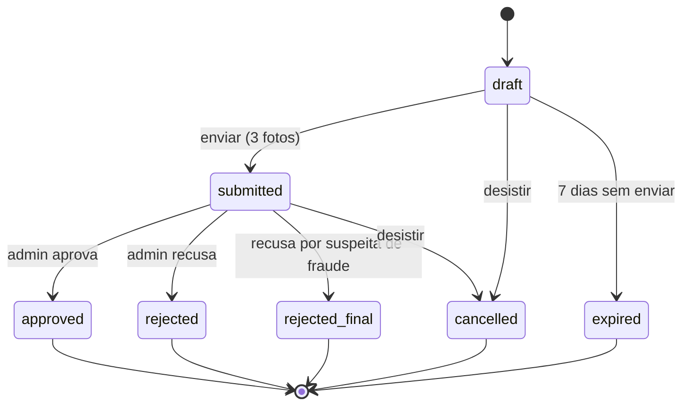

# PetHost — Módulo Hosts (anfitriões)

_Documento do que foi implementado · outubro de 2026 · complementa o [`PROJECT_STANDARDS.md`](PROJECT_STANDARDS.md), o [`modulo-auth.md`](modulo-auth.md) e o [`armazenamento-de-imagens.md`](armazenamento-de-imagens.md)_

O anfitrião — pessoa física ou empresa — é verificado por **aprovação manual do admin**: a pessoa cria a conta, abre uma **solicitação de cadastro** com CPF, tipo de documento, três fotos (na empresa, do representante legal, mais os dados da empresa) (frente, verso e selfie segurando o documento), e o admin confere e aprova ou recusa. O perfil de anfitrião (`host.hosts`) **só nasce na aprovação**: a tabela tem apenas gente verificada. As fotos ficam num **bucket privado** e são apagadas depois da decisão.

Depois da aprovação vem o **cadastro de recebimento** (onboarding do Stripe Connect): a conta conectada é criada já preenchida com os dados conferidos, a pessoa completa no Stripe, e o anfitrião só fica **disponível** — cantinhos na busca — quando o Stripe libera os repasses (seção 9).

## Sumário

1. [Fluxo](#1-fluxo)
2. [Estrutura](#2-estrutura)
3. [Endpoints](#3-endpoints)
4. [Regras](#4-regras)
5. [Fotos e privacidade (LGPD)](#5-fotos-e-privacidade-lgpd)
6. [Banco](#6-banco)
7. [Configuração](#7-configuração)
8. [Anfitrião de demonstração](#8-anfitrião-de-demonstração)
9. [Stripe](#9-stripe)
10. [Testes](#10-testes)
11. [Decisões e pendências](#11-decisões-e-pendências)

---

## 1. Fluxo

```
Cadastro (POST /users/register, Auth) → conta de anfitrião; loga, mas ainda não é anfitriã
   │
   ▼
POST /hosts/me/application ──▶ draft ──PUT .../documents/{front|back|selfie}──▶ (3 fotos)
   │                             │                        POST .../submission
   │                             │                                 ▼
   │     7 dias sem enviar ──▶ expired                         submitted ──▶ fila do admin
   │     DELETE (desistir) ──▶ cancelled                           │
   │                                       ┌───────────────────────┼─────────────────────────┐
   │                                       ▼                       ▼                         ▼
   │                                   approved               rejected                rejected_final
   │                        cria o perfil em hosts      motivo + nova tentativa    suspected_fraud:
   │                        e-mail "aprovado"           (até 3 recusas)            sem nova tentativa
   ▼
Depois da aprovação: cadastro de recebimento no Stripe (seção 9)
   │   POST /hosts/me/stripe-account/onboarding-session (ou /onboarding-link)
   │   → conta conectada criada e preenchida → a pessoa completa no Stripe
   ▼
Stripe libera os repasses (webhook account.updated) → cantinhos aparecem na busca
```

Em toda decisão (e na desistência) as fotos são apagadas conforme o prazo de guarda (padrão: na hora).



## 2. Estrutura

```
src/Modules/Hosts/
├── Domain/          Host (perfil verificado), HostApplication (+ HostApplicationDocument), Cpf, Cnpj,
│                    CompanyAddress, enums (status, documento, foto, motivo), HostsErrors, repositórios
├── Application/     StartHostApplication, UpdateMyHostApplication, UploadHostApplicationDocument,
│                    SubmitMyHostApplication, CancelMyHostApplication, GetMyHostApplication,
│                    ListHostApplications, GetHostApplicationById, GetHostApplicationDocument,
│                    ApproveHostApplication, RejectHostApplication, PurgeHostApplications, GetMyHost,
│                    UpdateMyHost, Change/RemoveMyHostAvatar, DeactivateMyHost, ReactivateHost,
│                    SuspendHost (suspender, tirar, liberar CPF/CNPJ), GetHostById, ListHosts,
│                    GetMyStripeAccount, StartMyStripeOnboarding, CreateMyStripeOnboardingLink,
│                    SyncMyStripeAccount, SyncStripeAccount (webhook), HostPayoutSetup,
│                    GetMyDashboard (painel)
│                    + portas IHostAccounts, IHostApplicationNotifier, IHostVerificationPolicy,
│                    IStripeConnect, IHostPayoutsNotifier, IHostBookings, IHostEarnings
├── Infrastructure/  HostsDbContext (schema host), migrations, repositórios, UoW (xmin + índices únicos),
│                    e-mail da decisão, tarefa de limpeza (BackgroundService), seed de demonstração,
│                    Payouts/ (StripeConnectGateway, HostAccountUpdatedWebhookHandler), e-mail "recebimento liberado"
└── Presentation/    HostsController (/hosts/me, verificação), HostProfileController (perfil, foto, status),
                     HostStripeAccountController (/hosts/me/stripe-account), HostDashboardController (/hosts/me/dashboard),
                     HostsAdminController (/hosts, admin),
                     HostApplicationsController (/host-applications, admin)
tests/Modules/Hosts/  Domain.UnitTests, Application.UnitTests, IntegrationTests
```

Mesmas regras de camada do §4. `PetHost.ArchitectureTests` (`HostsModuleBoundaryTests`) garante que o Hosts não referencia nenhum outro módulo: a conta vem do Auth por `IUserDirectory`/`IAccountRegistrar`, a trilha por `IAuditTrail`, as fotos por `IPrivateImageStorage`, o Stripe pelo `IStripeClientProvider` e o webhook pelo `IStripeWebhookHandler` (os dois em `Shared.Infrastructure/Stripe`), as reservas pelo `IBookingDirectory` (inativação, bloqueio e painel) e os ganhos do painel pelo `IPaymentDirectory`.

## 3. Endpoints

| Método | Rota | Acesso | O que faz | Sucesso |
|---|---|---|---|---|
| `GET` | `/api/v1/hosts/me` | anfitrião | Perfil verificado (404 `HOST_NOT_FOUND` antes da aprovação) | `200` |
| `GET` | `/api/v1/hosts/me/application` | anfitrião | "Minha verificação": última solicitação, `canStartNew`, `remainingAttempts`, `noticeVersion` | `200` |
| `POST` | `/api/v1/hosts/me/application` | anfitrião | Abre a solicitação (rascunho) | `201` |
| `PATCH` | `/api/v1/hosts/me/application` | anfitrião | Corrige CPF, tipo de documento e/ou (empresa) dados da empresa do rascunho — parcial | `200` |
| `PUT` | `/api/v1/hosts/me/application/documents` | anfitrião | Envia as fotos num pedido só: multipart com as partes `front`, `back` e `selfie` (tudo ou nada) | `200` |
| `POST` | `/api/v1/hosts/me/application/submission` | anfitrião | Envia para a fila do admin | `200` |
| `DELETE` | `/api/v1/hosts/me/application` | anfitrião | Desiste (rascunho ou em análise); fotos apagadas | `200` |
| `GET` | `/api/v1/host-applications?status=submitted` | admin | Fila (padrão `submitted`, as mais antigas primeiro) | `200` |
| `GET` | `/api/v1/host-applications/{applicationId}` | admin | Detalhe, com os dados da conta para comparar e a rota de cada foto | `200` |
| `GET` | `/api/v1/host-applications/{applicationId}/documents/{kind}` | admin | Link assinado da foto (`url`, `expiresAt` em Unix time em segundos; vale 5 min), `Cache-Control: no-store` | `200` |
| `POST` | `/api/v1/host-applications/{applicationId}/approval` | admin | Aprova (com `reason`) e cria o anfitrião | `200` |
| `POST` | `/api/v1/host-applications/{applicationId}/rejection` | admin | Recusa (`rejectionReason` + `reason`) | `200` |
| `POST` | `/api/v1/host-applications/identity-blocks/release` | admin | Libera um CPF bloqueado (`cpf` + `reason`; seção 4.1.1). Não bloqueado: `404 HOST_IDENTITY_BLOCK_NOT_FOUND` | `200` |

Anfitrião verificado (seção 4.2):

| Método | Rota | Acesso | O que faz | Sucesso |
|---|---|---|---|---|
| `PATCH` | `/api/v1/hosts/me` | anfitrião | Altera telefone, endereço e (empresa) nome fantasia e endereço da empresa. Identidade travada | `200` |
| `PUT` | `/api/v1/hosts/me/avatar` | anfitrião | Troca a foto de perfil (multipart, parte `file`; bucket público, como a do tutor) | `200` |
| `DELETE` | `/api/v1/hosts/me/avatar` | anfitrião | Tira a foto de perfil. Idempotente | `200` |
| `POST` | `/api/v1/hosts/me/deactivate` | anfitrião | Inativa perfil e conta (sessões caem na hora). Com reserva em aberto: `422 HOST_HAS_OPEN_BOOKING` | `200` |
| `POST` | `/api/v1/hosts/reactivate` | anônimo | Reativa conta e perfil com e-mail e senha; já com sessão | `200` |
| `POST` | `/api/v1/hosts/me/deletion` | anfitrião | Exclui a conta de anfitrião a pedido do titular (LGPD), com a senha atual. Sem volta. Vale também antes da aprovação (seção 4.2.1) | `200` |
| `GET` | `/api/v1/hosts` | admin | Todos os anfitriões, com a conta. `?stripeStatus=` filtra pela situação do cadastro de recebimento (ex.: `in_progress`, `rejected`; valor desconhecido: `400` em `stripeStatus`) | `200` |
| `GET` | `/api/v1/hosts/{hostId}` | admin | Um anfitrião, pelo id do anfitrião | `200` |
| `POST` | `/api/v1/hosts/{hostId}/suspension` | admin | Suspende perfil e conta, com motivo | `200` |
| `DELETE` | `/api/v1/hosts/{hostId}/suspension` | admin | Tira a suspensão | `200` |
| `POST` | `/api/v1/hosts/{hostId}/identity-release` | admin | Libera o CPF/CNPJ de um anfitrião suspenso (disputa), com motivo | `200` |
| `POST` | `/api/v1/hosts/{hostId}/stripe-account-reset` | admin | Desliga a conta do Stripe **recusada** (`rejected`) para o anfitrião cadastrar o recebimento de novo, com motivo. Outra situação: `422 HOST_STRIPE_ACCOUNT_NOT_REJECTED` | `200` |

Painel do anfitrião (seção 3.5):

| Método | Rota | Acesso | O que faz | Sucesso |
|---|---|---|---|---|
| `GET` | `/api/v1/hosts/me/dashboard?[month=yyyy-MM]` | anfitrião | Pedidos novos, aceitas esperando pagamento, estadias em andamento, chegadas atrasadas, próximas estadias e quanto recebeu no mês, numa chamada só. `month` troca o mês dos ganhos (formato errado ou no futuro: `400` em `month`) | `200` |

Cadastro de recebimento (seção 9):

| Método | Rota | Acesso | O que faz | Sucesso |
|---|---|---|---|---|
| `GET` | `/api/v1/hosts/me/stripe-account` | anfitrião | Situação gravada: `status`, `payoutsEnabled`, `disabledReason`, `listingsVisible`… (não chama o Stripe) | `200` |
| `POST` | `/api/v1/hosts/me/stripe-account/onboarding-session` | anfitrião | Cria a conta conectada na 1ª vez e abre a sessão do componente **embutido** (`clientSecret`, `publishableKey`, `expiresAt`) | `200` |
| `POST` | `/api/v1/hosts/me/stripe-account/onboarding-link` | anfitrião | Igual, pela página **hospedada** do Stripe (`url`, `expiresAt`) | `200` |
| `POST` | `/api/v1/hosts/me/stripe-account/synchronization` | anfitrião | Relê a conta no Stripe agora (o app chama ao voltar do cadastro) | `200` |
| `POST` | `/api/v1/stripe/webhooks` | Stripe (assinatura) | Webhooks do Stripe; o Hosts trata `account.updated` | `200` |

Rate limit: as rotas do anfitrião usam a política `account-update` (20 a cada 15 min por usuário); inativar usa `account-sensitive`; reativar, `credentials`. O webhook fica fora do rate limit (quem prova a origem é a assinatura).

### 3.1 Abrir — `POST /api/v1/hosts/me/application`

Pessoa física:

```json
{ "cpf": "529.982.247-25", "documentType": "cnh", "acceptNotice": true }
```

Pessoa jurídica (empresa de hospedagem): o **CPF, o documento e a selfie são do representante legal** — a pessoa dona da conta — e vêm também os dados da empresa:

```json
{
  "personType": "pj",
  "cpf": "529.982.247-25", "documentType": "cnh", "acceptNotice": true,
  "cnpj": "11.222.333/0001-81", "legalName": "Pet Feliz Hospedagem LTDA", "tradeName": "Pet Feliz",
  "companyAddress": { "zipCode": "87013-000", "street": "Av. Brasil", "number": "1500", "neighborhood": "Centro", "city": "Maringá", "state": "PR" }
}
```

- `personType`: `pf` (padrão, pessoa física) ou `pj` (pessoa jurídica); maiúsculas também valem (`PF`, `PJ`). Escolhido aqui e **fixo** depois.
- `documentType`: `rg`, `cnh` ou `cin` (Carteira de Identidade Nacional).
- `acceptNotice` precisa ser `true`: a pessoa leu o aviso de como as fotos são usadas. A solicitação guarda a versão do aviso (`noticeVersion`), quando foi aceito e o IP.
- Empresa: CNPJ (aceita o alfanumérico), razão social, nome fantasia e endereço da empresa obrigatórios. Pessoa física não manda nenhum deles.

| Status | Código | Quando |
|---|---|---|
| `201` | — | Rascunho aberto. `Location: /api/v1/hosts/me/application`. |
| `400` | `VALIDATION_ERROR` | `cpf`, `documentType`, `acceptNotice`, `personType` e, na empresa, `cnpj`, `legalName`, `tradeName`, `companyAddress.*` — todos juntos. Pessoa física com dado de empresa: erro no campo `cnpj`. |
| `409` | `HOST_APPLICATION_ALREADY_EXISTS` | Já há uma solicitação aberta. |
| `409` | `HOST_CPF_ALREADY_REGISTERED` | O CPF já é de uma conta de **outro e-mail** — tutor, anfitrião ou solicitação aberta (seção 4.1). O app mostra o e-mail do suporte (`GET /api/v1/support`); o admin resolve com a liberação de identidade (seção 4.2). |
| `409` | `HOST_CNPJ_ALREADY_REGISTERED` | O CNPJ já é de um anfitrião ou de solicitação aberta de outra conta. |
| `422` | `HOST_ALREADY_VERIFIED` | A conta já é anfitriã. |
| `422` | `HOST_APPLICATION_BLOCKED` | Houve recusa por suspeita de fraude. |
| `422` | `HOST_APPLICATION_ATTEMPTS_EXCEEDED` | Já foram 3 recusas. |
| `422` | `HOST_IDENTITY_BLOCKED` | O CPF está bloqueado (recusa por fraude ou 3 recusas, em qualquer conta, mesmo já excluída — seção 4.1.1). Vale também no `PATCH` que troca o CPF. Só o suporte libera. |

### 3.2 Formato da solicitação (para a própria pessoa)

```json
{
  "id": "01a2...", "status": "draft", "personType": "pf", "cpf": "52998224725", "documentType": "cnh",
  "attemptNumber": 1,
  "documents": [ { "kind": "front", "uploadedAt": "2026-10-10T12:00:00+00:00" } ],
  "missingDocuments": ["back", "selfie"],
  "createdAt": "...", "updatedAt": "..."
}
```

Também podem vir `company` (só empresa: `{ cnpj, legalName, tradeName, address }`), `rejectionReason`, `submittedAt`, `reviewedAt`, `closedAt`, `documentsPurgedAt`. **Nunca** vem link, chave ou imagem das fotos, nem a nota interna do admin.

**Corrigir o rascunho** (`PATCH /hosts/me/application`): `cpf`, `documentType` e, só na empresa, `cnpj`, `legalName`, `tradeName` e `companyAddress` — todos **parciais**: só o que vier muda, inclusive campo a campo no endereço (o resto é completado com o rascunho, e o conjunto é revalidado; `complement` vazio limpa). Ex.: só `{ "cnpj": "..." }` troca o CNPJ e mantém razão social e endereço. Erro de formato volta `400 VALIDATION_ERROR` só no campo enviado. Dados de empresa numa solicitação de pessoa física: `422 HOST_APPLICATION_COMPANY_DATA_NOT_ALLOWED`. CPF e CNPJ novos passam pelas mesmas conferências da abertura.

### 3.3 Fotos — `PUT /api/v1/hosts/me/application/documents`

As três fotos vão **num pedido só**: `multipart/form-data` com uma parte por foto.

| Parte | Foto |
|---|---|
| `front` | Frente do documento |
| `back` | Verso do documento |
| `selfie` | A pessoa segurando o documento |

```bash
curl -X PUT http://localhost:8080/api/v1/hosts/me/application/documents \
  -H "Authorization: Bearer <token>" \
  -F "front=@frente.jpg" -F "back=@verso.jpg" -F "selfie=@selfie.jpg"
```

Mesmas regras de arquivo das outras fotos (JPG/JPEG, PNG ou WebP, até 5 MB **cada**, formato conferido pelo conteúdo; corpo acima de 24 MB = 413). Diferenças:

- Vai para o **bucket privado** (seção 5).
- O normal é mandar as três. Mandar só algumas troca só essas vagas (as outras ficam): serve para refazer uma foto ruim ainda no rascunho. Nenhuma das três partes: `400` no campo `documents`.
- **Tudo ou nada:** se uma foto for recusada (formato, tamanho, repetida), nenhuma entra, as que já tinham subido são apagadas e o erro aponta a parte (`"field": "back"`).
- Só no rascunho (`422 HOST_APPLICATION_NOT_EDITABLE` depois de enviada), conferido **antes** de enviar os arquivos.
- Trocar a foto de uma vaga apaga a anterior. A mesma imagem em duas vagas (no mesmo envio ou contra uma vaga que fica): `409 HOST_APPLICATION_DOCUMENT_ALREADY_EXISTS`. Trocar frente e verso entre si no mesmo envio passa.
- A trilha registra um `host_application.document_uploaded` por envio, com as vagas (`kinds`) e quantas foram trocadas (`replaced`).

### 3.4 Admin — detalhe e decisão

O detalhe (`GET /host-applications/{id}`) traz tudo o que a pessoa enviou, o `user` (nome, nascimento, e-mail, telefone, endereço) para comparar com o documento, `reviewNotes`, `reviewedBy` e, em cada foto, `path` — a rota que devolve a imagem.

**Checklist do admin** (tela): nome e nascimento do documento batem com a conta; o CPF bate (a CNH e a CIN trazem o CPF); o rosto do documento é o da selfie; a selfie mostra o rosto **segurando o documento**; documento na validade (CNH); 18+.

**Empresa, além disso:** consultar o CNPJ na Receita (comprovante de inscrição, consulta pública): situação **ativa**, razão social e endereço batendo com o enviado, e o representante (nome da conta) no **quadro de sócios e administradores (QSA)**. Não pedimos contrato social nem cartão CNPJ em foto: a consulta é pública.

```json
// POST .../approval
{ "reason": "Documento e selfie conferidos" }

// POST .../rejection
{ "rejectionReason": "selfie_mismatch", "reason": "Selfie não mostra o documento" }
```

| Motivo (`rejectionReason`) | O que a pessoa lê (e-mail) | Pode tentar de novo? |
|---|---|---|
| `document_illegible` | Não conseguimos ler o documento nas fotos… | Sim |
| `document_expired` | O documento está vencido… | Sim |
| `selfie_mismatch` | A selfie precisa mostrar o rosto e o documento… | Sim |
| `data_mismatch` | Os dados do documento não batem com o cadastro… | Sim |
| `missing_document` | Uma das fotos não era a esperada… | Sim |
| `other` | Não foi possível confirmar a identidade… | Sim |
| `suspected_fraud` | Não foi possível confirmar a identidade. Fale com o suporte. | **Não** (`rejected_final`) |

| Status | Código | Quando |
|---|---|---|
| `400` | `VALIDATION_ERROR` | `reason` vazio ou acima de 500; `rejectionReason` desconhecido. |
| `404` | `HOST_APPLICATION_NOT_FOUND` | Id inexistente. |
| `409` | `HOST_APPLICATION_CONFLICT` | Outro admin decidiu ao mesmo tempo (concorrência otimista). |
| `409` | `HOST_CPF_ALREADY_REGISTERED` | Na aprovação (pessoa física), outro anfitrião já tem o CPF. |
| `409` | `HOST_CNPJ_ALREADY_REGISTERED` | Na aprovação (empresa), outro anfitrião já tem o CNPJ. |
| `422` | `HOST_APPLICATION_NOT_UNDER_REVIEW` | A solicitação não está em `submitted`. |

### 3.5 Painel — `GET /api/v1/hosts/me/dashboard`

Junta o que antes pedia duas chamadas (`GET /bookings/me?status=...` e `GET /payments/payouts/me`) e deixa o "recebido no mês" pronto, contado pela **data do repasse** no horário de Brasília. Antes da aprovação: `404 HOST_NOT_FOUND`. Valores em reais; nulos omitidos.

```json
{
  "generatedAt": "2026-10-18T14:00:00Z",
  "pendingRequests": {
    "count": 2,
    "items": [{
      "bookingId": "…",
      "listing": { "id": "…", "title": "Casa com quintal", "neighborhood": "Zona 7" },
      "owner": { "id": "…", "name": "Camila Souza", "avatarUrl": "…" },
      "ownerRating": { "average": 4.8, "count": 5 },
      "pets": [{ "id": "…", "name": "Pipoca", "species": "dog", "size": "small" }],
      "checkIn": "2026-10-25", "checkOut": "2026-10-28", "nights": 3, "petCount": 1,
      "totalPrice": 181.50, "requestedAt": "…", "responseDeadline": "…"
    }]
  },
  "awaitingPayment": { "count": 1 },
  "inProgress": { "count": 1, "items": [{ "…": "…", "checkedInAt": "…" }] },
  "overdueCheckIns": { "count": 1, "items": [{ "…": "…" }] },
  "upcomingStays": { "count": 3, "items": [{ "…": "…" }] },
  "earnings": {
    "month": "2026-10", "received": 810.00, "reversed": 0, "net": 810.00,
    "receivedPreviousMonth": 1240.00, "receivedYearToDate": 3000.00, "completedStays": 4,
    "breakdown": { "paidByOwners": 950.00, "lateFees": 10.00, "refunded": 50.00, "platformFee": 90.00 },
    "held": { "total": 324.00, "awaitingCheckOut": 224.00, "disputed": 100.00, "blocked": 0 },
    "expected": { "amount": 270.00, "installments": 3 },
    "payoutsEnabled": true
  }
}
```

| Campo | Regra |
|---|---|
| `pendingRequests` | Reservas `requested` ainda no prazo, do `responseDeadline` mais curto para o mais longo. |
| `awaitingPayment` | Só o total: `accepted` com o prazo de pagamento aberto (a vaga está segura, mas ainda pode expirar). |
| `inProgress` | `in_progress` (o pet está em casa), da saída mais próxima; `checkedInAt` em cada item. |
| `overdueCheckIns` | `confirmed` (paga) com o dia de chegada **já passado** (Brasília) e sem check-in, da mais antiga: o anfitrião esqueceu de marcar "Chegou" ou o pet não veio. Se ninguém marcar, a tarefa cancela no dia de saída com 50% de reembolso ([`modulo-bookings.md`](modulo-bookings.md) seção 7). |
| `upcomingStays` | `confirmed` (paga, sem check-in) com chegada **hoje ou depois**, da mais próxima. |
| `count` / `items` | `count` é o total do grupo; `items`, até **5**. A lista completa fica em `GET /bookings/me?status=...`. Sem telefone nem endereço do tutor (o contato continua no detalhe da reserva). |
| `earnings.month` | O mês de `received`, `reversed`, `net`, `breakdown` e `completedStays` (`yyyy-MM`): o pedido em `?month=` ou o atual (Brasília). |
| `received` | Soma de `host_payout_cents` das parcelas com `transferred_at` no mês (Brasília), antes de estornos. |
| `reversed` / `net` | Estorno de contestação perdida com `reversed_at` no mês; líquido = repassado − estornado. |
| `receivedPreviousMonth` | O mesmo do mês anterior ao `earnings.month`, para comparar. |
| `receivedYearToDate` | Repassado de 1º de janeiro até o fim do `earnings.month`, antes de estornos. |
| `completedStays` | Estadias com check-out no mês (do Bookings: `IBookingDirectory.CountCompletedStaysAsync`). |
| `breakdown` | As parcelas repassadas no mês: `paidByOwners` (o que os tutores pagaram, multa incluída) − `refunded` (devolvido ao tutor) − `platformFee` (10% do PetHost) = `received`. `lateFees` é a parte de multa e juros, já dentro de `paidByOwners`. É a regra do dicionário (`platform_fee + host_payout = amount + late_fee − refunded`). |
| `held` | Guardado agora (90% previstos das parcelas pagas ainda não repassadas; `total` = mesma conta do `payout.held` de "Ganhos"), pelo motivo: `awaitingCheckOut` (estadia não acabou), `disputed` (contestação aberta), `blocked` (o repasse não passou — Stripe bloqueou ou recusou — ou o reembolso falhou; a manutenção tenta de novo). Não muda com `?month=`. |
| `expected` | O que ainda vai entrar: 90% do valor das parcelas não pagas (`pending`, `processing`, `overdue`) nos pagamentos em andamento (`active`), e quantas são. Sem multa futura. Não muda com `?month=`. |
| `payoutsEnabled` | O Stripe libera os repasses. `false`: o painel avisa por que o dinheiro não chega. |

As reservas, o `held` e o `expected` são sempre os de agora; `?month=` só muda os ganhos do mês — por isso o `month` da resposta fica dentro de `earnings`. A conta dos ganhos fica no domínio do Payments (`HostEarningsReport`). Pedido ou aceite com prazo vencido que a tarefa de expiração (a cada 5 min) ainda não fechou já não entra. As reservas vêm do Bookings (`IBookingDirectory.GetHostOverviewAsync`, com cantinho, tutor, nota e pets montados pelo mesmo builder da listagem) e os ganhos do Payments (`IPaymentDirectory.GetHostEarningsAsync`), uma leitura depois da outra (um `DbContext` não aceita consultas em paralelo).

## 4. Regras

- **Uma solicitação aberta por conta**, no domínio e no banco (índice único parcial).
- **Tentativas:** a 1ª solicitação é a tentativa 1; cada recusa comum soma 1. Depois de 3 recusas, só pelo suporte. Desistir e expirar não contam.
- **Recusa definitiva:** `suspected_fraud` fecha como `rejected_final` e bloqueia novas solicitações — da conta e, pelo CPF, de qualquer outra (seção 4.1.1).
- **CPF da pessoa:** regra da seção 4.1. Formato igual ao do tutor: só dígitos, módulo 11, mascarado no `ToString()` e na trilha.
- **CNPJ único** entre anfitriões e solicitações abertas de contas diferentes (domínio + índices únicos `uq_hosts_cnpj` e `uq_host_applications_cnpj_open`).
- **Pessoa física ou jurídica** é escolhida ao abrir e não muda. Na empresa, o CPF, o documento e a selfie são do **representante legal** (a dona da conta); na trilha vão o tipo e o CNPJ (dado público da empresa).
- **Só o rascunho muda** (dados e fotos). Enviar exige as três fotos.
- **Aprovar cria o `Host`** — pessoa física ou empresa, com os dados conferidos —, `verified_at`, `verified_by` (o admin) e `application_id`, na mesma transação que fecha a solicitação.
- **Toda decisão do admin leva motivo** (`reason`, até 500): vai para `review_notes` e para a trilha.
- **Trilha:** `host_application.started`, `.updated`, `.document_uploaded`, `.submitted`, `.cancelled`, `.approved`, `.rejected`, `.viewed` (admin abriu), `.listed`, `.document_viewed` (admin abriu uma foto), `.expired`, `.documents_purged`, `.identity_blocked` (a recusa bloqueou o CPF; com o motivo) e `.identity_unblocked` (o admin liberou, com motivo). CPF só mascarado.
- **Pets da casa** (módulo Pets) só depois da aprovação: o Pets acha o anfitrião pelo `IHostDirectory`, que só enxerga `hosts`.
- **Endereço da empresa para a busca de cantinhos:** `IHostDirectory.GetCompanyAddressByUserIdAsync` devolve o endereço da empresa (anfitrião PJ; `null` para pessoa física ou conta sem perfil). O Listings usa quando a empresa busca logada como anfitrião ([`modulo-listings.md`](modulo-listings.md), origem da busca e selo Vizinho).

### 4.1 CPF entre tutor e anfitrião (restrição 9)

**O CPF identifica a pessoa; o e-mail identifica o login.** O mesmo CPF pode estar numa conta de tutor e numa de anfitrião só se as duas forem do **mesmo e-mail** (a mesma pessoa). CPF já usado por uma conta de outro e-mail, em qualquer papel, é recusado com `409` (`OWNER_CPF_ALREADY_REGISTERED` no tutor, `HOST_CPF_ALREADY_REGISTERED` no anfitrião).

| Peça | Onde | Papel |
|---|---|---|
| `ICpfHolderLookup` | `Shared.Contracts/Identity` | "Quais contas usam este CPF aqui?" — cada módulo que guarda CPF implementa: `OwnerCpfHolderLookup` (tutores) e `HostCpfHolderLookup` (anfitriões, inclusive representantes de empresa, e solicitações abertas). |
| `ICpfOwnership` | `Shared.Contracts/Identity` | "O CPF é de outra pessoa?" — junta todos os lookups e compara os e-mails das contas pelo `IUserDirectory` do Auth. A própria conta e as do mesmo e-mail não contam. |
| `CpfOwnership` | `Shared.Infrastructure/Identity` | A implementação (`AddCpfOwnership()` no `Program.cs`). |

Onde vale: cadastro do tutor (pelo e-mail, antes de a conta existir), troca de CPF do tutor, abertura e correção da solicitação de anfitrião. Os módulos continuam sem se referenciar (§5).

Consequência: como cada e-mail tem no máximo uma conta de anfitrião, uma pessoa representa no máximo uma empresa no PetHost.

### 4.1.1 CPF bloqueado (fraude ou tentativas esgotadas)

O bloqueio "da conta" vem do histórico das solicitações dela, e não alcançava a mesma pessoa com **outra conta** — nem com a mesma, depois de excluir a conta (a exclusão apaga as solicitações). Por isso a recusa que fecha a identidade de vez também bloqueia o **CPF**:

- **Quando:** recusa por `suspected_fraud` (motivo `fraud`) ou a recusa que completa as 3 tentativas (`attempts_exhausted`) — regra em `HostApplication.IdentityBlockFor`. Grava uma linha em `host.identity_blocks` depois de gravar a recusa; CPF já bloqueado fica como está. Trilha: `host_application.identity_blocked` (CPF mascarado e motivo) e `identityBlocked` nos detalhes da recusa.
- **Efeito:** abrir solicitação (ou trocar o CPF do rascunho) com esse CPF, em **qualquer conta**, responde `422 HOST_IDENTITY_BLOCKED`. Conferido antes da regra do CPF entre pessoas.
- **O que fica guardado:** só a **impressão** do CPF — HMAC-SHA256 com a chave `HostVerification:CpfFingerprintKey` (porta `ICpfFingerprint`, `HmacCpfFingerprint`). Sem a chave não se volta ao CPF nem se testam os 10⁹ CPFs possíveis, como daria com um SHA-256 simples. Trocar a chave invalida os bloqueios.
- **Sobrevive à exclusão da conta** (seção 4.2.1): é dado mínimo para prevenção à fraude (LGPD, art. 11, II, "g", a mesma base da verificação), sem o CPF em si.
- **Liberar (admin):** `POST /api/v1/host-applications/identity-blocks/release` com `{ "cpf", "reason" }` — para quando o bloqueio pegou o **dono de verdade** do CPF (alguém usou o CPF dele e foi recusado por fraude), depois de o suporte conferir o documento. A conta recusada continua bloqueada pelo histórico dela. Trilha: `host_application.identity_unblocked` com o CPF mascarado.

### 4.2 Anfitrião verificado: perfil, status e ações do admin

Mesmo molde do tutor ([`modulo-owners.md`](modulo-owners.md) seções 3.3 a 3.7): conta (Auth) e perfil (Hosts) mudam juntos, com compensação se um dos lados falhar.

- **Trava de identidade.** Todo anfitrião é verificado, então **nome, nascimento, CPF, CNPJ e razão social** ficam travados no `PATCH /hosts/me`: mudar é `422 HOST_IDENTITY_LOCKED` (nova verificação, pelo suporte). Mandar o valor atual passa (o front pode mandar o formulário inteiro). Livre: telefone, endereço da conta e, na empresa, nome fantasia e endereço da empresa (parcial, completado com o atual). Pessoa física com dado de empresa: `422 HOST_NOT_A_COMPANY`. Antes da aprovação não há perfil: `404 HOST_NOT_FOUND`.
- **Foto** (`/hosts/me/avatar`): igual à do tutor — bucket público, URL em `user.avatarUrl`, troca apaga a anterior.
- **Inativar** (`POST /hosts/me/deactivate`): perfil e conta; sessões caem na hora; a conta de tutor da mesma pessoa não é afetada. Conta ainda sem perfil (verificação em andamento) inativa só a conta. **Com reserva em aberto** (`requested`, `accepted`, `confirmed` ou `in_progress`): `422 HOST_HAS_OPEN_BOOKING` e nada muda — o anfitrião responde, cancela ou faz o check-out antes. A consulta é pela porta `IHostBookings` sobre o contrato `IBookingDirectory.HasOpenBookingForHostAsync` (Bookings). Sem essa trava, o pedido ficaria sem resposta e a estadia sem check-in nem check-out, já que a conta inativa não entra. **Reativar** (`POST /hosts/reactivate`, anônimo, e-mail e senha): conta e perfil; devolve a sessão com `host` (nulo se ainda não aprovado). Conta suspensa não volta: `403 AUTH_ACCOUNT_SUSPENDED`.
- **Suspender** (admin, com motivo): perfil e conta; login `403 AUTH_ACCOUNT_SUSPENDED`; a senha não desfaz. Idempotente. Depois de gravar, as reservas dos cantinhos dele que ainda não começaram (`requested`, `accepted`, `confirmed`) são **canceladas pela plataforma**, com **100% de reembolso** ao tutor e e-mail aos dois lados (porta `IHostBookings.CancelForSuspensionAsync`, contrato `IBookingSuspensions` — [`modulo-bookings.md`](modulo-bookings.md) seção 6.1). A estadia em andamento continua e o **admin** faz o check-out (`POST /bookings/{id}/check-out`, com motivo). Se o cancelamento falhar, vai para o log e a suspensão não é desfeita: suspender de novo cancela o que tiver sobrado. **Tirar a suspensão**: volta ao status que tinha e a pessoa recebe um e-mail avisando (pelo Auth); as reservas canceladas não voltam.
- **Liberar CPF/CNPJ** (admin, com motivo, só de suspenso — `422 HOST_SUSPENSION_REQUIRED`): pessoa física libera o CPF; empresa, o CNPJ e o CPF do representante. Diferente do tutor, os valores **ficam no perfil como evidência** (`identity_released_at`), mas deixam de contar: os índices únicos ignoram o perfil liberado e o `ICpfOwnership` também. A suspensão desse perfil não sai mais (`422 HOST_IDENTITY_RELEASED`).
- **Excluir a conta** (`POST /hosts/me/deletion`): seção 4.2.1.
- **Trilha:** `host.updated` (campos da empresa, pelo nome), `host.deactivated`, `host.reactivated`, `host.erased`, `host.suspended`, `host.suspension_lifted`, `host.identity_released` (CPF mascarado, CNPJ), `host.viewed` e `host.listed` (leitura do admin). Os dados da conta ficam com o Auth (`account.profile_updated`).

### 4.2.1 Excluir a conta — `POST /api/v1/hosts/me/deletion`

LGPD, art. 18, VI: eliminação dos dados a pedido do titular. Mesmo molde do tutor ([`modulo-owners.md`](modulo-owners.md) seção 3.5.1). Corpo `{ "currentPassword": "..." }` (faltando ou errada: `400` no campo `currentPassword`). **Com reserva em aberto:** `422 HOST_HAS_OPEN_BOOKING` e nada muda. Vale também para conta que ainda está na verificação (sem perfil). Sem volta.

| Some ou é anonimizado | Fica (lei ou o outro lado precisa) |
|---|---|
| Conta (Auth): nome `Conta excluída`, e-mail `excluida-<id>@pethost.invalid`, telefone, nascimento, endereço e foto apagados, senha inutilizada | Reservas, pagamentos e repasses |
| Perfil: CPF (da pessoa ou do representante) apagado, perfil inativo, `erased_at` | A conta conectada do Stripe (`stripe_account_id`): repasses feitos e estornos dependem dela |
| Solicitações de verificação, com os documentos e a selfie do bucket privado (a aprovação continua na trilha). O bloqueio do CPF por fraude ou tentativas esgotadas (seção 4.1.1) **fica**: só a impressão, sem o CPF | Dados da empresa (CNPJ, razão social, nome fantasia, endereço): pessoa jurídica não é dado pessoal na LGPD |
| Foto de perfil no bucket | Avaliações publicadas — o nome sai, porque vem da conta |
| Pets: inativos e sem fotos ([`modulo-pets.md`](modulo-pets.md)) | A trilha de auditoria |
| Cantinhos: inativos, sem fotos e sem o endereço que leva à casa — ficam bairro, cidade e UF, e a coordenada exata vira a aproximada ([`modulo-listings.md`](modulo-listings.md)) | Título, descrição e preço do cantinho, para o histórico |
| Conversas, com as mensagens, as denúncias e as fotos — o tutor perde o histórico | |

- Todas as sessões caem na hora; login e reativação com o e-mail antigo respondem `401`. O CPF fica livre (o `ICpfOwnership` não acha mais ninguém com ele). A conta de tutor da mesma pessoa não é afetada.
- **Ordem:** os outros módulos primeiro (contrato `IPersonalDataErasure`), depois as solicitações e o perfil (uma gravação só) e, por último, a conta. Se algo falhar no meio, a pessoa entra e pede de novo; cada passo é idempotente. Documentos e foto saem do bucket só depois que a conta foi anonimizada.
- Trilha: `host.erased` (só de anfitrião aprovado) e `account.erased` (Auth).

### 4.3 Cadastro de recebimento (Stripe Connect)

- **Ordem fixa:** verificação (admin) → cadastro de recebimento (Stripe) → anfitrião disponível. Sem perfil verificado, as rotas respondem `404 HOST_NOT_FOUND`: não existe conta conectada de quem ainda pode ser recusado.
- **Só anfitrião ativo e sem suspensão** abre ou continua o cadastro (`422 HOST_STRIPE_ONBOARDING_NOT_ALLOWED`).
- **Uma conta conectada por anfitrião** (domínio + `uq_hosts_stripe_account_id`). A 2ª abertura reaproveita a conta e só cria uma sessão nova. Trocar de conta: `409 HOST_STRIPE_ACCOUNT_ALREADY_EXISTS` (pelo suporte).
- **Disponível = ativo + sem suspensão + `stripe_payouts_enabled`** (`Host.IsListable`). É o que a busca e o detalhe público de cantinhos usam (`IHostDirectory.GetUnavailableIdsAsync`). **Cantinho só depois do Stripe:** criar cantinho exige os repasses liberados (`422 LISTING_HOST_PAYOUTS_NOT_ENABLED`, [`modulo-listings.md`](modulo-listings.md)). Se o Stripe bloquear depois, os cantinhos já criados ficam com o anfitrião, mas somem da busca até resolver, e o anfitrião não aceita pedidos novos (`422 BOOKING_LISTING_NOT_BOOKABLE`).
- **Bloqueio do Stripe com reservas em aberto:** quando os repasses passam de liberados para bloqueados (ou a conta é recusada) e o anfitrião tem reservas `requested`, `accepted`, `confirmed` ou `in_progress`, o admin recebe um alerta (`HostPayouts:AdminAlertEmail`) com a lista delas (`IHostBookings.ListOpenBookingIdsAsync`, contrato `IBookingDirectory.ListOpenBookingIdsForHostAsync`), uma vez por bloqueio. Os repasses dessas reservas ficam **retidos** pelo Payments (não vão ao Stripe, `HOST_PAYOUTS_DISABLED`, pendência `payout_blocked` — [`modulo-payments.md`](modulo-payments.md) seção 8) e saem sozinhos se o Stripe liberar de novo. O admin decide: cancelar a reserva que não começou (`POST /bookings/{id}/cancellation`, o tutor recebe 100%), encerrar a estadia em andamento ou suspender o anfitrião.
- **Situação** (`status`, calculada do espelho): `not_started` (sem conta) → `in_progress` (cadastro incompleto) → `under_review` (enviado; o Stripe confere — `disabled_reason` vazio, `requirements.pending_verification` ou `under_review`) → `enabled` (repasses liberados). `restricted`: o Stripe bloqueou e pede algo (`disabledReason` diz o quê). `rejected`: o Stripe recusou a conta de vez (`disabledReason` = `rejected.*`: fraude, termos, lista de restrição) — a pessoa não resolve sozinha. Também vem em `GET /hosts/me` (`stripeStatus`).
- **Quando o cadastro não anda** (seção 9.1): uma tarefa em segundo plano relê no Stripe quem ainda não recebe (webhook perdido) e manda **lembretes** por e-mail nos dias 3 e 7 (depois de abrir o cadastro; quem nem abriu, depois da aprovação). Não lembra quem está em análise nem quem foi recusado. O admin acha quem travou com `GET /hosts?stripeStatus=in_progress`.
- **Recusa do Stripe (`rejected`):** trilha `host.stripe_account_rejected`, e-mail ao anfitrião ("fale com o suporte") e alerta ao admin (`HostPayouts:AdminAlertEmail`), uma vez só. O admin decide se suspende o anfitrião (seção 4.2). A conta recusada não é mais relida nem lembrada, e o anfitrião não abre mais o cadastro (`422 HOST_STRIPE_ACCOUNT_REJECTED`, "fale com o suporte").
- **Nova chance (admin):** recusa por engano ou dado digitado errado → `POST /hosts/{hostId}/stripe-account-reset` com motivo. A conta recusada fica no histórico (`stripe_rejected_account_id` e trilha `host.stripe_account_reset`), o anfitrião volta para `not_started` e a próxima abertura do cadastro cria **outra** conta no Stripe (a chave de idempotência leva o número de tentativas, `stripe_account_resets`). Ela vem preenchida de novo com os dados do PetHost; o que estava errado a pessoa corrige no formulário do Stripe — ou, se o erro está no PetHost, antes, pelo `PATCH /hosts/me` (telefone, endereço) ou pelo suporte (nome, nascimento, CPF, que são travados). Fraude (`rejected.fraud`) pede suspensão, não nova chance.
- **Trilha:** `host.stripe_account_created`, `host.stripe_payouts_enabled` (com e-mail ao anfitrião: "sua conta de recebimento foi aprovada") `host.stripe_payouts_disabled` (com o `disabledReason`), `host.stripe_account_rejected` (com o `disabledReason`) e `host.stripe_reminder_sent` (com a situação e o número do lembrete).

## 5. Fotos e privacidade (LGPD)

| Medida | Como |
|---|---|
| Bucket separado e **privado** | `Storage:PrivateBucketName` (sem política de leitura pública). A API se recusa a subir se for o mesmo bucket das fotos públicas. |
| Sem URL fixa | O banco guarda a **chave** (`storage_key`), nunca uma URL. A pessoa não recebe link. O admin pede, foto a foto, uma **URL assinada que vence** em 5 min (`Storage:SignedUrlLifetimeMinutes`) e abre a imagem direto do bucket ([`armazenamento-de-imagens.md`](armazenamento-de-imagens.md) seção 8.1). |
| Acesso auditado | Cada link de foto emitido para o admin vira `host_application.document_viewed`, com o tipo da foto. Ler a solicitação vira `.viewed`. |
| Sem cache | Arquivo gravado com `Cache-Control: private, no-store` (o navegador não reaproveita a imagem depois que o link vence); a rota do admin responde `no-store`. |
| Prazo de guarda curto | `HostVerification:DocumentRetentionDays` (padrão **0 = apagar na decisão**). Desistência e rascunho expirado também apagam. |
| Limpeza automática | `HostApplicationsPurgeService` roda a cada `PurgeIntervalMinutes` (padrão 60): expira rascunhos com mais de `DraftLifetimeDays` (7) e apaga fotos com prazo vencido. A linha da solicitação fica, sem imagem (`documents_purged_at`), para a trilha. |
| Transparência | Aviso versionado (`HostVerificationNotice.CurrentVersion`), aceito antes de começar (`acceptNotice`), guardado com data e IP. |
| Minimização | Só frente, verso e selfie. Sem comprovante de endereço; o número do documento não é guardado. |

**Base legal** (para a documentação do projeto): a selfie usada para conferir a identidade é tratada como **dado pessoal sensível** (biométrico, LGPD art. 5º, II). A base é o **art. 11, II, "g"** — prevenção à fraude e segurança do titular em processos de identificação e cadastro em sistemas eletrônicos —, e não o consentimento (que poderia ser revogado no meio da análise). O aviso continua obrigatório por transparência. CPF e dados do cadastro: art. 7º, V.

> **Projeto acadêmico:** em desenvolvimento e na apresentação use **só documentos fictícios**. Para produção ficariam pendentes: política de privacidade, canal do titular, relatório de impacto (RIPD), DPA com o provedor do bucket (Supabase/R2) e avaliar a exigência de encarregado (DPO) por envolver dado sensível.
>
> Os metadados (EXIF com GPS, aparelho, data) das fotos saem antes de irem para o bucket privado ([`armazenamento-de-imagens.md`](armazenamento-de-imagens.md) seção 3.1).

## 6. Banco

Schema `host`. Migrations: `CreateHostsTable`, `AddHostApplications`, `AddStripeOnboardingTracking`, `AddStripeAccountReset`, `AddErasureToHosts` (`cpf` anulável, `erased_at` e `ck_hosts_cpf_only_null_when_erased`), `AddIdentityBlocks` (`host.identity_blocks`). O espelho `stripe_*` e o índice único `uq_hosts_stripe_account_id` (usado também na busca do webhook pelo `acct_...`) já existiam; `AddStripeOnboardingTracking` acrescentou o acompanhamento dos lembretes — `stripe_account_created_at` (quando o cadastro foi aberto; contas que já existiam recebem `updated_at`), `stripe_reminders_sent` (padrão `0`) e `stripe_reminded_at`; `AddStripeAccountReset`, o reset do admin — `stripe_rejected_account_id` (a conta recusada desligada, histórico) e `stripe_account_resets` (padrão `0`).

```sql
CREATE TABLE host.host_applications (
    id                  uuid         NOT NULL,
    user_id             uuid         NOT NULL,          -- FK lógica: auth.users.id
    status              varchar(20)  NOT NULL,
    person_type         varchar(10)  NOT NULL,          -- pf ou pj
    cpf                 char(11)     NOT NULL,          -- na empresa: do representante legal
    cnpj                char(14),                       -- só empresa
    legal_name          varchar(160),                   -- só empresa
    trade_name          varchar(120),                   -- só empresa
    company_zip_code … company_state,                   -- endereço da empresa, como em hosts
    document_type       varchar(10)  NOT NULL,
    notice_version      varchar(20)  NOT NULL,
    notice_accepted_at  timestamptz  NOT NULL,
    notice_ip_address   varchar(45),
    attempt_number      integer      NOT NULL,
    submitted_at        timestamptz,
    reviewed_at         timestamptz,
    reviewed_by         uuid,                           -- o admin, sem FK
    rejection_reason    varchar(30),
    review_notes        varchar(500),
    closed_at           timestamptz,
    documents_purged_at timestamptz,
    created_at          timestamptz  NOT NULL,
    updated_at          timestamptz  NOT NULL,
    CONSTRAINT pk_host_applications PRIMARY KEY (id)
    -- CHECKs: status, document_type, person_type, attempt_number >= 1, ck_host_applications_company_data
    -- (empresa tem todos os dados da empresa; pessoa física, nenhum),
    -- rejection_reason preenchido só em rejected/rejected_final
);
CREATE UNIQUE INDEX uq_host_applications_user_id_open ON host.host_applications (user_id) WHERE status IN ('draft', 'submitted');
CREATE UNIQUE INDEX uq_host_applications_cpf_open     ON host.host_applications (cpf)     WHERE status IN ('draft', 'submitted');
CREATE UNIQUE INDEX uq_host_applications_cnpj_open    ON host.host_applications (cnpj)    WHERE cnpj IS NOT NULL AND status IN ('draft', 'submitted');
CREATE INDEX ix_host_applications_status_submitted_at ON host.host_applications (status, submitted_at);
CREATE INDEX ix_host_applications_user_id_created_at  ON host.host_applications (user_id, created_at);
CREATE INDEX ix_host_applications_closed_at_pending_purge ON host.host_applications (closed_at)
    WHERE closed_at IS NOT NULL AND documents_purged_at IS NULL;

CREATE TABLE host.host_application_documents (
    id             uuid         NOT NULL,
    application_id uuid         NOT NULL REFERENCES host.host_applications (id) ON DELETE CASCADE,
    kind           varchar(10)  NOT NULL,               -- front, back, selfie
    storage_key    varchar(200) NOT NULL,               -- chave no bucket privado
    content_hash   char(64)     NOT NULL,               -- SHA-256
    size_bytes     bigint       NOT NULL,
    uploaded_at    timestamptz  NOT NULL,
    CONSTRAINT pk_host_application_documents PRIMARY KEY (id)
);
CREATE UNIQUE INDEX uq_host_application_documents_application_id_kind ON host.host_application_documents (application_id, kind);

CREATE TABLE host.identity_blocks (
    id              uuid         NOT NULL,
    cpf_fingerprint char(64)     NOT NULL,              -- HMAC-SHA256 do CPF, nunca o CPF
    reason          varchar(20)  NOT NULL,              -- fraud ou attempts_exhausted
    application_id  uuid         NOT NULL,              -- a solicitação recusada, sem FK (pode ser apagada)
    blocked_at      timestamptz  NOT NULL,
    CONSTRAINT pk_identity_blocks PRIMARY KEY (id),
    CONSTRAINT ck_identity_blocks_reason CHECK (reason IN ('fraud', 'attempts_exhausted'))
);
CREATE UNIQUE INDEX uq_identity_blocks_cpf_fingerprint ON host.identity_blocks (cpf_fingerprint);
```

Concorrência otimista pelo `xmin` do Postgres (coluna de sistema, não entra na migration): dois admins decidindo a mesma solicitação → o segundo recebe `409`.

`host.hosts` ganhou: `application_id` (único), `verified_at`, `verified_by`, `identity_released_at` (CPF/CNPJ liberado pelo admin; os índices `uq_hosts_cpf_individual` e `uq_hosts_cnpj` ignoram o perfil liberado), `erased_at` (conta excluída; `cpf` passa a nulo, e só nesse caso — `ck_hosts_cpf_only_null_when_erased`) e o espelho da conta conectada no Stripe — `stripe_details_submitted`, `stripe_charges_enabled`, `stripe_payouts_enabled` (padrão `false`), `stripe_disabled_reason`, `stripe_onboarded_at`, `stripe_synced_at`. Detalhes no [`dicionario-de-dados.md`](dicionario-de-dados.md).

```bash
dotnet dotnet-ef migrations add <Nome> --project src/Modules/Hosts/PetHost.Modules.Hosts.Infrastructure --startup-project src/Host/PetHost.Api --context HostsDbContext --output-dir Persistence/Migrations
```

## 7. Configuração

| Chave | Variável (`.env`) | Padrão | Observação |
|---|---|---|---|
| `Storage:PrivateBucketName` | `STORAGE_PRIVATE_BUCKET_NAME` | `pethost-documents` | Bucket **sem** leitura pública. Obrigatório e diferente de `Storage:BucketName`. |
| `HostVerification:DocumentRetentionDays` | `HOST_VERIFICATION_DOCUMENT_RETENTION_DAYS` | `0` | Dias que as fotos ficam depois que a solicitação fecha. |
| `HostVerification:DraftLifetimeDays` | `HOST_VERIFICATION_DRAFT_LIFETIME_DAYS` | `7` | Rascunho mais velho que isso expira. |
| `HostVerification:PurgeEnabled` | — | `true` | Liga a limpeza em segundo plano (os testes desligam). |
| `HostVerification:PurgeIntervalMinutes` | — | `60` | Intervalo da limpeza. |
| `HostVerification:CpfFingerprintKey` | `HOST_CPF_FINGERPRINT_KEY` | — (**obrigatória**, 32+ caracteres) | Chave do HMAC da impressão do CPF bloqueado (seção 4.1.1). Segredo, como o `Jwt:Key`; trocar invalida os bloqueios. Gere com `openssl rand -hex 32`. |
| `Seed:DemoHost:*` | `SEED_DEMO_HOST_*` | desligado | Seção 8. |
| `Stripe:SecretKey` | `STRIPE_SECRET_KEY` | vazio | Chave secreta **de teste** (`sk_test_...`). Vazia: a API sobe, mas o cadastro de recebimento responde `503 HOST_STRIPE_UNAVAILABLE`. |
| `Stripe:PublishableKey` | `STRIPE_PUBLISHABLE_KEY` | vazio | `pk_test_...`; vai na resposta da sessão embutida. |
| `Stripe:WebhookSecret` | `STRIPE_WEBHOOK_SECRET` | vazio | `whsec_...` do destino do webhook. Vazio: o webhook responde `503 STRIPE_WEBHOOK_UNAVAILABLE`. |
| `Stripe:ConnectWebhookSecret` | `STRIPE_CONNECT_WEBHOOK_SECRET` | vazio | Segredo do destino "contas conectadas", se for separado no Dashboard. Vazio = vale o de cima. |
| `HostPayouts:MaintenanceEnabled` | — | `true` | Liga a manutenção do cadastro de recebimento (os testes desligam). |
| `HostPayouts:MaintenanceIntervalMinutes` | `HOST_PAYOUTS_MAINTENANCE_INTERVAL_MINUTES` | `60` | Intervalo da rodada (releitura no Stripe + lembretes). |
| `HostPayouts:ReminderDays` | `HOST_PAYOUTS_REMINDER_DAYS` | `3,7` | Dias de cada lembrete, separados por vírgula (texto, não lista: o binder soma itens a lista com padrão). Vazio = sem lembrete. |
| `HostPayouts:EnabledResyncHours` | — | `24` | De quanto em quanto tempo quem já recebe é relido (bloqueio cujo webhook se perdeu). |
| `HostPayouts:AdminAlertEmail` | `HOST_PAYOUTS_ADMIN_ALERT_EMAIL` | vazio | Quem recebe o alerta de conta recusada pelo Stripe. Vazio = só trilha e filtro. |
| `Stripe:ConnectReturnUrl` / `:ConnectRefreshUrl` | `STRIPE_CONNECT_RETURN_URL` / `_REFRESH_URL` | `http://localhost:3000/anfitriao/recebimentos?stripe=...` | Para onde o Stripe devolve no fim do onboarding hospedado / quando o link venceu. Fixos na configuração (nunca do cliente: seria redirecionamento aberto). |

Configuração inválida (prazo negativo, intervalo zero, bucket privado igual ao público, chave da impressão do CPF ausente ou curta) **derruba a subida**.

## 8. Anfitrião de demonstração

Para a apresentação (por exemplo, mostrar um repasse do Stripe sem passar pela fila do admin no dia), o seed cria na subida um anfitrião **já verificado**:

```env
SEED_DEMO_HOST_ENABLED=true
SEED_DEMO_HOST_EMAIL=dona.cida@pethost.local
SEED_DEMO_HOST_PASSWORD=Troque@Esta123
SEED_DEMO_HOST_CPF=123.456.789-09
SEED_DEMO_HOST_STRIPE_ACCOUNT_ID=acct_...   # opcional: conta conectada criada no Dashboard do Stripe
```

- Cria a conta pelo contrato do Auth (`IAccountRegistrar`, mesmas regras do cadastro) e passa pelo **mesmo fluxo do domínio** (abre, "fotos" de mentira que nunca vão ao bucket, envia, aprova com o ator `5eed0000-0000-7000-8000-000000000001`, apaga as fotos). Não existe atalho no domínio para criar anfitrião sem verificação.
- Idempotente pelo e-mail; nunca troca a senha de uma conta que já existe. Se o perfil não puder ser gravado, a conta é desfeita.
- Nome, telefone, nascimento e endereço têm padrão fictício (`Seed:DemoHost:FullName`, `:Phone`, `:BirthDate`, `:ZipCode`, `:Street`, `:Number`, `:Neighborhood`, `:City`, `:State`).
- **Só dados fictícios.** Com Stripe em modo de teste, a conta conectada também é de teste.
- Com `SEED_DEMO_HOST_STRIPE_ACCOUNT_ID` e `STRIPE_SECRET_KEY`, o seed lê a situação da conta no Stripe logo depois de criar o anfitrião: conta de teste já aprovada põe os cantinhos na busca na hora, sem esperar webhook. Stripe fora do ar ou sem chave: só fica no log.

## 9. Stripe

Ordem: **verificação (admin) → cadastro de recebimento (Stripe Connect) → anfitrião disponível**. O cadastro só abre depois da aprovação (o `Host` só existe aprovado), para não criar conta conectada de quem será recusado; o anfitrião só fica disponível — cantinhos na busca e no detalhe público — quando o Stripe libera os repasses (`stripe_payouts_enabled`). Regras na seção 4.3.

```
anfitrião aprovado ──POST .../onboarding-session──▶ cria a conta conectada (1ª vez, preenchida)
                                                    + sessão do componente embutido
        app abre o componente account-onboarding (Connect.js) e a pessoa completa no Stripe
                                    │
          Stripe ──webhook account.updated──▶ POST /api/v1/stripe/webhooks
                                    │          (assinatura conferida; a conta é RELIDA na API)
                                    ▼
          espelho stripe_* gravado ── payouts_enabled? ──▶ cantinhos na busca + e-mail + trilha
```

**Conta conectada** (`StripeConnectGateway`): criada pela **Accounts v2** (`POST /v2/core/accounts`) — o Stripe recusa a criação pela v1 em integração nova ("Stripe no longer recommends Accounts v1 for new Connect integrations"). Configuração **`recipient`** com `stripe_balance.stripe_transfers` (cobrança e transferência separadas: o PetHost cobra o tutor e transfere ao anfitrião) e **`merchant`** com `card_payments` — numa conta brasileira o Stripe não libera `stripe_transfers` sem ela —, `dashboard = express` (o anfitrião tem o painel simples do Stripe para ver os repasses), `identity.country = BR`. Taxas do Stripe e perdas (estorno, chargeback) com a plataforma (`defaults.responsibilities.fees_collector` e `losses_collector` = `application`, obrigatório com o painel Express). `display_name` = nome da pessoa ou nome fantasia; metadados `host_id` e `user_id`. Criada com **chave de idempotência** pelo id do anfitrião: clique duplo ou nova tentativa devolvem a mesma conta.

O resto continua nos endpoints **v1**, que o Stripe mantém compatíveis com contas v2: leitura da conta (`GET /v1/accounts/{id}`, de onde vêm `details_submitted`, `charges_enabled`, `payouts_enabled` e `requirements.disabled_reason`), sessão do componente embutido (`/v1/account_sessions`), link hospedado (`/v1/account_links`), representante da empresa (`/v1/accounts/{id}/persons`) e o webhook v1 `account.updated` (escopo "contas conectadas"). Os eventos v2 (`v2.core.account[...]`, "thin") ficam para quando precisarmos.

**Pré-preenchimento** (a pessoa não digita de novo o que o PetHost já conferiu):

- Pessoa física → `identity.entity_type = individual` e `identity.individual` com nome (`given_name` = primeiro nome, `surname` = sobrenomes), nascimento (`date_of_birth`), CPF (`id_numbers: [{ type: br_cpf }]`), e-mail, telefone (`+55` + DDD + número) e endereço da conta (`line1` = rua + número, `line2` = complemento, CEP `00000-000`).
- Pessoa jurídica → `identity.entity_type = company` e `identity.business_details` com razão social (`registered_name`), CNPJ (`id_numbers: [{ type: br_cnpj }]`), telefone e endereço da empresa; nome fantasia em `display_name`; e o **representante** como `person` (`relationship.representative`) com os dados da conta e o CPF verificado. Se o Stripe recusar o pré-preenchimento do representante, segue (log `Warning`): o onboarding pede.
- O resto (conta bancária, documento, sócios, MCC) o Stripe coleta no onboarding dele.

**Dois jeitos de abrir o onboarding** (mesmas regras):

| Rota | Para | Devolve |
|---|---|---|
| `POST /hosts/me/stripe-account/onboarding-session` | Componente **embutido** (`account-onboarding` do Connect.js) dentro do app — o padrão do escopo | `clientSecret`, `publishableKey`, `expiresAt` (Unix, s) e a situação (`account`) |
| `POST /hosts/me/stripe-account/onboarding-link` | Página **hospedada** do Stripe (útil no Swagger/apresentação, sem front) | `url` (uso único, vence em minutos), `expiresAt` e `account`. Pede de uma vez tudo o que será exigido (`collection_options.fields = eventually_due`) |

As duas respostas vão com `Cache-Control: no-store`; o segredo e o link não são guardados nem logados.

**Webhook** (`POST /api/v1/stripe/webhooks`, um só para a API inteira, em `Shared.Infrastructure/Stripe`):

- Anônimo e fora do rate limit; a origem é provada pela assinatura `Stripe-Signature` (HMAC com `Stripe:WebhookSecret` ou `Stripe:ConnectWebhookSecret`, tolerância de 5 min contra reenvio). Assinatura ausente, errada ou velha: `400` no campo `stripeSignature`.
- O processador (`StripeWebhookProcessor`) entrega o evento aos `IStripeWebhookHandler` que aceitam o tipo; tipo que ninguém trata: `200`, ignorado. O Hosts registra `HostAccountUpdatedWebhookHandler` (`account.updated`); o Payments registra `PaymentWebhookHandler` (cobrança, reembolso e contestação — [`modulo-payments.md`](modulo-payments.md) seção 7). O repasse vai para a conta conectada que o `IHostDirectory` informa (`HostReference.StripeAccountId`).
- **O evento é só um aviso:** a conta é relida na API (`GET /v1/accounts/{id}`) e o espelho gravado com o que veio. Evento repetido ou fora de ordem não estraga nada — por isso não precisou da tabela `stripe_events` aqui (ela continua prevista para os pagamentos).
- Conta que não é de nenhum anfitrião: `200`, ignorada. Stripe fora do ar na releitura: `500`, e o Stripe reenvia mais tarde.

**Sem esperar o webhook:** `POST /hosts/me/stripe-account/synchronization` relê a conta na hora (o app chama ao voltar do cadastro; útil em desenvolvimento sem webhook configurado).

### 9.1 Quando o cadastro não anda

| Situação | O que acontece |
|---|---|
| **Webhook perdido** (o Stripe desistiu de reenviar) | `HostPayoutsMaintenanceService` roda a cada `HostPayouts:MaintenanceIntervalMinutes` (padrão 60) o `RunPayoutsMaintenanceCommand`: relê no Stripe todo anfitrião ativo que ainda não recebe e, a cada `EnabledResyncHours` (24), quem já recebe (para pegar um bloqueio). Stripe fora do ar ou sem chave: para na primeira falha e tenta na próxima rodada. |
| **Parou no meio / nem começou** | Lembrete por e-mail nos dias `HostPayouts:ReminderDays` (3 e 7) depois de abrir o cadastro — ou da aprovação, se nem abriu —, com texto conforme a situação (`not_started`, `in_progress`, `restricted`). Grava antes de enviar, para não repetir. Para quem está em análise, recusado, inativo ou suspenso, não vai. |
| **Desistiu de vez** | Continua anfitrião verificado, mas sem cantinho e invisível na busca: nada dele é reservável. O suporte acha pelo filtro `GET /hosts?stripeStatus=not_started` ou `in_progress`. Pode continuar o cadastro quando quiser (mesma conta). |
| **Recusado pelo Stripe** (`rejected.*`) | Situação `rejected`, trilha, e-mail ao anfitrião e alerta ao admin; o anfitrião não abre mais o cadastro. O admin decide: suspender (seção 4.2) ou, se foi engano, dar nova chance com `stripe-account-reset` (seção 4.3). Os cantinhos — que só existem se o Stripe aprovou antes — saem da busca. |

**Erros do Stripe** (`StripeConnectGateway`): pedido recusado (HTTP 400/402/404) → `422 HOST_STRIPE_REQUEST_REJECTED` (o código e o campo do Stripe vão só para o log); fora do ar, lento, limite, chave errada ou sem chave → `503 HOST_STRIPE_UNAVAILABLE`. Nada é gravado em nenhum dos dois.

**Desenvolvimento local:** com a [Stripe CLI](https://docs.stripe.com/stripe-cli), `stripe listen --events account.updated --forward-to localhost:8080/api/v1/stripe/webhooks --forward-connect-to localhost:8080/api/v1/stripe/webhooks` (o `--events` é obrigatório nas versões novas da CLI; os eventos de pagamento entram na lista, separados por vírgula, quando o módulo de pagamentos existir) e o `whsec_...` que ela imprime em `STRIPE_WEBHOOK_SECRET`. Pelo ngrok do compose: destino `<URL pública>/api/v1/stripe/webhooks` no Dashboard, com "eventos das contas conectadas" ligado. No modo de teste, os dados de teste do Stripe (ex.: conta bancária e documento de teste) aprovam a conta na hora.

## 10. Testes

| Projeto | O que cobre | Resultado |
|---|---|---|
| `Hosts.Domain.UnitTests` | Cadastro de recebimento (situação `rejected` para `rejected.*`, lembrete devido conforme a agenda — conta da aprovação se nem abriu, para em análise/recusado/inativo/suspenso, acaba depois do último —, pode abrir só ativo e sem suspensão, ligar a mesma conta de novo, recusar outra conta, espelho do Stripe: liberar/bloquear repasses, data da 1ª liberação, motivo normalizado, situação `not_started`…`enabled`, `IsListable`); `HostApplication` (abrir com histórico, tentativas, bloqueio, rascunho, fotos, foto repetida, enviar, aprovar criando o `Host`, recusar comum/definitiva, desistir, expirar, apagar fotos), valores dos enums, `Host` (verificação, `LinkStripeAccount`), `Cpf`, `Cnpj`, `CompanyAddress`, `CompanyDetails`; solicitação de empresa (abrir, corrigir os dados, recusar dados de empresa em pessoa física, aprovar criando o anfitrião empresa); ciclo do `Host` (inativar/reativar idempotentes, suspender, liberar CPF/CNPJ só de suspenso, suspensão que não sai depois da liberação, contato da empresa, exclusão: CPF apagado, dados da empresa mantidos, idempotente, sem reativar); bloqueio do CPF (fraude, 3 recusas, ainda pode tentar; o bloqueio e os valores do motivo) | 183 ✅ |
| `Hosts.Application.UnitTests` | Todos os casos de uso: abrir (CPF em uso, já anfitriã, corrida), corrigir, fotos (posse antes do upload, troca apaga a anterior, compensação quando gravar falha ou lança), enviar, desistir (prazo de guarda), fila/detalhe/foto do admin com trilha, aprovar (cria o host, apaga fotos, e-mail, conflito), recusar (pode ou não tentar de novo), limpeza, validadores, pessoa jurídica (CNPJ em uso, campos de empresa todos juntos na abertura, correção parcial da empresa completada com o rascunho, dado de empresa em pessoa física), CPF de outra pessoa pelo `ICpfOwnership`; perfil com a identidade travada (valor igual passa), contato da empresa, compensação, foto, inativar/reativar (com e sem perfil; com reserva em aberto recusa sem gravar nada), suspender/tirar/liberar com compensação e trilha (suspender cancela as reservas; conta que não pôde ser suspensa não cancela nada), leitura do admin; cadastro de recebimento (404 antes da aprovação, recusa de suspenso sem chamar o Stripe, conta criada uma vez e preenchida — PF e empresa —, reaproveitada depois, Stripe fora do ar sem gravar nada, link hospedado, sincronização liberando cantinhos com e-mail e trilha uma vez só, bloqueio na trilha, bloqueio com reservas em aberto alertando o admin uma vez com a lista, webhook de conta desconhecida); manutenção (releitura liberando quem perdeu o webhook, para no Stripe fora do ar, pula recusado e quem não tem conta, lembrete uma vez por etapa e não repetido se gravar falhar, lembrete para quem nem começou), recusa definitiva avisando anfitrião e admin uma vez só, filtro `stripeStatus` do admin (e 400), reset da conta recusada (nova tentativa com trilha e motivo, recusa de conta não recusada, 404, motivo obrigatório); painel (404 antes da aprovação sem ler reservas nem ganhos, reservas e ganhos em reais com composição, guardado por motivo, previsto e estadias concluídas no mês de Brasília, mês de Brasília na virada do UTC, `month` no passado, 400 de formato e de mês no futuro); excluir a conta (ordem módulos → solicitações e perfil → conta → documentos e foto, conta ainda sem perfil, senha errada e reserva em aberto recusam sem tocar em nada, arquivos mantidos se a conta não pôde ser excluída, para antes da conta se o perfil não grava); CPF bloqueado (abrir e trocar o CPF recusam sem gravar e antes da regra entre pessoas; recusa por fraude e a 3ª recusa bloqueiam com trilha, recusa comum não, CPF já bloqueado fica, conflito tira o bloqueio do contexto sem derrubar a recusa; liberar com trilha mascarada, 404, validador) | 155 ✅ |
| `Hosts.IntegrationTests` | Ponta a ponta com Postgres, Redis e RustFS: fluxo completo até a aprovação, fotos no bucket privado e não no público, bucket privado sem leitura anônima, resposta da pessoa sem link, link assinado do admin abrindo a foto direto do bucket (`no-store`, vence em 5 min, URL adulterada dá 403), 403 para não admin, 400/409/422 das regras, recusa e nova tentativa, bloqueio por fraude, desistência apagando fotos, limpeza de rascunho abandonado, trilha, seed de demonstração (verificado, com Stripe, idempotente), empresa ponta a ponta até o anfitrião PJ, 400/409 de empresa, restrição 9 nos dois sentidos (tutor e anfitrião: mesmo e-mail pode, outro e-mail não), o ciclo do anfitrião (PATCH com trava, foto no bucket, inativar e reativar, suspensão que a senha não desfaz, liberação do CPF para a dona verdadeira, 403 para não admin, trilha) e o cadastro de recebimento com o **SDK do Stripe de verdade contra uma API do Stripe de mentira** (`FakeStripeApi`): 404 antes da aprovação, 403 para tutor, conta criada uma vez com o que foi enviado ao Stripe (país, CPF, nome, telefone, endereço, capacidades, chave de idempotência), link hospedado, 503 sem gravar nada, webhook assinado liberando o anfitrião na busca, bloqueio escondendo de novo, assinatura errada 400, conta desconhecida 200, Stripe fora na releitura 500; manutenção liberando o anfitrião sem webhook, lembrete por e-mail uma vez (dia 3), recusa (`rejected.fraud`) com e-mail ao anfitrião e ao admin, filtro `?stripeStatus=` do admin (e 400), recusado bloqueado no cadastro até o admin dar nova chance — conta nova com outra chave de idempotência, a recusada no histórico; painel (404 antes da aprovação, vazio depois); exclusão da conta (anfitrião aprovado perde o CPF e a solicitação, sessões caem, login `401`; conta na verificação tem a solicitação apagada e o CPF fica livre para outra pessoa; `400` com senha errada); CPF bloqueado (fraude bloqueia o CPF só pela impressão, o bloqueio sobrevive à exclusão da conta e vale para o mesmo e-mail e para outro; o admin libera para a dona de verdade, a conta do fraudador continua bloqueada, liberar de novo `404`, `403` para não admin, `400` sem CPF válido ou motivo) | 64 ✅ |

## 11. Decisões e pendências

| Decisão | Por quê |
|---|---|
| Upload próprio + aprovação manual, em vez de só o Stripe | Decisão sua: o admin confere documento e selfie de verdade, e o Stripe Identity não está disponível para conta brasileira (out/2026). Grátis e funciona hoje. |
| Solicitação em tabela própria; `hosts` só com verificados | Decisão sua. O caso de verificação tem ciclo, histórico e fotos; o perfil de anfitrião fica limpo. |
| Conta de login criada no cadastro | Decisão sua: a pessoa acompanha o status e refaz uma foto sem recomeçar. |
| Fotos apagadas na decisão (prazo configurável) | Menor exposição (LGPD). Prazo maior exige justificativa (ex.: apurar fraude). |
| Recusa comum permite nova tentativa (até 3); fraude é definitiva | Foto ruim é o caso comum (público 60+); o limite segura quem testa documento falso. |
| RG, CNH e CIN | A CIN substitui o RG desde 2022. |
| Pessoa jurídica com o documento do representante, sem foto de documento da empresa | O representante é a dona da conta (a pessoa verificada). A empresa é conferida na consulta pública do CNPJ (situação, endereço, QSA), sem pedir contrato social. |
| CPF único por pessoa entre os módulos (restrição 9) por contrato em `Shared.Contracts` | Cada módulo informa quem usa o CPF (`ICpfHolderLookup`); a regra compara e-mails num lugar só (`ICpfOwnership`), sem os módulos se referenciarem. |
| Stripe só depois da aprovação | Não cria conta conectada para quem será recusado. |
| Base legal art. 11, II, "g" em vez de consentimento | Consentimento revogável quebraria a análise; o aviso continua obrigatório. |
| Bucket privado no mesmo provedor/credencial do público | Simples para o MVP. Em produção, um projeto/credencial separado reduz o impacto de uma chave vazada. |
| Motivo obrigatório também na aprovação | §15: toda ação do admin sobre dado de outra pessoa leva motivo. |
| Onboarding do Stripe no módulo Hosts (não num módulo de pagamentos) | A conta conectada e o espelho `stripe_*` são do anfitrião (já estavam em `host.hosts`). O que é de Stripe e serve a mais de um módulo — cliente da API e o endpoint único do webhook — ficou em `Shared.Infrastructure/Stripe`, como e-mail e bucket. |
| Conta Express | O anfitrião (público 60+) ganha o painel simples do Stripe para ver os repasses; o PetHost não precisa construir essa tela. |
| Criação pela Accounts v2, o resto em v1 | Decisão sua, depois que o Stripe recusou a criação v1 em integração nova. A v2 é o caminho recomendado; leitura, sessão, link e `account.updated` continuam v1 porque o Stripe garante a compatibilidade com contas v2 — mudança mínima e testada. |
| Webhook só como aviso, relendo a conta | Idempotente e imune a evento fora de ordem sem tabela de eventos. |
| Disponível só com `payouts_enabled` | Sem repasses liberados não dá para pagar a reserva ao anfitrião; o cantinho não pode ser reservado. |
| Não inativa com reserva em aberto (`422`) | A conta inativa perde as sessões e não entra nem para responder, cancelar ou fazer o check-out: o pet poderia ficar numa estadia `in_progress` sem saída. A suspensão (admin) não é barrada: ela cancela as reservas que não começaram, e o admin encerra a estadia em andamento. |
| Bloqueio do Stripe retém os repasses e alerta o admin, sem cancelar sozinho | O bloqueio costuma ser temporário (documento pendente): cancelar tudo puniria o tutor e o anfitrião por algo que se resolve. O dinheiro fica com a plataforma até o Stripe liberar ou o admin reembolsar. |
| Chegada atrasada (paga, sem check-in, dia de chegada passado) num grupo próprio do painel | Na lista de próximas estadias ela parecia futura; separada, o anfitrião vê que precisa marcar "Chegou" — ou que o pet não veio. |
| Painel numa rota do Hosts, com reservas e ganhos por contrato | A tela é do anfitrião; o Hosts não referencia outros módulos, então pergunta ao Bookings e ao Payments pelo `Shared.Contracts`. O "recebido no mês" sai pronto, pela data do repasse em Brasília, em vez de o app somar páginas de `/payouts/me`. |
| Criar cantinho só depois do Stripe aprovar | Decisão sua: o cantinho só existe quando já pode ser reservado e pago. A ordem fica verificação → recebimento → cantinho. |
| Excluir a conta anonimiza em vez de apagar a linha | LGPD, art. 18, VI, com o que a lei manda guardar (art. 16): reservas, pagamentos e repasses apontam para o anfitrião. Decisão sua: pets e cantinhos ficam inativos sem fotos (o cantinho também sem o endereço exato); conversas somem; o CPF vira nulo (coluna anulável só para isso); as solicitações somem com os documentos. |
| Dados da empresa ficam na exclusão | Pessoa jurídica não é titular na LGPD, e a conta conectada do Stripe (repasses feitos) foi aberta com eles. O CPF do representante, que é de uma pessoa, sai. |
| Bloqueio pelo CPF, só com a impressão (HMAC) | Pedido seu, depois do teste que mostrou o recomeço: quem era recusado por fraude excluía a conta (ou abria outra) e voltava a ter 3 tentativas. HMAC com chave, e não SHA-256 simples, porque o CPF tem só 10⁹ valores e um hash simples se reverte testando todos. Sobrevive à exclusão (prevenção à fraude). |
| Admin libera o CPF bloqueado | Sem isso, quem teve o CPF usado por um fraudador ficaria sem poder ser anfitrião. A conta recusada continua bloqueada. |
