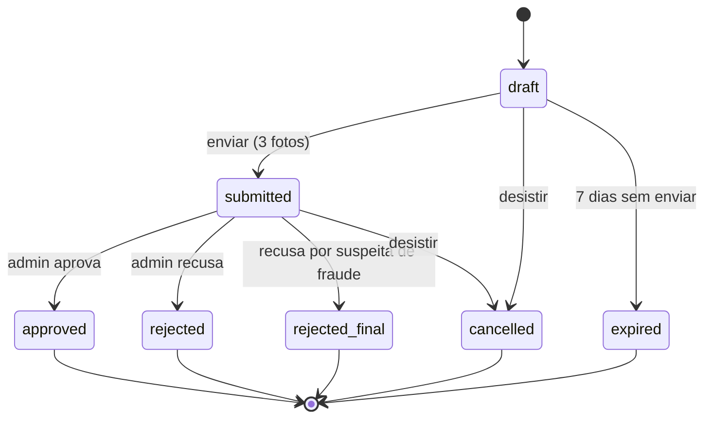

# PetHost — Módulo Hosts (anfitriões)

_Documento do que foi implementado · outubro de 2026 · complementa o [`PROJECT_STANDARDS.md`](PROJECT_STANDARDS.md), o [`modulo-auth.md`](modulo-auth.md) e o [`armazenamento-de-imagens.md`](armazenamento-de-imagens.md)_

O anfitrião — pessoa física ou empresa — é verificado por **aprovação manual do admin**: a pessoa cria a conta, abre uma **solicitação de cadastro** com CPF, tipo de documento, três fotos (na empresa, do representante legal, mais os dados da empresa) (frente, verso e selfie segurando o documento), e o admin confere e aprova ou recusa. O perfil de anfitrião (`host.hosts`) **só nasce na aprovação**: a tabela tem apenas gente verificada. As fotos ficam num **bucket privado** e são apagadas depois da decisão.

## Sumário

1. [Fluxo](#1-fluxo)
2. [Estrutura](#2-estrutura)
3. [Endpoints](#3-endpoints)
4. [Regras](#4-regras)
5. [Fotos e privacidade (LGPD)](#5-fotos-e-privacidade-lgpd)
6. [Banco](#6-banco)
7. [Configuração](#7-configuração)
8. [Anfitrião de demonstração](#8-anfitrião-de-demonstração)
9. [Stripe](#9-stripe)
10. [Testes](#10-testes)
11. [Decisões e pendências](#11-decisões-e-pendências)

---

## 1. Fluxo

```
Cadastro (POST /users/register, Auth) → conta de anfitrião; loga, mas ainda não é anfitriã
   │
   ▼
POST /hosts/me/application ──▶ draft ──PUT .../documents/{front|back|selfie}──▶ (3 fotos)
   │                             │                        POST .../submission
   │                             │                                 ▼
   │     7 dias sem enviar ──▶ expired                         submitted ──▶ fila do admin
   │     DELETE (desistir) ──▶ cancelled                           │
   │                                       ┌───────────────────────┼─────────────────────────┐
   │                                       ▼                       ▼                         ▼
   │                                   approved               rejected                rejected_final
   │                        cria o perfil em hosts      motivo + nova tentativa    suspected_fraud:
   │                        e-mail "aprovado"           (até 3 recusas)            sem nova tentativa
   ▼
Depois da aprovação: onboarding do Stripe Connect → cantinho (próximos passos)
```

Em toda decisão (e na desistência) as fotos são apagadas conforme o prazo de guarda (padrão: na hora).



## 2. Estrutura

```
src/Modules/Hosts/
├── Domain/          Host (perfil verificado), HostApplication (+ HostApplicationDocument), Cpf, Cnpj,
│                    CompanyAddress, enums (status, documento, foto, motivo), HostsErrors, repositórios
├── Application/     StartHostApplication, UpdateMyHostApplication, UploadHostApplicationDocument,
│                    SubmitMyHostApplication, CancelMyHostApplication, GetMyHostApplication,
│                    ListHostApplications, GetHostApplicationById, GetHostApplicationDocument,
│                    ApproveHostApplication, RejectHostApplication, PurgeHostApplications, GetMyHost,
│                    UpdateMyHost, Change/RemoveMyHostAvatar, DeactivateMyHost, ReactivateHost,
│                    SuspendHost (suspender, tirar, liberar CPF/CNPJ), GetHostById, ListHosts
│                    + portas IHostAccounts, IHostApplicationNotifier, IHostVerificationPolicy
├── Infrastructure/  HostsDbContext (schema host), migrations, repositórios, UoW (xmin + índices únicos),
│                    e-mail da decisão, tarefa de limpeza (BackgroundService), seed de demonstração
└── Presentation/    HostsController (/hosts/me, verificação), HostProfileController (perfil, foto, status),
                     HostsAdminController (/hosts, admin), HostApplicationsController (/host-applications, admin)
tests/Modules/Hosts/  Domain.UnitTests, Application.UnitTests, IntegrationTests
```

Mesmas regras de camada do §4. `PetHost.ArchitectureTests` (`HostsModuleBoundaryTests`) garante que o Hosts não referencia nenhum outro módulo: a conta vem do Auth por `IUserDirectory`/`IAccountRegistrar`, a trilha por `IAuditTrail`, as fotos por `IPrivateImageStorage`.

## 3. Endpoints

| Método | Rota | Acesso | O que faz | Sucesso |
|---|---|---|---|---|
| `GET` | `/api/v1/hosts/me` | anfitrião | Perfil verificado (404 `HOST_NOT_FOUND` antes da aprovação) | `200` |
| `GET` | `/api/v1/hosts/me/application` | anfitrião | "Minha verificação": última solicitação, `canStartNew`, `remainingAttempts`, `noticeVersion` | `200` |
| `POST` | `/api/v1/hosts/me/application` | anfitrião | Abre a solicitação (rascunho) | `201` |
| `PATCH` | `/api/v1/hosts/me/application` | anfitrião | Corrige CPF, tipo de documento e/ou (empresa) dados da empresa do rascunho — parcial | `200` |
| `PUT` | `/api/v1/hosts/me/application/documents` | anfitrião | Envia as fotos num pedido só: multipart com as partes `front`, `back` e `selfie` (tudo ou nada) | `200` |
| `POST` | `/api/v1/hosts/me/application/submission` | anfitrião | Envia para a fila do admin | `200` |
| `DELETE` | `/api/v1/hosts/me/application` | anfitrião | Desiste (rascunho ou em análise); fotos apagadas | `200` |
| `GET` | `/api/v1/host-applications?status=submitted` | admin | Fila (padrão `submitted`, as mais antigas primeiro) | `200` |
| `GET` | `/api/v1/host-applications/{applicationId}` | admin | Detalhe, com os dados da conta para comparar e a rota de cada foto | `200` |
| `GET` | `/api/v1/host-applications/{applicationId}/documents/{kind}` | admin | A imagem crua da foto, `Cache-Control: no-store` | `200` |
| `POST` | `/api/v1/host-applications/{applicationId}/approval` | admin | Aprova (com `reason`) e cria o anfitrião | `200` |
| `POST` | `/api/v1/host-applications/{applicationId}/rejection` | admin | Recusa (`rejectionReason` + `reason`) | `200` |

Anfitrião verificado (seção 4.2):

| Método | Rota | Acesso | O que faz | Sucesso |
|---|---|---|---|---|
| `PATCH` | `/api/v1/hosts/me` | anfitrião | Altera telefone, endereço e (empresa) nome fantasia e endereço da empresa. Identidade travada | `200` |
| `PUT` | `/api/v1/hosts/me/avatar` | anfitrião | Troca a foto de perfil (multipart, parte `file`; bucket público, como a do tutor) | `200` |
| `DELETE` | `/api/v1/hosts/me/avatar` | anfitrião | Tira a foto de perfil. Idempotente | `200` |
| `POST` | `/api/v1/hosts/me/deactivate` | anfitrião | Inativa perfil e conta (sessões caem na hora) | `200` |
| `POST` | `/api/v1/hosts/reactivate` | anônimo | Reativa conta e perfil com e-mail e senha; já com sessão | `200` |
| `GET` | `/api/v1/hosts` | admin | Todos os anfitriões, com a conta | `200` |
| `GET` | `/api/v1/hosts/{hostId}` | admin | Um anfitrião, pelo id do anfitrião | `200` |
| `POST` | `/api/v1/hosts/{hostId}/suspension` | admin | Suspende perfil e conta, com motivo | `200` |
| `DELETE` | `/api/v1/hosts/{hostId}/suspension` | admin | Tira a suspensão | `200` |
| `POST` | `/api/v1/hosts/{hostId}/identity-release` | admin | Libera o CPF/CNPJ de um anfitrião suspenso (disputa), com motivo | `200` |

Rate limit: as rotas do anfitrião usam a política `account-update` (20 a cada 15 min por usuário); inativar usa `account-sensitive`; reativar, `credentials`.

### 3.1 Abrir — `POST /api/v1/hosts/me/application`

Pessoa física:

```json
{ "cpf": "529.982.247-25", "documentType": "cnh", "acceptNotice": true }
```

Pessoa jurídica (empresa de hospedagem): o **CPF, o documento e a selfie são do representante legal** — a pessoa dona da conta — e vêm também os dados da empresa:

```json
{
  "personType": "pj",
  "cpf": "529.982.247-25", "documentType": "cnh", "acceptNotice": true,
  "cnpj": "11.222.333/0001-81", "legalName": "Pet Feliz Hospedagem LTDA", "tradeName": "Pet Feliz",
  "companyAddress": { "zipCode": "87013-000", "street": "Av. Brasil", "number": "1500", "neighborhood": "Centro", "city": "Maringá", "state": "PR" }
}
```

- `personType`: `pf` (padrão, pessoa física) ou `pj` (pessoa jurídica); maiúsculas também valem (`PF`, `PJ`). Escolhido aqui e **fixo** depois.
- `documentType`: `rg`, `cnh` ou `cin` (Carteira de Identidade Nacional).
- `acceptNotice` precisa ser `true`: a pessoa leu o aviso de como as fotos são usadas. A solicitação guarda a versão do aviso (`noticeVersion`), quando foi aceito e o IP.
- Empresa: CNPJ (aceita o alfanumérico), razão social, nome fantasia e endereço da empresa obrigatórios. Pessoa física não manda nenhum deles.

| Status | Código | Quando |
|---|---|---|
| `201` | — | Rascunho aberto. `Location: /api/v1/hosts/me/application`. |
| `400` | `VALIDATION_ERROR` | `cpf`, `documentType`, `acceptNotice`, `personType` e, na empresa, `cnpj`, `legalName`, `tradeName`, `companyAddress.*` — todos juntos. Pessoa física com dado de empresa: erro no campo `cnpj`. |
| `409` | `HOST_APPLICATION_ALREADY_EXISTS` | Já há uma solicitação aberta. |
| `409` | `HOST_CPF_ALREADY_REGISTERED` | O CPF já é de uma conta de **outro e-mail** — tutor, anfitrião ou solicitação aberta (seção 4.1). |
| `409` | `HOST_CNPJ_ALREADY_REGISTERED` | O CNPJ já é de um anfitrião ou de solicitação aberta de outra conta. |
| `422` | `HOST_ALREADY_VERIFIED` | A conta já é anfitriã. |
| `422` | `HOST_APPLICATION_BLOCKED` | Houve recusa por suspeita de fraude. |
| `422` | `HOST_APPLICATION_ATTEMPTS_EXCEEDED` | Já foram 3 recusas. |

### 3.2 Formato da solicitação (para a própria pessoa)

```json
{
  "id": "01a2...", "status": "draft", "personType": "pf", "cpf": "52998224725", "documentType": "cnh",
  "attemptNumber": 1,
  "documents": [ { "kind": "front", "uploadedAt": "2026-10-10T12:00:00+00:00" } ],
  "missingDocuments": ["back", "selfie"],
  "createdAt": "...", "updatedAt": "..."
}
```

Também podem vir `company` (só empresa: `{ cnpj, legalName, tradeName, address }`), `rejectionReason`, `submittedAt`, `reviewedAt`, `closedAt`, `documentsPurgedAt`. **Nunca** vem link, chave ou imagem das fotos, nem a nota interna do admin.

**Corrigir o rascunho** (`PATCH /hosts/me/application`): `cpf`, `documentType` e, só na empresa, `cnpj`, `legalName`, `tradeName` e `companyAddress` — todos **parciais**: só o que vier muda, inclusive campo a campo no endereço (o resto é completado com o rascunho, e o conjunto é revalidado; `complement` vazio limpa). Ex.: só `{ "cnpj": "..." }` troca o CNPJ e mantém razão social e endereço. Erro de formato volta `400 VALIDATION_ERROR` só no campo enviado. Dados de empresa numa solicitação de pessoa física: `422 HOST_APPLICATION_COMPANY_DATA_NOT_ALLOWED`. CPF e CNPJ novos passam pelas mesmas conferências da abertura.

### 3.3 Fotos — `PUT /api/v1/hosts/me/application/documents`

As três fotos vão **num pedido só**: `multipart/form-data` com uma parte por foto.

| Parte | Foto |
|---|---|
| `front` | Frente do documento |
| `back` | Verso do documento |
| `selfie` | A pessoa segurando o documento |

```bash
curl -X PUT http://localhost:8080/api/v1/hosts/me/application/documents \
  -H "Authorization: Bearer <token>" \
  -F "front=@frente.jpg" -F "back=@verso.jpg" -F "selfie=@selfie.jpg"
```

Mesmas regras de arquivo das outras fotos (JPG/JPEG, PNG ou WebP, até 5 MB **cada**, formato conferido pelo conteúdo; corpo acima de 24 MB = 413). Diferenças:

- Vai para o **bucket privado** (seção 5).
- O normal é mandar as três. Mandar só algumas troca só essas vagas (as outras ficam): serve para refazer uma foto ruim ainda no rascunho. Nenhuma das três partes: `400` no campo `documents`.
- **Tudo ou nada:** se uma foto for recusada (formato, tamanho, repetida), nenhuma entra, as que já tinham subido são apagadas e o erro aponta a parte (`"field": "back"`).
- Só no rascunho (`422 HOST_APPLICATION_NOT_EDITABLE` depois de enviada), conferido **antes** de enviar os arquivos.
- Trocar a foto de uma vaga apaga a anterior. A mesma imagem em duas vagas (no mesmo envio ou contra uma vaga que fica): `409 HOST_APPLICATION_DOCUMENT_ALREADY_EXISTS`. Trocar frente e verso entre si no mesmo envio passa.
- A trilha registra um `host_application.document_uploaded` por envio, com as vagas (`kinds`) e quantas foram trocadas (`replaced`).

### 3.4 Admin — detalhe e decisão

O detalhe (`GET /host-applications/{id}`) traz tudo o que a pessoa enviou, o `user` (nome, nascimento, e-mail, telefone, endereço) para comparar com o documento, `reviewNotes`, `reviewedBy` e, em cada foto, `path` — a rota que devolve a imagem.

**Checklist do admin** (tela): nome e nascimento do documento batem com a conta; o CPF bate (a CNH e a CIN trazem o CPF); o rosto do documento é o da selfie; a selfie mostra o rosto **segurando o documento**; documento na validade (CNH); 18+.

**Empresa, além disso:** consultar o CNPJ na Receita (comprovante de inscrição, consulta pública): situação **ativa**, razão social e endereço batendo com o enviado, e o representante (nome da conta) no **quadro de sócios e administradores (QSA)**. Não pedimos contrato social nem cartão CNPJ em foto: a consulta é pública.

```json
// POST .../approval
{ "reason": "Documento e selfie conferidos" }

// POST .../rejection
{ "rejectionReason": "selfie_mismatch", "reason": "Selfie não mostra o documento" }
```

| Motivo (`rejectionReason`) | O que a pessoa lê (e-mail) | Pode tentar de novo? |
|---|---|---|
| `document_illegible` | Não conseguimos ler o documento nas fotos… | Sim |
| `document_expired` | O documento está vencido… | Sim |
| `selfie_mismatch` | A selfie precisa mostrar o rosto e o documento… | Sim |
| `data_mismatch` | Os dados do documento não batem com o cadastro… | Sim |
| `missing_document` | Uma das fotos não era a esperada… | Sim |
| `other` | Não foi possível confirmar a identidade… | Sim |
| `suspected_fraud` | Não foi possível confirmar a identidade. Fale com o suporte. | **Não** (`rejected_final`) |

| Status | Código | Quando |
|---|---|---|
| `400` | `VALIDATION_ERROR` | `reason` vazio ou acima de 500; `rejectionReason` desconhecido. |
| `404` | `HOST_APPLICATION_NOT_FOUND` | Id inexistente. |
| `409` | `HOST_APPLICATION_CONFLICT` | Outro admin decidiu ao mesmo tempo (concorrência otimista). |
| `409` | `HOST_CPF_ALREADY_REGISTERED` | Na aprovação (pessoa física), outro anfitrião já tem o CPF. |
| `409` | `HOST_CNPJ_ALREADY_REGISTERED` | Na aprovação (empresa), outro anfitrião já tem o CNPJ. |
| `422` | `HOST_APPLICATION_NOT_UNDER_REVIEW` | A solicitação não está em `submitted`. |

## 4. Regras

- **Uma solicitação aberta por conta**, no domínio e no banco (índice único parcial).
- **Tentativas:** a 1ª solicitação é a tentativa 1; cada recusa comum soma 1. Depois de 3 recusas, só pelo suporte. Desistir e expirar não contam.
- **Recusa definitiva:** `suspected_fraud` fecha como `rejected_final` e bloqueia novas solicitações.
- **CPF da pessoa:** regra da seção 4.1. Formato igual ao do tutor: só dígitos, módulo 11, mascarado no `ToString()` e na trilha.
- **CNPJ único** entre anfitriões e solicitações abertas de contas diferentes (domínio + índices únicos `uq_hosts_cnpj` e `uq_host_applications_cnpj_open`).
- **Pessoa física ou jurídica** é escolhida ao abrir e não muda. Na empresa, o CPF, o documento e a selfie são do **representante legal** (a dona da conta); na trilha vão o tipo e o CNPJ (dado público da empresa).
- **Só o rascunho muda** (dados e fotos). Enviar exige as três fotos.
- **Aprovar cria o `Host`** — pessoa física ou empresa, com os dados conferidos —, `verified_at`, `verified_by` (o admin) e `application_id`, na mesma transação que fecha a solicitação.
- **Toda decisão do admin leva motivo** (`reason`, até 500): vai para `review_notes` e para a trilha.
- **Trilha:** `host_application.started`, `.updated`, `.document_uploaded`, `.submitted`, `.cancelled`, `.approved`, `.rejected`, `.viewed` (admin abriu), `.listed`, `.document_viewed` (admin abriu uma foto), `.expired`, `.documents_purged`. CPF só mascarado.
- **Pets da casa** (módulo Pets) só depois da aprovação: o Pets acha o anfitrião pelo `IHostDirectory`, que só enxerga `hosts`.

### 4.1 CPF entre tutor e anfitrião (restrição 9)

**O CPF identifica a pessoa; o e-mail identifica o login.** O mesmo CPF pode estar numa conta de tutor e numa de anfitrião só se as duas forem do **mesmo e-mail** (a mesma pessoa). CPF já usado por uma conta de outro e-mail, em qualquer papel, é recusado com `409` (`OWNER_CPF_ALREADY_REGISTERED` no tutor, `HOST_CPF_ALREADY_REGISTERED` no anfitrião).

| Peça | Onde | Papel |
|---|---|---|
| `ICpfHolderLookup` | `Shared.Contracts/Identity` | "Quais contas usam este CPF aqui?" — cada módulo que guarda CPF implementa: `OwnerCpfHolderLookup` (tutores) e `HostCpfHolderLookup` (anfitriões, inclusive representantes de empresa, e solicitações abertas). |
| `ICpfOwnership` | `Shared.Contracts/Identity` | "O CPF é de outra pessoa?" — junta todos os lookups e compara os e-mails das contas pelo `IUserDirectory` do Auth. A própria conta e as do mesmo e-mail não contam. |
| `CpfOwnership` | `Shared.Infrastructure/Identity` | A implementação (`AddCpfOwnership()` no `Program.cs`). |

Onde vale: cadastro do tutor (pelo e-mail, antes de a conta existir), troca de CPF do tutor, abertura e correção da solicitação de anfitrião. Os módulos continuam sem se referenciar (§5).

Consequência: como cada e-mail tem no máximo uma conta de anfitrião, uma pessoa representa no máximo uma empresa no PetHost.

### 4.2 Anfitrião verificado: perfil, status e ações do admin

Mesmo molde do tutor ([`modulo-owners.md`](modulo-owners.md) seções 3.3 a 3.7): conta (Auth) e perfil (Hosts) mudam juntos, com compensação se um dos lados falhar.

- **Trava de identidade.** Todo anfitrião é verificado, então **nome, nascimento, CPF, CNPJ e razão social** ficam travados no `PATCH /hosts/me`: mudar é `422 HOST_IDENTITY_LOCKED` (nova verificação, pelo suporte). Mandar o valor atual passa (o front pode mandar o formulário inteiro). Livre: telefone, endereço da conta e, na empresa, nome fantasia e endereço da empresa (parcial, completado com o atual). Pessoa física com dado de empresa: `422 HOST_NOT_A_COMPANY`. Antes da aprovação não há perfil: `404 HOST_NOT_FOUND`.
- **Foto** (`/hosts/me/avatar`): igual à do tutor — bucket público, URL em `user.avatarUrl`, troca apaga a anterior.
- **Inativar** (`POST /hosts/me/deactivate`): perfil e conta; sessões caem na hora; a conta de tutor da mesma pessoa não é afetada. Conta ainda sem perfil (verificação em andamento) inativa só a conta. **Reativar** (`POST /hosts/reactivate`, anônimo, e-mail e senha): conta e perfil; devolve a sessão com `host` (nulo se ainda não aprovado). Conta suspensa não volta: `403 AUTH_ACCOUNT_SUSPENDED`.
- **Suspender** (admin, com motivo): perfil e conta; login `403 AUTH_ACCOUNT_SUSPENDED`; a senha não desfaz. Idempotente. **Tirar a suspensão**: volta ao status que tinha e a pessoa recebe um e-mail avisando (pelo Auth).
- **Liberar CPF/CNPJ** (admin, com motivo, só de suspenso — `422 HOST_SUSPENSION_REQUIRED`): pessoa física libera o CPF; empresa, o CNPJ e o CPF do representante. Diferente do tutor, os valores **ficam no perfil como evidência** (`identity_released_at`), mas deixam de contar: os índices únicos ignoram o perfil liberado e o `ICpfOwnership` também. A suspensão desse perfil não sai mais (`422 HOST_IDENTITY_RELEASED`).
- **Trilha:** `host.updated` (campos da empresa, pelo nome), `host.deactivated`, `host.reactivated`, `host.suspended`, `host.suspension_lifted`, `host.identity_released` (CPF mascarado, CNPJ), `host.viewed` e `host.listed` (leitura do admin). Os dados da conta ficam com o Auth (`account.profile_updated`).

## 5. Fotos e privacidade (LGPD)

| Medida | Como |
|---|---|
| Bucket separado e **privado** | `Storage:PrivateBucketName` (sem política de leitura pública). A API se recusa a subir se for o mesmo bucket das fotos públicas. |
| Sem URL | O banco guarda a **chave** (`storage_key`), nunca uma URL. A pessoa não recebe link; o admin vê pela rota da API. |
| Acesso auditado | Cada abertura de foto pelo admin vira `host_application.document_viewed`, com o tipo da foto. Ler a solicitação vira `.viewed`. |
| Sem cache | Arquivo gravado com `Cache-Control: private, no-store`; a rota do admin responde `no-store`. |
| Prazo de guarda curto | `HostVerification:DocumentRetentionDays` (padrão **0 = apagar na decisão**). Desistência e rascunho expirado também apagam. |
| Limpeza automática | `HostApplicationsPurgeService` roda a cada `PurgeIntervalMinutes` (padrão 60): expira rascunhos com mais de `DraftLifetimeDays` (7) e apaga fotos com prazo vencido. A linha da solicitação fica, sem imagem (`documents_purged_at`), para a trilha. |
| Transparência | Aviso versionado (`HostVerificationNotice.CurrentVersion`), aceito antes de começar (`acceptNotice`), guardado com data e IP. |
| Minimização | Só frente, verso e selfie. Sem comprovante de endereço; o número do documento não é guardado. |

**Base legal** (para a documentação do projeto): a selfie usada para conferir a identidade é tratada como **dado pessoal sensível** (biométrico, LGPD art. 5º, II). A base é o **art. 11, II, "g"** — prevenção à fraude e segurança do titular em processos de identificação e cadastro em sistemas eletrônicos —, e não o consentimento (que poderia ser revogado no meio da análise). O aviso continua obrigatório por transparência. CPF e dados do cadastro: art. 7º, V.

> **Projeto acadêmico:** em desenvolvimento e na apresentação use **só documentos fictícios**. Para produção ficariam pendentes: política de privacidade, canal do titular, relatório de impacto (RIPD), DPA com o provedor do bucket (Supabase/R2) e avaliar a exigência de encarregado (DPO) por envolver dado sensível.
>
> Os metadados (EXIF com GPS, aparelho, data) das fotos saem antes de irem para o bucket privado ([`armazenamento-de-imagens.md`](armazenamento-de-imagens.md) seção 3.1).

## 6. Banco

Schema `host`. Migrations: `CreateHostsTable`, `AddHostApplications`.

```sql
CREATE TABLE host.host_applications (
    id                  uuid         NOT NULL,
    user_id             uuid         NOT NULL,          -- FK lógica: auth.users.id
    status              varchar(20)  NOT NULL,
    person_type         varchar(10)  NOT NULL,          -- pf ou pj
    cpf                 char(11)     NOT NULL,          -- na empresa: do representante legal
    cnpj                char(14),                       -- só empresa
    legal_name          varchar(160),                   -- só empresa
    trade_name          varchar(120),                   -- só empresa
    company_zip_code … company_state,                   -- endereço da empresa, como em hosts
    document_type       varchar(10)  NOT NULL,
    notice_version      varchar(20)  NOT NULL,
    notice_accepted_at  timestamptz  NOT NULL,
    notice_ip_address   varchar(45),
    attempt_number      integer      NOT NULL,
    submitted_at        timestamptz,
    reviewed_at         timestamptz,
    reviewed_by         uuid,                           -- o admin, sem FK
    rejection_reason    varchar(30),
    review_notes        varchar(500),
    closed_at           timestamptz,
    documents_purged_at timestamptz,
    created_at          timestamptz  NOT NULL,
    updated_at          timestamptz  NOT NULL,
    CONSTRAINT pk_host_applications PRIMARY KEY (id)
    -- CHECKs: status, document_type, person_type, attempt_number >= 1, ck_host_applications_company_data
    -- (empresa tem todos os dados da empresa; pessoa física, nenhum),
    -- rejection_reason preenchido só em rejected/rejected_final
);
CREATE UNIQUE INDEX uq_host_applications_user_id_open ON host.host_applications (user_id) WHERE status IN ('draft', 'submitted');
CREATE UNIQUE INDEX uq_host_applications_cpf_open     ON host.host_applications (cpf)     WHERE status IN ('draft', 'submitted');
CREATE UNIQUE INDEX uq_host_applications_cnpj_open    ON host.host_applications (cnpj)    WHERE cnpj IS NOT NULL AND status IN ('draft', 'submitted');
CREATE INDEX ix_host_applications_status_submitted_at ON host.host_applications (status, submitted_at);
CREATE INDEX ix_host_applications_user_id_created_at  ON host.host_applications (user_id, created_at);
CREATE INDEX ix_host_applications_closed_at_pending_purge ON host.host_applications (closed_at)
    WHERE closed_at IS NOT NULL AND documents_purged_at IS NULL;

CREATE TABLE host.host_application_documents (
    id             uuid         NOT NULL,
    application_id uuid         NOT NULL REFERENCES host.host_applications (id) ON DELETE CASCADE,
    kind           varchar(10)  NOT NULL,               -- front, back, selfie
    storage_key    varchar(200) NOT NULL,               -- chave no bucket privado
    content_hash   char(64)     NOT NULL,               -- SHA-256
    size_bytes     bigint       NOT NULL,
    uploaded_at    timestamptz  NOT NULL,
    CONSTRAINT pk_host_application_documents PRIMARY KEY (id)
);
CREATE UNIQUE INDEX uq_host_application_documents_application_id_kind ON host.host_application_documents (application_id, kind);
```

Concorrência otimista pelo `xmin` do Postgres (coluna de sistema, não entra na migration): dois admins decidindo a mesma solicitação → o segundo recebe `409`.

`host.hosts` ganhou: `application_id` (único), `verified_at`, `verified_by`, `identity_released_at` (CPF/CNPJ liberado pelo admin; os índices `uq_hosts_cpf_individual` e `uq_hosts_cnpj` ignoram o perfil liberado) e o espelho da conta conectada no Stripe — `stripe_details_submitted`, `stripe_charges_enabled`, `stripe_payouts_enabled` (padrão `false`), `stripe_disabled_reason`, `stripe_onboarded_at`, `stripe_synced_at`. Detalhes no [`dicionario-de-dados.md`](dicionario-de-dados.md).

```bash
dotnet dotnet-ef migrations add <Nome> --project src/Modules/Hosts/PetHost.Modules.Hosts.Infrastructure --startup-project src/Host/PetHost.Api --context HostsDbContext --output-dir Persistence/Migrations
```

## 7. Configuração

| Chave | Variável (`.env`) | Padrão | Observação |
|---|---|---|---|
| `Storage:PrivateBucketName` | `STORAGE_PRIVATE_BUCKET_NAME` | `pethost-documents` | Bucket **sem** leitura pública. Obrigatório e diferente de `Storage:BucketName`. |
| `HostVerification:DocumentRetentionDays` | `HOST_VERIFICATION_DOCUMENT_RETENTION_DAYS` | `0` | Dias que as fotos ficam depois que a solicitação fecha. |
| `HostVerification:DraftLifetimeDays` | `HOST_VERIFICATION_DRAFT_LIFETIME_DAYS` | `7` | Rascunho mais velho que isso expira. |
| `HostVerification:PurgeEnabled` | — | `true` | Liga a limpeza em segundo plano (os testes desligam). |
| `HostVerification:PurgeIntervalMinutes` | — | `60` | Intervalo da limpeza. |
| `Seed:DemoHost:*` | `SEED_DEMO_HOST_*` | desligado | Seção 8. |

Configuração inválida (prazo negativo, intervalo zero, bucket privado igual ao público) **derruba a subida**.

## 8. Anfitrião de demonstração

Para a apresentação (por exemplo, mostrar um repasse do Stripe sem passar pela fila do admin no dia), o seed cria na subida um anfitrião **já verificado**:

```env
SEED_DEMO_HOST_ENABLED=true
SEED_DEMO_HOST_EMAIL=dona.cida@pethost.local
SEED_DEMO_HOST_PASSWORD=Troque@Esta123
SEED_DEMO_HOST_CPF=123.456.789-09
SEED_DEMO_HOST_STRIPE_ACCOUNT_ID=acct_...   # opcional: conta conectada criada no Dashboard do Stripe
```

- Cria a conta pelo contrato do Auth (`IAccountRegistrar`, mesmas regras do cadastro) e passa pelo **mesmo fluxo do domínio** (abre, "fotos" de mentira que nunca vão ao bucket, envia, aprova com o ator `5eed0000-0000-7000-8000-000000000001`, apaga as fotos). Não existe atalho no domínio para criar anfitrião sem verificação.
- Idempotente pelo e-mail; nunca troca a senha de uma conta que já existe. Se o perfil não puder ser gravado, a conta é desfeita.
- Nome, telefone, nascimento e endereço têm padrão fictício (`Seed:DemoHost:FullName`, `:Phone`, `:BirthDate`, `:ZipCode`, `:Street`, `:Number`, `:Neighborhood`, `:City`, `:State`).
- **Só dados fictícios.** Com Stripe em modo de teste, a conta conectada também é de teste.

## 9. Stripe

Ordem: **verificação (admin) → onboarding do Stripe Connect → cantinho**. O onboarding só é liberado depois da aprovação, para não criar conta conectada de quem será recusado. O cantinho aparece na busca com anfitrião verificado + `stripe_payouts_enabled` + cantinho ativo.

- `Host.LinkStripeAccount` guarda o `acct_...` (usado hoje pelo seed; amanhã pelo módulo de pagamentos no onboarding).
- O webhook `account.updated` atualizará o espelho (`stripe_*`) — responsabilidade do módulo de pagamentos, ainda não implementado.
- Pessoa física → `individual` com nome, nascimento, CPF (`id_number`), telefone e endereço da conta. O que o Stripe pedir além disso é coletado no onboarding dele.
- Pessoa jurídica → `company` com razão social (`company.name`), CNPJ (`tax_id`), endereço da empresa e telefone, mais o **representante** (`relationship.representative`) com os dados da conta e o CPF da solicitação.

## 10. Testes

| Projeto | O que cobre | Resultado |
|---|---|---|
| `Hosts.Domain.UnitTests` | `HostApplication` (abrir com histórico, tentativas, bloqueio, rascunho, fotos, foto repetida, enviar, aprovar criando o `Host`, recusar comum/definitiva, desistir, expirar, apagar fotos), valores dos enums, `Host` (verificação, `LinkStripeAccount`), `Cpf`, `Cnpj`, `CompanyAddress`, `CompanyDetails`; solicitação de empresa (abrir, corrigir os dados, recusar dados de empresa em pessoa física, aprovar criando o anfitrião empresa); ciclo do `Host` (inativar/reativar idempotentes, suspender, liberar CPF/CNPJ só de suspenso, suspensão que não sai depois da liberação, contato da empresa) | 126 ✅ |
| `Hosts.Application.UnitTests` | Todos os casos de uso: abrir (CPF em uso, já anfitriã, corrida), corrigir, fotos (posse antes do upload, troca apaga a anterior, compensação quando gravar falha ou lança), enviar, desistir (prazo de guarda), fila/detalhe/foto do admin com trilha, aprovar (cria o host, apaga fotos, e-mail, conflito), recusar (pode ou não tentar de novo), limpeza, validadores, pessoa jurídica (CNPJ em uso, campos de empresa todos juntos na abertura, correção parcial da empresa completada com o rascunho, dado de empresa em pessoa física), CPF de outra pessoa pelo `ICpfOwnership`; perfil com a identidade travada (valor igual passa), contato da empresa, compensação, foto, inativar/reativar (com e sem perfil), suspender/tirar/liberar com compensação e trilha, leitura do admin | 96 ✅ |
| `Hosts.IntegrationTests` | Ponta a ponta com Postgres, Redis e RustFS: fluxo completo até a aprovação, fotos no bucket privado e não no público, bucket privado sem leitura anônima, resposta da pessoa sem link, `no-store` na foto do admin, 403 para não admin, 400/409/422 das regras, recusa e nova tentativa, bloqueio por fraude, desistência apagando fotos, limpeza de rascunho abandonado, trilha, seed de demonstração (verificado, com Stripe, idempotente), empresa ponta a ponta até o anfitrião PJ, 400/409 de empresa, restrição 9 nos dois sentidos (tutor e anfitrião: mesmo e-mail pode, outro e-mail não), e o ciclo do anfitrião (PATCH com trava, foto no bucket, inativar e reativar, suspensão que a senha não desfaz, liberação do CPF para a dona verdadeira, 403 para não admin, trilha) | 38 ✅ |

## 11. Decisões e pendências

| Decisão | Por quê |
|---|---|
| Upload próprio + aprovação manual, em vez de só o Stripe | Decisão sua: o admin confere documento e selfie de verdade, e o Stripe Identity não está disponível para conta brasileira (out/2026). Grátis e funciona hoje. |
| Solicitação em tabela própria; `hosts` só com verificados | Decisão sua. O caso de verificação tem ciclo, histórico e fotos; o perfil de anfitrião fica limpo. |
| Conta de login criada no cadastro | Decisão sua: a pessoa acompanha o status e refaz uma foto sem recomeçar. |
| Fotos apagadas na decisão (prazo configurável) | Menor exposição (LGPD). Prazo maior exige justificativa (ex.: apurar fraude). |
| Recusa comum permite nova tentativa (até 3); fraude é definitiva | Foto ruim é o caso comum (público 60+); o limite segura quem testa documento falso. |
| RG, CNH e CIN | A CIN substitui o RG desde 2022. |
| Pessoa jurídica com o documento do representante, sem foto de documento da empresa | O representante é a dona da conta (a pessoa verificada). A empresa é conferida na consulta pública do CNPJ (situação, endereço, QSA), sem pedir contrato social. |
| CPF único por pessoa entre os módulos (restrição 9) por contrato em `Shared.Contracts` | Cada módulo informa quem usa o CPF (`ICpfHolderLookup`); a regra compara e-mails num lugar só (`ICpfOwnership`), sem os módulos se referenciarem. |
| Stripe só depois da aprovação | Não cria conta conectada para quem será recusado. |
| Base legal art. 11, II, "g" em vez de consentimento | Consentimento revogável quebraria a análise; o aviso continua obrigatório. |
| Bucket privado no mesmo provedor/credencial do público | Simples para o MVP. Em produção, um projeto/credencial separado reduz o impacto de uma chave vazada. |
| Motivo obrigatório também na aprovação | §15: toda ação do admin sobre dado de outra pessoa leva motivo. |

| # | Pendência | Impacto |
|---|---|---|
| 1 | ~~CPF entre papéis (restrição 9).~~ | Feito: seção 4.1. |
| 2 | ~~EXIF das fotos não é removido.~~ | Feito: metadados removidos em todo upload ([`armazenamento-de-imagens.md`](armazenamento-de-imagens.md) seção 3.1). |
| 3 | ~~Pessoa jurídica.~~ | Feito: seção 3.1. Falta só o anfitrião de demonstração em versão empresa (o seed cria pessoa física). |
| 4 | ~~Trava de identidade depois da aprovação.~~ | Feito: seção 4.2. Falta corrigir nome/nascimento **antes** da aprovação (a conta ainda não tem rota de edição; hoje é cancelar e falar com o suporte). |
| 5 | ~~Inativar, reativar e suspender anfitrião.~~ | Feito: seção 4.2 (também liberar CPF/CNPJ, foto e listagem do admin). Ao montar o cantinho: anfitrião inativo ou suspenso some da busca. |
| 6 | Mudar o tipo de documento mantém as fotos já enviadas. | O admin vê a divergência e recusa com `missing_document`; dá para limpar as fotos na troca se virar problema. |
| 7 | Onboarding do Stripe e webhook `account.updated`. | Módulo de pagamentos. |
