# PetHost — Módulo Payments (pagamentos)

_Documento do que foi implementado · outubro de 2026 · complementa o [`PROJECT_STANDARDS.md`](PROJECT_STANDARDS.md), o [`escopo-mvp.md`](escopo-mvp.md) (seção 6), o [`modulo-bookings.md`](modulo-bookings.md) e o [`dicionario-de-dados.md`](dicionario-de-dados.md)_

O **pagamento** é como o tutor paga a reserva aceita — **Pix ou cartão, à vista ou em até 6 parcelas**, sem sair do PetHost (checkout transparente) — e para onde o dinheiro vai depois: fica guardado com o PetHost, vai **90% para o anfitrião** no check-out, volta ao tutor no cancelamento e segue a decisão do banco numa contestação. Tudo em **modo de teste** do Stripe.

## Sumário

- [1. Visão geral](#1-visão-geral)
- [2. Ciclos de status](#2-ciclos-de-status)
- [3. Estrutura](#3-estrutura)
- [4. Endpoints](#4-endpoints)
- [5. Parcelas](#5-parcelas)
- [6. Checkout transparente](#6-checkout-transparente)
- [7. Confirmação pelo webhook](#7-confirmação-pelo-webhook)
- [8. Repasse ao anfitrião](#8-repasse-ao-anfitrião)
- [9. Cancelamento e reembolso](#9-cancelamento-e-reembolso)
- [10. Parcela vencida](#10-parcela-vencida)
- [11. Contestação (chargeback)](#11-contestação-chargeback)
- [12. Reconciliação e manutenção](#12-reconciliação-e-manutenção)
- [13. E-mails e trilha](#13-e-mails-e-trilha)
- [14. Banco](#14-banco)
- [15. Comunicação com outros módulos](#15-comunicação-com-outros-módulos)
- [16. Configuração](#16-configuração)
- [17. Testando com o Stripe de teste](#17-testando-com-o-stripe-de-teste)
- [18. Testes](#18-testes)
- [19. Decisões e pendências](#19-decisões-e-pendências)

---

## 1. Visão geral

| Peça | Como é |
|---|---|
| Modelo no Stripe | **Cobrança e transferência separadas** (escopo, seção 6): a cobrança é da plataforma; o repasse é uma `Transfer` para a conta conectada do anfitrião com `source_transaction` = a cobrança de origem. Sem `application_fee` nem `on_behalf_of`. |
| Meios | `card` e `pix` no mesmo `PaymentIntent` (BRL). O app usa o **Payment Element**: cartão e QR code do Pix na própria página. |
| Parcelas | **Controladas pelo PetHost**: cada parcela é uma cobrança própria no Stripe. O Stripe **não** oferece parcelamento no cartão para contas brasileiras (out/2026: só México, Japão e Mastercard Installments), então o "6x" é nosso — o tutor paga cada parcela quando ela vence, com Pix ou cartão. |
| Confirmação | **Só pelo webhook** (ou pela releitura pedida pelo app), nunca pelo retorno do navegador. O evento é só um aviso: a cobrança é relida na API. |
| Dinheiro | Em **centavos inteiros** (`bigint`), como o Stripe. A reserva continua em reais; a API responde em reais. |

O agregado `Payment` **decide** o que pedir ao Stripe e **registra** o resultado; quem chama o Stripe é a Application (`PaymentReconciler`). Repetir a reconciliação nunca repete um pedido já registrado, e toda escrita no Stripe leva **chave de idempotência derivada da parcela** — retry, webhook duplicado ou gravação que falhou depois do Stripe nunca cobram, devolvem ou repassam duas vezes.

## 2. Ciclos de status

**Reserva** (mudou com o pagamento — detalhes em [`modulo-bookings.md`](modulo-bookings.md)):

```mermaid
stateDiagram-v2
    [*] --> requested: tutor pede
    requested --> accepted: anfitrião aceita (segura a vaga; 24h para pagar)
    accepted --> confirmed: 1ª parcela paga (webhook)
    accepted --> expired: 24h sem pagar
    accepted --> cancelled: tutor ou anfitrião
    confirmed --> cancelled: tutor, anfitrião ou plataforma (parcela vencida)
    confirmed --> in_progress: check-in
    in_progress --> completed: check-out (libera o repasse)
```



**Pagamento** (`payments.status`):

| Status | Quando |
|---|---|
| `pending` | Plano escolhido; a 1ª parcela ainda não foi paga. Dá para trocar o número de parcelas. |
| `active` | Pago em parte (há parcelas a vencer). |
| `paid` | Todas as parcelas pagas. |
| `cancelled` | A reserva foi cancelada, expirou ou sumiu: parcelas em aberto canceladas; o que foi pago segue o reembolso. |

**Parcela** (`payment_installments`): `status` (`pending` → `processing` → `paid`; `overdue`; `cancelled`), e três situações paralelas da mesma cobrança: `refund_status` (`none`, `pending`, `succeeded`, `failed`), `payout_status` (`held`, `transferred`, `cancelled`, `reversed`) e `dispute_status` (`none`, `open`, `won`, `lost`).

## 3. Estrutura

```
src/Modules/Payments/
├── Domain/          Payment (agregado), Installment, PaymentId, PaymentClock, enums + ...Values,
│                    ChargeSnapshot/RefundSnapshot/DisputeSnapshot (o Stripe relido), PaymentAction (o que pedir),
│                    BookingStage, OverdueCheck, InstallmentChange, PayableBooking, PaymentsErrors,
│                    IPaymentRepository, IPaymentsUnitOfWork
├── Application/     ChoosePaymentPlan, StartInstallmentPayment, GetBookingPayment, SyncBookingPayment,
│                    SyncPaymentIntent (webhook), ReconcileBookingPayment (aviso do Bookings),
│                    RunPaymentsMaintenance, ListMyPayouts, ListPaymentIssues,
│                    PaymentReconciler, PaymentEffects(+Publisher), PaymentCommitter, PaymentAccess,
│                    portas IStripePayments, IPaymentBookings, IPaymentParties, IPaymentNotifier
├── Infrastructure/  PaymentsDbContext (schema payment), PaymentConfiguration, PaymentRepository,
│                    PaymentsUnitOfWork, StripePaymentsGateway, PaymentWebhookHandler (+ stripe_events),
│                    adaptadores (PaymentBookings, PaymentParties), contratos (PaymentDirectory,
│                    BookingPaymentsSync), PaymentEmailNotifier, PaymentsMaintenanceService
└── Presentation/    BookingPaymentController (/bookings/{id}/payment), PaymentsController (/payments)
```

## 4. Endpoints

| Método | Rota | Quem | O quê |
|---|---|---|---|
| `GET` | `/api/v1/bookings/{bookingId}/payment` | owner, host, admin | O pagamento: parcelas e situação de cada uma (`amount` sem acréscimo; em aberto, `amountDue` = quanto pagar agora; `lateFee` quando há multa e juros). Antes do plano: `status = not_started`, `paymentDeadline` e `options` (1x a 6x). O anfitrião vê `payout`; o admin, também `stripe` (ids para o Dashboard). |
| `PUT` | `/api/v1/bookings/{bookingId}/payment` | owner | Escolhe (ou troca, antes de pagar) o número de parcelas: `{ "installmentCount": 3 }`. |
| `POST` | `/api/v1/bookings/{bookingId}/payment/installments/{n}/payment-session` | owner | Abre o checkout da parcela `n`: devolve `clientSecret`, `publishableKey`, `paymentIntentId`, `amount` (quanto pagar agora, com multa e juros se atrasada), `lateFee` (o acréscimo incluído em `amount`), `pixExpiresAt` (Unix) e `paymentMethods` (`card`, `pix`). |
| `POST` | `/api/v1/bookings/{bookingId}/payment/synchronization` | owner, admin | Relê agora no Stripe e reconcilia (o app chama ao voltar do Payment Element; funciona sem webhook). |
| `GET` | `/api/v1/payments/payouts/me?page=&pageSize=` | host | "Ganhos": por reserva paga, repassado, guardado e estornado, e o repasse de cada parcela (com o `lateFee` pago pelo tutor). Paginado. |
| `GET` | `/api/v1/payments/issues` | admin | Pendências: `installment_overdue`, `dispute_open`, `dispute_lost`, `refund_failed`, `payout_failed`, `payout_reversal_failed`, com o objeto do Stripe. Lista administrativa, sem paginação. |
| `POST` | `/api/v1/stripe/webhooks` | Stripe (assinatura) | Endpoint único (Shared). O Payments trata os eventos de cobrança, reembolso e contestação (seção 7). |

Reserva de outra pessoa: `404 PAYMENT_BOOKING_NOT_FOUND` (§8). As rotas que criam algo no Stripe (`PUT` do plano, `payment-session`, `synchronization`) usam a política de rate limit `account-update`.

**Erros do módulo:** `PAYMENT_BOOKING_NOT_FOUND`, `PAYMENT_NOT_FOUND`, `PAYMENT_OWNER_NOT_FOUND`, `PAYMENT_HOST_NOT_FOUND` (404); `PAYMENT_BOOKING_NOT_AWAITING_PAYMENT`, `PAYMENT_WINDOW_CLOSED`, `PAYMENT_INSTALLMENT_COUNT_NOT_ALLOWED`, `PAYMENT_PLAN_LOCKED`, `PAYMENT_CLOSED`, `PAYMENT_INSTALLMENT_ALREADY_PAID`, `PAYMENT_INSTALLMENT_PROCESSING`, `PAYMENT_INSTALLMENT_OUT_OF_ORDER`, `PAYMENT_STRIPE_REQUEST_REJECTED` (422); `PAYMENT_INSTALLMENT_NOT_FOUND` (404); `PAYMENT_CONFLICT` (409); `PAYMENT_STRIPE_UNAVAILABLE` (503); validação em `installmentCount`, `installmentNumber`, `page`, `pageSize` (400).

## 5. Parcelas

| Regra | Detalhe |
|---|---|
| Quantas | **1 a 6**; cada parcela de pelo menos **R$ 50,00** (`MinInstallmentCents`). Reserva de R$ 121,00 vai até 2x; abaixo de R$ 100,00, só à vista. Mais do que isso: `422 PAYMENT_INSTALLMENT_COUNT_NOT_ALLOWED`. |
| Divisão | Partes iguais; os centavos que sobram vão na 1ª (R$ 300,01 em 3x = 100,01 + 100,00 + 100,00). |
| 1ª parcela | Vence no **prazo de pagamento da reserva**: 24h depois do aceite, sem passar do fim do dia de chegada (Brasília). É ela que **confirma** a reserva. Fora do prazo: `422 PAYMENT_WINDOW_CLOSED` (e a reserva expira). |
| As outras | Vencem **a cada 30 dias**, no fim do dia (Brasília), contando do dia em que o plano foi escolhido — **inclusive depois da estadia** (decisão do produto: dá para parcelar mesmo reservando perto da chegada). |
| Ordem | Pagas em ordem; **adiantar a próxima pode**. Pular: `422 PAYMENT_INSTALLMENT_OUT_OF_ORDER`. |
| Trocar o plano | Só enquanto nada foi pago nem está sendo pago (`422 PAYMENT_PLAN_LOCKED`). As cobranças abertas das parcelas antigas são canceladas no Stripe; as novas parcelas têm ids novos. |
| Juros do parcelamento | Nenhum: parcelar não custa nada a mais. As taxas do Stripe de cada cobrança saem dos 10% do PetHost. Só a parcela **paga com atraso** tem multa e juros (seção 10). |

## 6. Checkout transparente

1. O tutor escolhe as parcelas: `PUT /bookings/{id}/payment`.
2. Para cada parcela: `POST .../installments/{n}/payment-session` → o app monta o Payment Element com `publishableKey` e `clientSecret` (`stripe.elements({ clientSecret })`) e chama `stripe.confirmPayment(...)`. No **Pix**, o QR code aparece na página e vale até `pixExpiresAt`; no **cartão**, o 3DS acontece dentro do Element.
3. Depois de pagar, o app pode chamar `POST .../payment/synchronization` para mostrar o resultado na hora; a fonte da verdade continua sendo o webhook.

A cobrança aberta da parcela é **reaproveitada** (chamar de novo devolve o mesmo `clientSecret`); se o Pix anterior venceu (ou o cartão foi recusado), o valor é atualizado para o do dia (multa e juros crescem com o atraso) e o prazo do próximo QR code é renovado — com um QR code ainda valendo, o valor dele fica como está (no máximo 24h de juros a menos); cancelada, outra é criada (a tentativa entra na chave de idempotência). **O QR code nunca vale além do prazo da parcela**: na 1ª, o prazo da reserva; nas outras, antes do check-in, o fim da tolerância — senão o tutor pagaria uma reserva já cancelada. Validade padrão de 24h (`PixLifetime`). Se o Stripe já recebeu (webhook atrasado), a chamada relê, reconcilia e responde `422 PAYMENT_INSTALLMENT_ALREADY_PAID` / `..._PROCESSING`.

## 7. Confirmação pelo webhook

Eventos tratados (`PaymentWebhookHandler`): `payment_intent.succeeded`, `.processing`, `.payment_failed`, `.canceled`; `charge.refunded`, `charge.refund.updated`, `refund.created`, `refund.updated`, `refund.failed`; `charge.dispute.created`, `.updated`, `.closed`, `.funds_withdrawn`, `.funds_reinstated`.

- O objeto do evento (`pi_`, `ch_`, `re_`, `dp_`) leva à cobrança da parcela; a cobrança é **relida** (`PaymentIntent` com `latest_charge`, os reembolsos e a contestação) e aplicada ao agregado (`ApplyCharge`). Por isso o webhook é **idempotente e imune a evento fora de ordem**.
- **`payment.stripe_events`** guarda o id de cada evento tratado: repetido é ignorado. É gravado **depois** de tratar — evento que falhou não fica marcado e volta quando o Stripe reenviar. O corpo do evento **não** é guardado (traz dados do tutor e não é preciso: a cobrança é relida).
- Cobrança que não é de nenhuma parcela: `200`, ignorada. **Stripe fora do ar ou conflito de gravação: `500`**, e o Stripe reenvia.
- A 1ª parcela paga confirma a reserva pelo contrato `IBookingPaymentOutcomes`. Se a reserva foi cancelada ou expirou enquanto o tutor pagava, o dinheiro **volta inteiro** automaticamente.

## 8. Repasse ao anfitrião

- **Quando:** no **check-out** (`completed`), cada parcela paga é repassada; parcela paga **depois** do check-out é repassada assim que é paga.
- **Quanto:** **90%** do que ficou retido na parcela (o que o tutor pagou — valor + multa e juros por atraso — menos o reembolso), arredondado para baixo; o centavo que sobra e os 10% ficam com o PetHost (`platform_fee_cents`), e é deles que sai a taxa do Stripe. Regra do dicionário: `platform_fee_cents + host_payout_cents = amount_cents + late_fee_cents − refunded_cents`.
- **Como:** `Transfer` para a conta conectada do anfitrião (`hosts.stripe_account_id`, pelo `IHostDirectory`), com `source_transaction` = a cobrança da parcela e `transfer_group` = a reserva. Com `source_transaction`, o repasse usa o dinheiro daquela cobrança mesmo antes de ele ficar disponível no saldo (Pix e cartão liquidam em dias diferentes).
- **Falhou** (sem conta conectada, conta bloqueada): o repasse fica `held` com o motivo (`payout_failure_code`, ex.: `NO_CONNECTED_ACCOUNT`) e a manutenção tenta de novo; aparece em `GET /payments/issues` (`payout_failed`).

## 9. Cancelamento e reembolso

O percentual vem da reserva (`refundPercentage`, regra do Bookings) e vale **sobre o que já foi pago** (acréscimo por atraso incluído, se houve). Parcelas ainda não pagas são **canceladas** (e as cobranças abertas delas, canceladas no Stripe).

| Quem / como | Reserva | Reembolso de cada parcela paga | O que fica retido |
|---|---|---|---|
| Anfitrião cancela | confirmada | 100% | nada (repasse cancelado) |
| Tutor, 48h+ antes da chegada | confirmada | 100% | nada |
| Tutor, menos de 48h antes | confirmada | **50%** | 50% → **repassado na hora** 90/10 (R$ 121,00: volta R$ 60,50, a anfitriã recebe R$ 54,45) |
| Plataforma (parcela vencida antes do check-in) | confirmada | 100% | nada |
| Expirou / cancelada antes de pagar, mas o pagamento chegou depois | aceita | 100% | nada |

O reembolso é pedido antes do repasse; o repasse do que ficou retido sai na reconciliação seguinte (na mesma chamada). Pix é devolvido para a conta de origem e pode levar um tempo (`refund_status = pending` até o Stripe confirmar). **Reembolso que falha** (`failed`): alerta ao admin, nada é repassado daquela parcela e ela aparece em `GET /payments/issues` (`refund_failed`).

## 10. Parcela vencida

Vale para as parcelas da 2ª em diante; a 1ª vencida é a **expiração da reserva** (Bookings). Tolerância de **24h** depois do vencimento (`OverdueGrace`).

| Quando venceu | O que acontece |
|---|---|
| **Antes do check-in** (reserva aceita ou confirmada) | A plataforma **cancela a reserva** (`cancelledBy = platform`, 100%) e devolve tudo o que foi pago. E-mail aos dois lados. |
| **Depois do check-in** (em andamento ou concluída) | A reserva continua; a parcela fica **`overdue`** (ainda pode ser paga), o tutor e o admin são avisados e o **tutor não pede estadia nova** (`422 BOOKING_OWNER_PAYMENT_OVERDUE`) até pagar. O anfitrião recebe só o que foi pago — o risco de calote fica com ele (decisão do produto). |

**Multa e juros** (`Payment.LateFeeFor`): parcela paga depois da tolerância paga **multa de 2%** (o máximo do CDC) e **juros de 1% ao mês**, simples, por dia de calendário (Brasília) desde o dia do vencimento (mês de 30 dias), arredondando o meio para cima. Dentro das 24h de tolerância, nada a mais. A 1ª parcela nunca tem acréscimo (vencida, a reserva expira).

| Exemplo (parcela de R$ 100,00, vencida em 10/11) | Multa | Juros | Total |
|---|---|---|---|
| Paga em 11/11 (tolerância) | — | — | R$ 100,00 |
| Paga em 12/11 (2 dias) | R$ 2,00 | R$ 0,07 | R$ 102,07 |
| Paga em 10/12 (30 dias) | R$ 2,00 | R$ 1,00 | R$ 103,00 |

O acréscimo entra na **cobrança** do Stripe (o checkout pede o `amountDue`) e fica gravado na parcela (`late_fee_cents`, conferido com o valor que o Stripe recebeu). Ele segue a parcela: o repasse é 90% do que o tutor pagou e o reembolso conta sobre o que foi pago. Na prática só acontece **depois do check-in** — antes, a parcela vencida cancela a reserva. Não há negativação (seção 19).

**Lembretes:** 3 dias antes de cada vencimento (da 2ª parcela em diante), um e-mail ao tutor, uma vez só. Parcela em atraso: o aviso de atraso já mostra o valor com multa e juros, e o tutor recebe **um lembrete a cada 7 dias** (`OverdueReminderInterval`) com o valor atualizado, até pagar.

## 11. Contestação (chargeback)

Só no cartão (o Pix não tem contestação no Stripe). As perdas ficam com a plataforma no Stripe (`losses_collector = application`, conta Express), por isso o PetHost **estorna o repasse** quando perde.

| Situação | Repasse da parcela |
|---|---|
| Contestação **aberta** | Retido: nada se move naquela parcela (nem reembolso, nem repasse). Alerta ao admin. |
| **Ganha** (`won`, `warning_closed`, `prevented`) | Segue a regra normal. |
| **Perdida antes do repasse** | Cancelado: o anfitrião não recebe a parte daquela parcela. |
| **Perdida depois do repasse** | **Estornado** do anfitrião (`TransferReversal` do valor repassado). E-mail ao anfitrião e alerta ao admin. Estorno que falha (saldo, conta fechada): alerta uma vez, a manutenção tenta de novo, `payout_reversal_failed` nas pendências. |

As evidências da contestação são enviadas pelo admin no **Dashboard do Stripe** (não há rota para isso no MVP); o admin acha o caso em `GET /payments/issues` (com o `dp_...`).

## 12. Reconciliação e manutenção

Webhook, aviso do Bookings (cancelou, expirou, concluiu), releitura pedida pelo app e manutenção periódica passam pelo **mesmo caminho** (`PaymentReconciler`): (1) 1ª parcela paga confirma a reserva; (2) parcela vencida cancela a reserva ou entra em atraso; (3) lembretes (do vencimento e o semanal do atraso); (4) pedidos ao Stripe que o agregado decide (`Reconcile`) — cancelar cobranças, reembolsar, repassar, estornar — em rodadas até não sobrar nada. Pedido que falha no Stripe fica para a próxima vez; o que deu certo é gravado. Efeitos (trilha e e-mails) só saem **depois** de gravar.

**Manutenção** (`PaymentsMaintenanceService`, a cada `Payments:MaintenanceIntervalMinutes`, padrão 15): revisita até 100 pagamentos que ainda têm o que fazer (`settled_at` nulo), um por vez — relê o que pode ter mudado sem webhook (**cobrança aberta** — o tutor pode ter pago e o webhook se perdido —, cobrança em processamento, reembolso a caminho, contestação aberta) e reconcilia. Assim, mesmo sem webhook nenhum, um pagamento feito é confirmado em até um intervalo. Um pagamento chega ao fim (`settled_at`) quando nada mais será cobrado, devolvido ou repassado. Os testes desligam a tarefa e chamam o comando.

O aviso do Bookings é **best-effort**: se falhar (Stripe fora, conflito), vai para o log e a manutenção completa depois — o cancelamento ou o check-out nunca são desfeitos por causa do pagamento.

## 13. E-mails e trilha

| Quando | Quem recebe |
|---|---|
| Parcela paga | Tutor ("pagamento recebido") |
| Lembrete (3 dias antes) | Tutor |
| Parcela em atraso | Tutor (valor com multa e juros) + alerta ao admin |
| Parcela ainda em atraso (a cada 7 dias) | Tutor (valor atualizado) |
| Reembolso pedido | Tutor (valor) |
| Repasse feito | Anfitrião (valor) |
| Repasse estornado | Anfitrião + alerta ao admin |
| Contestação aberta / decidida, reembolso que falhou, estorno que falhou | Alerta ao admin (`Payments:AdminAlertEmail`; vazio = só trilha e pendências) |

A confirmação da reserva ("pagamento confirmado, reserva garantida", com endereço e telefone) e o aviso de "confirmada" ao anfitrião saem do Bookings.

**Trilha** (alvo `payment`, id do pagamento; detalhes com reserva, parcela e valor em centavos — nada pessoal): `payment.plan_chosen`, `payment.installment_paid` (meio), `payment.installment_overdue`, `payment.refund_created`, `payment.refund_failed`, `payment.payout_transferred`, `payment.payout_reversed`, `payment.dispute_opened`, `payment.dispute_closed` (resultado). No Bookings: `booking.confirmed` e `booking.cancelled` com `by = platform`.

## 14. Banco

Schema `payment`, migrations `CreatePaymentsTables` e `AddLateFeesToPaymentInstallments` (`late_fee_cents`, `overdue_reminded_at`). Colunas no [dicionário](dicionario-de-dados.md#payments--pagamentos).

- `payment.payments`: um por reserva (`uq_payments_booking_id`). Valor em centavos, `currency = 'brl'`, `installment_count` 1–6, `plan_revision`, `status`, `refund_percentage`, `cancelled_at`, `settled_at`. Concorrência otimista pelo `xmin` (toda mudança numa parcela também atualiza o pagamento). Índices: `ix_payments_owner_id`, `ix_payments_host_id_created_at` (ganhos), parcial `ix_payments_updated_at_unsettled` (`WHERE settled_at IS NULL`, fila da manutenção).
- `payment.payment_installments`: PK `id` (UUID v7, base das chaves de idempotência), FK física para `payments` (`ON DELETE CASCADE`), `uq_payment_installments_payment_id_number`, único parcial `uq_payment_installments_stripe_payment_intent_id` (o webhook acha a parcela pela cobrança), `ix_payment_installments_status` (tutor em atraso). CHECKs: número 1–6, status e meios na lista, `late_fee_cents ≥ 0`, `refunded_cents` entre 0 e o valor pago (`amount_cents + late_fee_cents`), `host_payout_cents + platform_fee_cents ≤ amount_cents + late_fee_cents`, `reversed_cents ≤ host_payout_cents`.
- `payment.stripe_events`: `uq_stripe_events_stripe_event_id`.

`booking_id`, `owner_id` e `host_id` são FKs lógicas (§5). Conflito de gravação (`xmin`) e dois planos criados ao mesmo tempo (`uq_payments_booking_id`) viram `409 PAYMENT_CONFLICT`.

## 15. Comunicação com outros módulos

Nenhuma referência a outro módulo (§5, verificado em `PaymentsModuleBoundaryTests`):

| Porta (Application) | Adaptador | Contrato (`Shared.Contracts`) |
|---|---|---|
| `IPaymentBookings` | `PaymentBookings` | `IBookingDirectory.GetForPaymentAsync` (**novo**: `BookingPaymentView`) e **`IBookingPaymentOutcomes`** (novo, implementado pelo Bookings: `ConfirmPaidAsync`, `CancelUnpaidAsync`) |
| `IPaymentParties` | `PaymentParties` | `IOwnerDirectory`, `IHostDirectory` (`HostReference` ganhou `StripeAccountId`), `IUserDirectory` |
| `IPaymentNotifier` | `PaymentEmailNotifier` | `IEmailOutbox` (`Shared.Infrastructure`) |
| `IStripePayments` | `StripePaymentsGateway` | `IStripeClientProvider` (`Shared.Infrastructure/Stripe`) |

No sentido contrário, o Payments **implementa** `IPaymentDirectory` (`HasOverdueInstallmentAsync`: o Bookings barra pedido de tutor devendo) e **`IBookingPaymentsSync`** (`SyncBookingAsync`: o Bookings avisa que a reserva foi cancelada, expirou ou foi concluída). O webhook entra pelo `IStripeWebhookHandler` do endpoint único.

## 16. Configuração

| Chave | Variável (`docker-compose`) | Padrão | Para quê |
|---|---|---|---|
| `Stripe:SecretKey` / `:PublishableKey` | `STRIPE_SECRET_KEY` / `STRIPE_PUBLISHABLE_KEY` | vazio | As mesmas do cadastro de recebimento. Sem chave: `503 PAYMENT_STRIPE_UNAVAILABLE`. |
| `Stripe:WebhookSecret` | `STRIPE_WEBHOOK_SECRET` | vazio | Segredo do destino "eventos da sua conta" (onde chegam os eventos de cobrança). |
| `Payments:MaintenanceEnabled` | — | `true` | Liga a manutenção (os testes desligam). |
| `Payments:MaintenanceIntervalMinutes` | `PAYMENTS_MAINTENANCE_INTERVAL_MINUTES` | `15` | Intervalo da manutenção. |
| `Payments:AdminAlertEmail` | `PAYMENTS_ADMIN_ALERT_EMAIL` | vazio | Quem recebe os alertas. |

## 17. Testando com o Stripe de teste

1. Chaves de teste no `.env` e a Stripe CLI encaminhando os eventos (lista completa no `.env.example`):
   `stripe listen --events account.updated,payment_intent.succeeded,... --forward-to localhost:8080/api/v1/stripe/webhooks --forward-connect-to localhost:8080/api/v1/stripe/webhooks` — e o `whsec_...` que ela imprime em `STRIPE_WEBHOOK_SECRET`.
2. O anfitrião precisa de conta conectada com repasses liberados (cadastro de recebimento, ou o anfitrião de demonstração com `SEED_DEMO_HOST_STRIPE_ACCOUNT_ID`).
3. **Cartão:** `4242 4242 4242 4242` (aprovado), `4000 0000 0000 9995` (recusado), `4000 0000 0000 0259` (aprovado e depois contestado — para testar a contestação; a evidência `losing_evidence` no Dashboard faz perder, `winning_evidence` faz ganhar).
4. **Pix:** no modo de teste, a página de instruções do QR code (`next_action.pix_display_qr_code.hosted_instructions_url`) permite simular o pagamento; confira o passo a passo atual na documentação do Stripe.
5. Sem a CLI, `POST /bookings/{id}/payment/synchronization` relê e confirma do mesmo jeito.

**Pagou e o status não mudou?** O Stripe confirma, mas o evento não chegou à API certa. Confira:

- `payment.stripe_events` vazio = nenhum evento de pagamento foi tratado pela API.
- O destino do webhook (Dashboard ou `stripe listen`) aponta para a API **com o módulo Payments**. Com o ngrok do compose, o destino é o container `api`: depois de mudar o código, rode `docker compose up -d --build api`. Uma imagem antiga responde `200` sem tratar o evento, e o Stripe dá a entrega como feita.
- O destino escuta os eventos de **"sua conta"** (`payment_intent.*`, `charge.*`), e o `whsec_...` dele é o `STRIPE_WEBHOOK_SECRET`. Segredo errado responde `400`, e o Stripe fica tentando de novo.
- Enquanto isso, `POST .../payment/synchronization` (o app deve chamar ao voltar do checkout) ou a manutenção (até 15 min) relê a cobrança e confirma.

## 18. Testes

- **Domínio** (`Payments.Domain.UnitTests`, 83): opções e divisão do valor, mínimo de R$ 50, vencimentos mensais em Brasília, troca de plano (nova revisão, ids novos, travada depois de pagar), quem pode ser pago (ordem, prazo, já paga, processando, fechado), validade do Pix (prazo da 1ª, tolerância antes do check-in, 24h depois, mínimo de 1 minuto), releitura idempotente (pago, falha, cancelada, contestação aberta/fechada, reembolso que falha), reconciliação em cada ramo (repasse 90/10 no check-out e da parcela paga depois, reembolso 100%/50% sobre o que foi pago com repasse do retido, expirada com pagamento tardio, cobrança aberta cancelada, contestação aberta/ganha/perdida antes e depois do repasse com estorno, reembolso que falhou), atraso antes e depois do check-in, multa e juros (tolerância, 2 e 30 dias, 1ª e paga sem acréscimo, valor da cobrança, valor pago fixo, repasse 90/10 e reembolso sobre o pago), lembretes (do vencimento e o semanal do atraso), arredondamentos e valores no banco.
- **Application** (`Payments.Application.UnitTests`, 86): o reconciliador (confirma a reserva, reembolsa a expirada, cancela por parcela vencida, marca atraso com o valor acrescido, lembra — inclusive o lembrete semanal do atraso —, repassa para a conta conectada, sem conta, Stripe recusando ou fora do ar, cancelamento recusado porque o tutor pagou no último segundo, estorno e falha de estorno avisada uma vez, reserva sumida), cada handler com caminho feliz e cada falha (plano — inclusive reserva ainda não aceita —, checkout com cobrança nova/reaproveitada/cancelada/já paga e com multa e juros (cobrança nova e cobrança aberta atualizada para o valor do dia), leitura por tutor/anfitrião/admin, webhook por `pi_`/`dp_`/objeto alheio/Stripe fora/conflito, releitura, aviso do Bookings, manutenção, ganhos, pendências) e o publicador (trilha e quem recebe cada aviso).
- **Integração** (`Payments.IntegrationTests`, 18, Postgres + Redis + RustFS em container, Stripe em memória, webhook real assinado): o caminho inteiro (opções → 2x → checkout → Pix pago → webhook → confirmada → evento repetido ignorado → check-in/check-out → repasse 90% para a conta conectada → 2ª parcela paga depois e repassada na hora → ganhos do anfitrião → e-mails), validação e limite de R$ 50, plano em reserva não aceita, troca de plano cancelando a cobrança antiga, ordem das parcelas, acesso (404 para estranho, 403 para o anfitrião escolher), releitura sem webhook, manutenção confirmando pagamento cujo webhook nunca chegou, cancelamento pelo anfitrião (100%) e pelo tutor no dia (50% + repasse do retido), expiração cancelando o QR code aberto, parcela vencida antes do check-in (cancelada pela plataforma) e depois (atraso, tutor bloqueado, pendência do admin, liberado ao pagar), atraso com multa e juros (valor devido na leitura e no checkout, e-mail com o valor, repasse de 90% do que foi pago), contestação perdida depois do repasse (estorno, e-mail ao anfitrião, alerta ao admin), assinatura inválida e cobrança alheia.
- **Arquitetura** (`PaymentsModuleBoundaryTests`): o Payments não referencia outro módulo nem é referenciado; Domain e Application sem EF, ASP.NET nem `Stripe.net`; Presentation sem Domain.

## 19. Decisões e pendências

| Decisão | Por quê |
|---|---|
| Parcelas controladas pelo PetHost (uma cobrança por parcela) | O Stripe não parcela cartão de conta brasileira. Assim o "6x" vale para Pix e cartão. |
| Até 6x, mensais, inclusive depois da estadia; mínimo de R$ 50 por parcela | Pedido do produto (parcelar mesmo reservando perto da chegada). O mínimo evita cobranças de centavos e taxas fixas que comem a parcela. |
| Tutor paga cada parcela (sem cobrança automática do cartão salvo) | Decisão do produto: mais simples e igual para Pix e cartão; sem falha de cobrança off-session nem 3DS fora da tela. Lembrete 3 dias antes. |
| Parcela vencida: tolerância de 24h; antes do check-in cancela com 100%; depois, atraso + bloqueio | Decisão do produto. Antes do check-in a vaga pode voltar para outro tutor; depois, a estadia já aconteceu. |
| Risco de calote das parcelas pós-estadia fica com o anfitrião | Decisão do produto: ele recebe só o que o tutor pagou, quando pagou. |
| Atraso: multa de 2% + juros de 1% ao mês por dia, divididos 90/10; lembrete semanal; sem negativação | Padrão brasileiro (o CDC limita a multa a 2%). O acréscimo segue a parcela (o anfitrião, que corre o risco, recebe 90%; a taxa do Stripe sobre ele sai dos 10%). Negativar (Serasa/SPC) exige contrato com birô, CNPJ e aviso prévio por escrito ao devedor (CDC, art. 43, §2º) — fora do MVP; o bloqueio de novas reservas já é a consequência dentro da plataforma. |
| Reembolso percentual sobre o que já foi pago | Com parcelas, "50% do total" poderia ser mais do que o tutor pagou. Sobre o que foi pago é simples e nunca cobra mais. |
| O retido no cancelamento tardio é repassado na hora | A estadia não vai acontecer; não há check-out para esperar. |
| Contestação perdida depois do repasse estorna o anfitrião | Decisão do produto. As perdas são da plataforma no Stripe (`losses_collector = application`); sem estorno o PetHost pagaria a conta. |
| O aceite segura a vaga por 24h | O escopo dizia "datas só bloqueiam pagas"; com o pagamento assíncrono, dois tutores aceitos poderiam pagar pela mesma vaga. O aceite (que já confere a capacidade com o cantinho travado) passa a segurar a vaga até pagar ou expirar. |
| Webhook relê a cobrança; `stripe_events` sem corpo | Imune a evento repetido e fora de ordem; não guarda dado do tutor à toa. |
| Cálculo no agregado, chamadas ao Stripe na Application | Toda regra de dinheiro testável sem rede; chave de idempotência por parcela torna qualquer retry seguro. |

**Pendências**

1. **Evidência de contestação pela API**: hoje o admin envia no Dashboard do Stripe.
2. **Cobrança automática** das parcelas no cartão salvo (`setup_future_usage`), se o produto quiser no futuro.
3. **Negativação** do tutor em atraso (Serasa/SPC/Boa Vista): evolução futura, com integração a um birô e o aviso prévio exigido pelo CDC. Hoje o atraso tem multa, juros, lembrete semanal e bloqueio de novas reservas.
4. **Suspensão pelo admin** com reserva paga em aberto continua sem cancelamento automático (pendência do Bookings).
